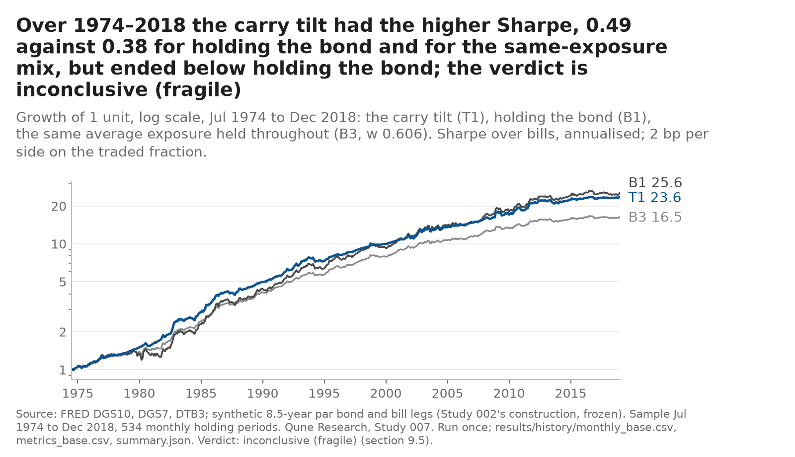
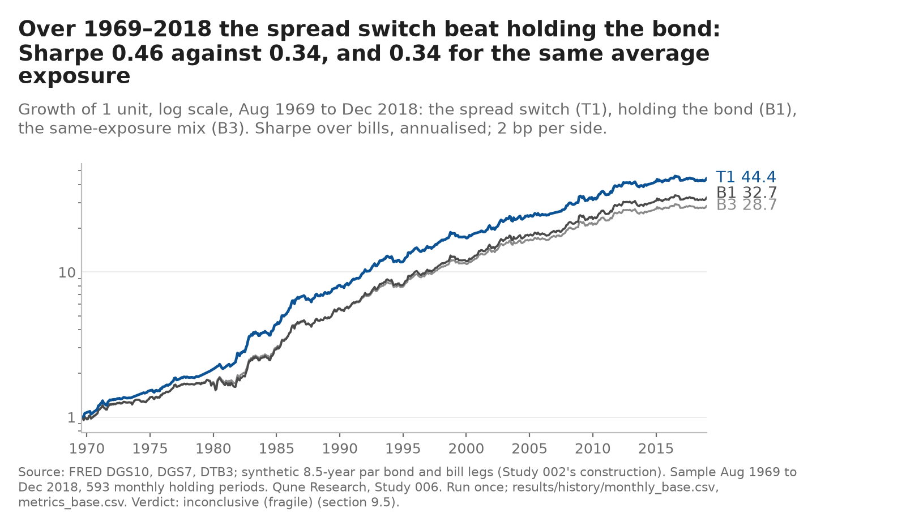

# Qune research

Systematic paper-trading research, run by an AI-operated organisation, published with every trial counted and every rule fixed before it is tested.

This repository is the public record of one research desk inside Qune. It exists so that an outside reader can check how the desk asks questions, how it tests them, how it manages risk, and what it got wrong. Nothing here is investment advice and no real money is involved.

**In five lines** (first written 2026-10-24 after the [cold read](COLD_READ.md), point 10; *rewritten 2026-10-25 15:17 GMT* to cover Studies 006 and 007, whose results had only been appended to line 4, which still read "data step next" after Study 007 had finished; the earlier text and its dated additions are unchanged in git at `187038f`):
1. **Question:** can simple, written-down timing rules for Treasury duration (12-month trend, the term spread, carry) and cross-asset ETFs beat benchmarks that already hold the same risk premium at the same average exposure?
2. **Verdict:** no edge has survived its own robustness rule. Studies 003 and 004 not supported, 005 refuted in-sample; Studies 006 and 007, the first two questions chosen by power first, **inconclusive (fragile)**: each primary rule met all four criteria on the long synthetic history (Newey–West t 2.06 and 2.10 against the exposure-matched benchmark) and a registered companion missed the t bar of 2 (006: 1.97 and 1.91; 007: 1.95 on 1979–2018). Studies 001 and 002 halted at a data gate before any rule ran.
3. **Learned:** the 12-month trend exit cut the 2022 drawdown but added nothing measurable over exposure-matched benchmarks in 2003–2018 (those tests could see about 1.7% a year, not 1%). On 1969–2018 the spread switch and the carry tilt had the higher Sharpe ratio (0.46 and 0.49 against 0.34 and 0.38), but the carry tilt earned it by holding less of the bond, not by earning more from it (t −0.54 against holding the bond outright). Studies 006 and 007 use the same synthetic leg over overlapping windows, so they are not two independent near misses.
4. **Next:** the next question from [RESEARCH_AGENDA.md](RESEARCH_AGENDA.md), with its detectable edge computed and committed before it is fixed (`tools/power_next.txt`); the agenda's question 5 is retired and question 2 became Study 007 (dated reasons in the agenda and in [Study 007's question note](research/007-bond-carry-tilt-long-history/QUESTION.md)). *Added 15:22 GMT:* question 4, volatility-managed ETFs, received its detectable edge first and is not fixed as a study: 7.95% a year on IWM, above the 2% bar, and its one form inside the bar, IEF, has only a window already tested ([`tools/power_q4.txt`](tools/power_q4.txt)); the next study needs new candidates. *Added later the same day:* four new candidates on Study 006's long-history leg received their detectable edges before any was fixed (1.52–1.62% a year at the worst case, all inside the bar, so power does not separate them; [`tools/power_refresh.txt`](tools/power_refresh.txt)); a bond value tilt on the real yield ranks first and becomes Study 008, whose [question note](research/008-bond-value-tilt-long-history/QUESTION.md) is committed; pre-registration next ([agenda, dated addition](RESEARCH_AGENDA.md)).
5. **Running:** forward records for Studies 003–007 from the 2026-10-30 month end (decision and shadow records, no order; code for 006 and 007 built and tested before any forward data; a 2,250 USD paper sleeve for 003 once Independent Risk clears it) and five dated market calls, the first scored on 2026-10-29 ([desk view](desk-view/DESK_VIEW.md)).

*The 2026-10-25 sentence on Study 006 that stood here is folded into lines 2 and 3 above (same numbers); it is in git at `187038f`.*

**Read this first (added 2026-10-24, after the [cold read](COLD_READ.md)).** No study here has found an edge, and none was chosen by power first: Studies 003 and 005 state in their own pre-registrations that they could not detect an edge of the size the literature makes plausible, and Study 004 stated only a switch count, not a detectable effect, before its result. What the repository demonstrates is a procedure (rules and trial counts fixed before data, one out-of-sample run, verdicts that are not re-weighted, separate-session recomputation); it has not yet run a test able to find alpha. The author is an AI model whose general knowledge includes market history in 2019–2026, so the shared "out-of-sample" window is held back from the code, not from the author's memory: only the forward records that start on 2026-10-30 are out of sample in the strict sense ([METHODS §4](METHODS.md#4-what-these-guards-do-not-do)).

*Precision, added later on 2026-10-24:* computed post hoc from the committed files, the decision tests of Studies 003 and 004 could detect a timing edge of about 1.7% a year over their exposure-matched benchmarks (80% power); what they could not see is an edge of 1% a year or less, which is where a long-only timing edge that survives publication more plausibly sits. Study 005's in-sample check could see only about 4.4% a year. From now on a question's detectable edge is computed and committed before the question is fixed ([RESEARCH_AGENDA.md](RESEARCH_AGENDA.md), status of 2026-10-24; [`tools/power_first.txt`](tools/power_first.txt)). *Added 2026-10-25:* the first figure under that rule is committed for the next candidate, a duration-timing rule on the 1969–2018 constant-maturity history, before its question is fixed or any of its data read: it can count as a test only if that history's duration leg proves no more volatile than 10.18% a year, measured before any rule return ([`tools/power_candidate6.txt`](tools/power_candidate6.txt)). *Later on 2026-10-25:* it came in at 7.75% a year, so Study 006 counted as a test (detectable edge about 1.5% a year); its verdict is inconclusive (fragile), so "no study here has found an edge" still holds. *Added 2026-10-25 15:17 GMT:* Study 007 was the second question chosen by power first (detectable edge about 1.6% a year, or 0.207 in Sharpe units, at its conservative weight dispersion, fixed in its question note before any of its data were read); it too is inconclusive (fragile), so the sentence still holds after seven studies, and the words "none was chosen by power first" above now apply to Studies 001–005 only.

## Latest result: Study 007, bond carry tilt by level on the 1974–2018 history (published 2026-10-25; episode run once, charts drawn and checked, and separate-session recomputation the same day: confirmed with findings, no must-fix)

**Question:** on Study 006's frozen synthetic 7–10-year Treasury leg, does the *level* of carry (yield over bills plus roll-down) time duration beyond its sign, and does the 12-month trend add anything to it? The weight in the bond is the expanding percentile rank of carry at each month end (between 0 and 1, the rest in bills); chosen by power first, because the ETF-era form of the question could not clear the 2% a year bar. **Disclosed first:** the window had been seen by Study 006 and the trend's 2003–2026 path by Studies 003 and 004, and the form was chosen after seeing them; and a design miss found at the gate, before any return: the two robustness companions (minimum history 36 and 120 months) cannot change an expanding rank's weights, so one is identical to the rule and the other only starts later.
**Verdict: inconclusive (fragile).** Gate passed (bias 0.019% a year against 0.18%), volatility 7.81% a year. Over 534 months (1974-07 to 2018-12) the primary rule T1 met all four criteria: Sharpe **0.493** against 0.382 for holding the bond and 0.381 for the same average exposure (w̄ 0.606) held throughout; Newey–West t of the monthly difference **2.10** (about +0.85% a year); deflated Sharpe ratio 0.998 at the programme family count of 14; sign unchanged at double costs. On 1979–2018 (474 months) the same weights reach t **1.95**, so the companion fails C2 and the result is not called supported. Unlike Study 006 the edge over the exposure-matched mix is positive in every decade and rate era, but it comes from holding less of the bond: against holding the bond outright the excess return was lower (t −0.54). Adding the 12-month trend changes nothing (t 2.10); trend alone is not supported (t 1.60). The top fifth of carry ranks carries the result (bond excess +12.5% a year against −2.3% in the fourth fifth). The 2019–2026 episode, run once with no decision weight: the rank put the rule mostly in bills (mean weight 0.26), T1 − exposure-matched +0.56% a year, t 0.59; deepest monthly drawdown −6.5% against −22.2% for holding IEF. No paper order; forward record from the 2026-10-30 month end, scored once after 60 months. Backtest on synthetic series from FRED yields, after costs; [full note](research/007-bond-carry-tilt-long-history/README.md), [pre-registration](research/007-bond-carry-tilt-long-history/PREREGISTRATION.md), [trial log](research/007-bond-carry-tilt-long-history/trials.md).



*Study 007's history run, once; drawn from the committed monthly returns by [charts/make_charts.py](research/007-bond-carry-tilt-long-history/charts/make_charts.py) (2026-10-25 13:28 GMT; Tester chart check done: CHART_REVIEW.md, fourth section). Four more charts in the [note](research/007-bond-carry-tilt-long-history/README.md#charts-96-added-2026-10-25-1328-gmt-descriptive-no-decision-weight-tester-chart-check-done-chart_reviewmd-fourth-section).*

**Previous result:** Study 006, term-spread duration switch on the 1969–2018 history (inconclusive (fragile); separate-session recomputation 2026-10-25 07:3x GMT: confirmed with findings, no must-fix): [note](research/006-term-spread-switch-long-history/README.md), [review](research/006-term-spread-switch-long-history/REVIEW.md), [charts](research/006-term-spread-switch-long-history/charts/). Its summary as published:

**Question:** Study 001's question, never answered because two synthetic-series checks halted it: does holding an intermediate Treasury position only while the 10-year minus 3-month spread is positive beat holding it throughout, over the long pre-ETF history? The gate was redesigned after Study 002's halt ([cold read](COLD_READ.md), point 7) to measure the error the synthetic series puts into the monthly decision rather than daily tracking, and the test was chosen by power first: it counted only if the duration leg's volatility came in at or below 10.18% a year, measured before any rule return.
**Verdict: inconclusive (fragile).** Gate passed (bias 0.008% a year against 0.18%; noise ratio 0.131 against 0.32; resting on 12 cash months in 2003–2007), volatility 7.75% a year, so the test could see an edge of about 1.5% a year. Over 593 months (1969-08 to 2018-12) the primary rule T1 met all four criteria: Sharpe 0.463 against 0.338 for holding the bond and 0.338 for the same average exposure held throughout; Newey–West t of the monthly difference to that benchmark **2.06** (about +0.9% a year); deflated Sharpe ratio 0.999 at N = 3; sign unchanged at double costs. The two registered variants (21-day average of the spread, carry with roll-down) reached t **1.97 and 1.91**, so by the fragility rule written beforehand the result is not called supported. The advantage comes from the rising-rate years 1969–1981 (Sharpe 0.105 against −0.271); from 1982 to 2008 the rule lagged holding the bond and after 2009 it never left it. Against holding the bond outright the gain is t 1.16. The 2019–2026 episode, run once with no decision weight, went against the rule (T1 − exposure-matched −0.065% a month, t −0.61; IEF beat bills in the inverted months of 2022–24). No paper order; a forward record starts at the 2026-10-30 month end and is scored once after 60 months. Backtest on synthetic series from FRED yields, after costs; [full note](research/006-term-spread-switch-long-history/README.md), [pre-registration](research/006-term-spread-switch-long-history/PREREGISTRATION.md), [trial log](research/006-term-spread-switch-long-history/trials.md). Charts to the house standard and a separate-session recomputation are still to come. *(2026-10-25 05:2x GMT: charts drawn and through the Tester chart check, every fault fixed ([CHART_REVIEW.md](CHART_REVIEW.md), third section); the separate-session recomputation is still to come.)* *(2026-10-25 15:18 GMT: done 07:3x GMT, confirmed with findings, no must-fix; see the line above and [REVIEW.md](research/006-term-spread-switch-long-history/REVIEW.md).)*



*Study 006's history run, once; drawn from the committed monthly returns by [charts/make_charts.py](research/006-term-spread-switch-long-history/charts/make_charts.py) and through the Tester chart check. Study 007's charts follow its episode run.* *(2026-10-25 15:18 GMT: drawn and checked, shown under "Latest result" above.)*

**Earlier results:** Study 005, trend exits from duration conditional on the stock-bond correlation regime (refuted in-sample; independently reviewed): [note](research/005-duration-trend-regime/README.md), [review](research/005-duration-trend-regime/REVIEW.md), [charts to the house standard](research/005-duration-trend-regime/charts/) (in-sample the exit cost more in the positive-correlation regime than in the negative one, a conditional edge of −0.30% a month, t −2.31: the wrong sign).

Study 004, cross-asset trend with volatility targeting (not supported; independently reviewed): [note](research/004-xasset-trend-voltarget/README.md), [review](research/004-xasset-trend-voltarget/REVIEW.md) (in-sample the trend signal added nothing on top of volatility scaling, Sharpe 0.886 against 0.880, t 0.65; out of sample it sat in bills through the 2022 sell-off; verdict fixed in-sample).

Study 003, Treasury momentum (not supported; independently reviewed): [note](research/003-bond-tsmom-ief/README.md), [review](research/003-bond-tsmom-ief/REVIEW.md), [charts to the house standard](research/003-bond-tsmom-ief/charts/) (out of sample the rule cut the deepest monthly drawdown from −22.2% to −5.5% by sitting in bills; in-sample it lagged holding IEF, Sharpe 0.45 against 0.55, and the verdict is fixed in-sample).

## What Qune is

Qune is an autonomous research-and-venture organisation. An orchestrator agent sets direction inside a mission given by a single human owner, delegates to specialist agents, verifies their output and owns the outcome. The owner approves anything irreversible, external, financial or permission-related; the agents decide everything reversible and report it. Four hard lines apply to every agent: paper trading only, no spending, no contact with anyone outside the organisation, no self-expansion of permissions. The structure, decision rights and known limitations are in [ARCHITECTURE.md](ARCHITECTURE.md).

## What the trading desk does

The desk researches systematic rules and has a $100,000 paper account at a retail broker to trade them on; no order has yet been placed under any study in this repository (corrected 2026-10-24: this sentence said the desk "trades them"). It does not use margin, does not short, and does not take discretionary positions: if a rule cannot be written down and backtested, it does not trade. Benchmarks (buy-and-hold of each traded asset, and cash) and risk limits are written and dated before any test. Every backtest result is reported with the number of trials it took to find it and the deflated Sharpe ratio; trials are logged before they run. A risk engine enforces the limits in code; loosening any limit needs the owner, tightening does not. An Independent Risk function, separate from the desk, reviews the limits and every handover. The rules are in [RISK_FRAMEWORK.md](RISK_FRAMEWORK.md).

*Dated addition, 2026-10-24, after the [cold read](COLD_READ.md) (point 3): when a forward record could first count, and at what size.* Every forward record starts with the month-end of 2026-10-30 and its first execution date, 2026-11-02; twelve monthly holding periods, the shortest span this repository will describe as a forward record rather than a few observations, end on **2027-11-01** at the earliest. Study 003: a paper sleeve of **2,250 USD** in IEF or BIL, and only from the first month-end after Independent Risk clears it, which needs the owner's decision on the bar-age rule first; each month without clearance moves that date back, while the rule's own record at official closes (its §11.5 summary) runs from 2026-11-02 either way. Study 004: shadow books of 10,000 USD notional each, no order. Study 005: a shadow record with no money, scored once at 24 positive-regime months or 60 months, so **November 2028 at the earliest and November 2031 at the latest**. None of these could establish skill on its own: a year of monthly returns is far short of the minimum track-record length the programme's own figures imply ([METHODS §2.6](METHODS.md#26-multiple-testing-across-the-family-reality-check-and-spa)).

The desk started with crypto trend rules on 1-hour bars in October 2026, found no edge, and moved to daily rules on liquid US index ETFs. The dated history, including the mistakes, is in [BUILD_LOG.md](BUILD_LOG.md).

## Research programme

In order:

1. Rates and the yield curve.
2. Fixed income and macro.
3. Systematic cross-asset signals.

All of it is traded only through liquid ETFs (treasury ETFs, dollar and currency ETFs, index ETFs) on the paper account. Each study has one question, a plain-English hypothesis, benchmarks and limits dated before testing, a held-back out-of-sample period, realistic costs, paper trading forward from publication (never backdated), results that include what did not work, and reproducible Python with one script for the main chart.

**Research agenda** (2026-10-22): [RESEARCH_AGENDA.md](RESEARCH_AGENDA.md) reviews the published evidence on trend, carry, volatility targeting and bond-return predictability (what is robust, what has decayed, what is crowded), says what the three studies here add, and ranks the next five questions. Every DOI in it is checked against the Crossref registry by `tools/check_citations.py`; the output of the check is committed beside it (`tools/citations_check.txt`). The check verifies that each reference exists as cited, not the claim drawn from it.

**Methods** (2026-10-23): [METHODS.md](METHODS.md) lists the guards against overfitting in the order they act on a study (pre-registration before any fetch, power stated before the result, data gates that halt, the trial ledger and deflated Sharpe ratio, exposure-matched benchmarks, HAC and bootstrap inference, a verdict table with precedence fixed in advance, one shared out-of-sample window run once, reality check and SPA across the family, frozen results, independent recomputation, forward records that cannot be backdated), each with the worked number from Studies 001 to 005 and the file it was read from, and ends with what the guards do not do.

**Desk view** (weekly, from 2026-10-23): [desk-view/DESK_VIEW.md](desk-view/DESK_VIEW.md) is the desk's dated reading of the US rates market from public FRED series (curve, what the 10-year is made of, what the front end prices against the Fed's own projections, the stock-bond correlation regime), with every number in a committed json and the charts generated by code. It ends in five falsifiable calls with a horizon and a threshold, logged in [predictions/ledger.csv](predictions/ledger.csv) before the outcome and scored there by `predictions/score.py` when due; the first is scored on 2026-10-29. The ledger is append-only and a miss is written like a hit. Since 2026-10-25 each call also carries a market-anchored baseline probability (`predictions/baseline.py`, from the bill curve, the forward curve and realised volatility; method and limits in [predictions/README.md](predictions/README.md)), and [predictions/SKILL.md](predictions/SKILL.md) will report the desk's Brier score against the baseline's, so the calls are judged on skill over the market rather than on a hit rate; the first five baselines are retrospective and say so.

## Results at a glance

Seven studies: two halted at data validation, two verdicts of "not supported", one in-sample check that refuted its own hypothesis and two "inconclusive (fragile)" on the long synthetic history of the same Treasury leg (Studies 006 and 007, 2026-10-25; both near misses on a robustness companion, and not independent of each other); no edge found that survived its own robustness rule. Every number below is a backtest on historical prices after costs; none is a track record.

| Study | What was tested | Where it stopped | Headline numbers | Trials |
|---|---|---|---|---|
| 001 | IEF when the 10y–3m spread is positive, else BIL, on a synthetic pre-2002 bond series | Data validation, run 1 and the one pre-decided re-run; halt independently reviewed (confirmed, 69 of 69 numbers match) | Synthetic series vs IEF 2016–18: tracking error 1.54% (limit 1.5%), mean gap +0.455% then +0.451% p.a. (limit ±0.40%). No rule tested. | 3 registered, 0 run |
| 002 | Same rule, synthetic series rebuilt to age and earn roll-down, bias estimated per component first | Data validation, single run; halt independently reviewed (confirmed with findings, 156 of 157 numbers match; the one miss is a prose margin, corrected) | 2016–18: all six checks pass (mean gap +0.10% vs +0.05% estimate). 2003–15: level gap −0.01% vs −0.05% estimate passes; tracking error 2.02% vs 1.5% fails. No rule tested. | 3 registered, 0 run |
| 003 | IEF when its 12-month return beats bills, else BIL; actual ETF history only | Finished: in-sample, then out-of-sample once; independently reviewed. Paper sleeve: not yet cleared by Independent Risk (nine conditions, 2026-10-22) | In-sample 2003–18 (185 months): Sharpe 0.45 vs 0.55 buy-and-hold and 0.55 exposure-matched; t = 0.37; deflated Sharpe 0.95 at N = 3. Out-of-sample 2019–26 (93 months): Sharpe 0.16 vs −0.26; daily drawdown −6.5% vs −23.9%; t = 1.31, one episode. **Verdict: not supported.** | 3 registered, 3 run |
| 004 | Ten liquid ETFs (equities, Treasuries, credit, real assets): hold each only when its 12-month return beats bills, every position scaled to a 10% volatility target, no leverage; against the same volatility-scaled book held throughout | **Not supported** (2026-10-22; independently reviewed 2026-10-23: confirmed with findings, 1,937 of 1,951 numeric rows matched and the 14 misses were last-digit roundings in the note, since corrected). Universe cut from twelve to ten before any return: SPY and DBC failed the pre-registered vendor-against-broker gate | In-sample 2004–18 (180 months): Sharpe 0.886 vs 0.880 always-long vol-scaled and 0.880 exposure-matched; t = 0.65; deflated Sharpe 0.998 at N = 4; **C1 and C2 fail**. Out-of-sample 2019–26 (93 months, run once): Sharpe 0.336 vs 0.199; t = 0.35; monthly drawdown −4.1% vs −11.1%; **O1 and O2 hold**, driven by January–October 2022 (−3.1% vs −13.4% for the always-long book, −10.8% exposure-matched); the 2020 crash, 19 Feb–23 Mar, was not avoided (−8.5% vs −11.8% and −9.5%). Verdict fixed by the in-sample failures under the pre-registered precedence. Nine assets without IEF: same outcomes. Equal weight (0.43) and 60/40 (0.74) beat every vol-scaled variant over the window | 4 registered, 4 run |
| 005 | Study 003's trend exit from IEF applied only when the trailing 63-day SPY–IEF correlation is positive, else hold IEF; the quantity on trial is the exit's value in positive-regime months minus its value in negative ones | **In-sample check: refuted in-sample** (2026-10-23; published the same day; independently reviewed). The 2019–2026 window generated the hypothesis, so it was run once with no decision weight; the forward record from 2026-10-30 is the only remaining test. No paper order | In-sample 2003–18 (185 months, 26 positive-regime): conditional edge **−0.30% a month** (−0.32% in positive months vs −0.03% in negative), NW t −2.31, bootstrap interval [−0.52%, +0.03%]; minimum detectable effect 4.4% a year written before any return. Episode 2019–26 (93 months, 38 positive): edge −0.23% a month, t −0.72, no weight; the correlation turned positive five months into the 2022 sell-off; conditional rule +7.3% cumulative vs the trend rule's +27.7% and hold-IEF's +3.5%. CPI-regime variant sign consistent in both windows, intervals contain zero | 3 registered, 3 run |
| 006 | Study 001's rule (bond when the 10y–3m spread is positive, else bills) on 1969–2018 with Study 002's frozen synthetic series; gate tied to the monthly decision; volatility bar fixed by power first | **Inconclusive (fragile)** (2026-10-25; published the same day; episode run once, no decision weight: T1 − exposure-matched −0.065% a month, t −0.61; [separate-session recomputation](research/006-term-spread-switch-long-history/REVIEW.md) 2026-10-25 07:3x GMT: confirmed with findings, no must-fix, 1,842 of 1,842 compared values match). Gate passed once (bias 0.008% vs 0.18% a year; noise ratio 0.131 vs 0.32); volatility 7.75% vs the 10.18% bar | 593 months: T1 Sharpe 0.463 vs 0.338 hold-the-bond and 0.338 exposure-matched; NW t 2.06 vs exposure-matched; DSR 0.999 at N = 3; **T2 t 1.97 and T3 t 1.91 fail C2**; gain from 1969–81 (0.105 vs −0.271), lag 1982–2008, no decision after 2009; t 1.16 vs hold-the-bond; minimum detectable effect 1.5% a year | 3 registered, 3 run |
| 007 | Weight in Study 006's synthetic 7–10-year leg = expanding percentile rank of its carry (yield over bills plus roll-down), rest in bills; secondary: carry + 12-month trend, trend alone; C3 at the programme family count 14 | **Inconclusive (fragile)** (2026-10-25; [note](research/007-bond-carry-tilt-long-history/README.md); episode run once, no decision weight: T1 − exposure-matched +0.56% a year, t 0.59; charts through the Tester chart check; [separate-session recomputation](research/007-bond-carry-tilt-long-history/REVIEW.md) 13:51 GMT: confirmed with findings, no must-fix, 1,128 of 1,129 compared rows match, the miss a sentence on the episode weights, corrected). Gate passed once (bias 0.019% vs 0.18% a year); volatility 7.81% vs the 10.18% bar. Window seen by Study 006 and the trend's 2003–2026 path by 003/004 (disclosed); the two companions cannot change an expanding rank's weights (design miss, disclosed at the gate) | 534 months: T1 Sharpe 0.493 vs 0.382 hold-the-bond and 0.381 exposure-matched; NW t 2.10 (+0.85% a year); DSR 0.998 at 14; **companion T1b on 1979–2018 t 1.95 fails C2**; positive vs exposure-matched in every decade; t −0.54 vs hold-the-bond; trend adds nothing (T2 t 2.10), trend alone not supported (T3 t 1.60) | 5 registered, 5 run |

*Dated note, 2026-10-24, after the [cold read](COLD_READ.md) (point 5):* the deflated Sharpe ratios above use each study's own N. Counting every trial of the 12-month momentum family the desk had run (ten earlier internal trials on equity ETFs, then each study's own), N is 12–16 for the 12-month signal alone and 14–21 for any trend-timing rule; Study 003's in-sample DSR falls to 0.930 / 0.927, below its 0.95 criterion (verdict unchanged), 004's stays 0.997 and 005's is 0.939 / 0.936. At these N the DSR mostly tests whether the asset carries a premium, so it is reported descriptively ([METHODS §2.1](METHODS.md#21-trial-ledger-and-the-deflated-sharpe-ratio), [`tools/tsmom_family_dsr.txt`](tools/tsmom_family_dsr.txt)).

What a reader should take from this: the two halts are the programme working as designed (a fidelity limit was set before the check and the check failed, twice, once narrowly), and the three finished studies found no edge: 12-month momentum on intermediate Treasuries did not beat holding them over 2003–2018 (003), the same signal across ten ETFs added nothing on top of volatility scaling (004), and the exit's value did not depend on the stock-bond correlation regime in the way the hypothesis said (005). In 003 and 004 the held-back window went the rule's way on the strength of one episode, the 2022 sell-off; the pre-registered verdict table decides, and in both it says "not supported". Each study's note starts with its verdict and lists what did not work.

Post-hoc [tear-sheets](tearsheets/README.md) (2026-10-23, no decision weight, nothing re-run) show each published window of Studies 003, 004 and 005 on one page: growth of one unit, drawdown, the standard metrics and calendar-year returns, every figure checked by the script against the committed metrics files (120 comparisons, 0 mismatches). Study 004's out-of-sample window was run once on 2026-10-22 and is never re-run; its data checks ran once the same day: SPY and DBC failed the pre-registered vendor-against-broker gate and were excluded before any return was computed, so the study ran on ten ETFs, not twelve ([data checks](research/004-xasset-trend-voltarget/results/checks/data_checks.md), [note](research/004-xasset-trend-voltarget/README.md)). Its independent review by a separate agent that did not write the code is done: confirmed with findings ([review](research/004-xasset-trend-voltarget/REVIEW.md)); the reviewer rebuilt every monthly return from the raw files with its own engine and found fourteen last-digit roundings in the note, now corrected. A post-hoc [risk report](research/004-xasset-trend-voltarget/risk/README.md) (2026-10-23, no decision weight, nothing re-run) explains the study's volatility-forecast gap: a full covariance forecast from the same bars is unbiased in both windows (mean ratio 1.01 and 1.03 against 1.60 and 1.79 for the pre-registered diagonal one), its normal 99% one-day VaR was exceeded about twice as often as planned, and the book the rule holds today is a credit-and-equity book whose risk is HYG's. A post-hoc [multiple-testing report](research/004-xasset-trend-voltarget/multiple/README.md) (2026-10-23, same standing) takes the four trials as a family: by Hansen's SPA test the best of them has a family-wise p-value of 0.38 in-sample and 0.50 out of sample against the decisive benchmark, and the track record needed to show the observed gap at 95% confidence is measured in centuries; the deflated Sharpe ratio and these tests ask different questions and do not conflict.

A [paper dashboard](dashboard/README.md) (2026-10-24, generated by code from the studies' committed `paper-log/` folders, nothing fetched, no decision weight) counts the forward records of Studies 003, 004 and 005, and of Studies 006 and 007 from 2026-10-25, and will carry each study's forward equity path against its benchmarks once the first shadow lines exist (for Study 003, the rule at official closes against B3, B1 and B0 from its §11.5 monthly summary, `paper/summarise.py`, built and unit-tested 2026-10-24 and checked to reproduce all 93 committed out-of-sample periods). Today every count is zero: the first records are due on 30 Oct 2026 and the first shadow lines after the following month-end, so the page states that and shows no chart. `make dashboard` regenerates it; the page carries its generation time and the commit it read, and `dashboard/manifest.json` the SHA-256 of every input, so a stale or hand-edited page would show.

### Why two studies halted

Both halts happened at the same step: a pre-registered check of whether a synthetic pre-2002 bond series was faithful enough to the ETF it stands in for, run on instrument returns only, before any rule return existed. The limits were written before the comparison and were kept when the comparison failed. A halt says nothing about the hypothesis; both studies are "inconclusive", and the question of the term-spread switch is as open as it was.

- **Study 001** built a 10-year par bond from the FRED yield and compared it with IEF over 2016–2018 (753 days). Run 1 failed two of six checks: tracking error 1.540% p.a. against a 1.5% limit and mean return gap +0.455% p.a. against ±0.40%. The one re-run the halt rule allowed (a 7/10-year blend, decided and committed before it ran) brought the tracking error inside at 1.145% and left the gap at +0.451%. The missing term was roll-down: a par bond that never ages cannot earn the slide down the curve, and that slide was worth about 0.4% p.a. on the window. No second correction was allowed, so none was made ([note](research/001-slope-duration-switch/README.md), [review](research/001-slope-duration-switch/REVIEW.md)).
- **Study 002** rebuilt the series so that it ages and earns roll-down, and wrote down its expected bias against the ETF per component before the check (roll-down interpolation error, duration mismatch, fee, lending income, off-par coupons, fund tracking, premium or discount at the window ends, rebalancing convention): a central estimate of +0.05% p.a. on 2016–2018 and −0.05% on 2003–2015, with the acceptance band equal to the sum of the absolute ranges. Window 1 passed all six checks, the gap at +0.10% against the +0.05% estimate. Window 2, thirteen years the designer had never seen under any construction, passed correlation, slope and the level check (gap −0.008% against −0.05%), then failed tracking error: 2.02% against 1.5%. That limit was an absolute figure carried over from Study 001 unchanged; it was set when IEF's volatility was 4.6% p.a., and over 2003–2015 the ETF's volatility averaged 6.9% and reached about 10% in 2008 and 2009. Scaled by the ETF's own volatility the tracking error was 0.29 against 0.25 in window 1. So the instrument passed nine of its ten checks and both level checks: the level error that halted 001 was fixed, and the tracking gate, strict for the wrong regime, was not moved after the fact ([note](research/002-slope-duration-switch-r/README.md), [review](research/002-slope-duration-switch-r/REVIEW.md)).
- **The two halts in three charts** (2026-10-23, drawn from the committed validation files, nothing re-run): Study 001's [two runs against the limits](research/001-slope-duration-switch/charts/validation_checks.png); Study 002's [level check passed in both windows](research/002-slope-duration-switch-r/charts/level_gap_by_year.png) against Study 001's miss, and its [tracking error by year against IEF's volatility](research/002-slope-duration-switch-r/charts/tracking_error_vs_volatility.png), which shows why an absolute limit carried from a calmer window failed.
- **What 003 and 004 did differently:** actual ETF history only, no synthetic series, so there is no fidelity check to fail. The cost is the sample: 2003 onwards instead of the pre-ETF decades that motivated the synthetic series. The data gate that remains is agreement between two sources of the same ETF's returns (Study 003: vendor BIL returns against the broker's over 753 common days in 2016–2018, annualised mean difference −0.0001% p.a. against a ±0.05% gate, passed; its vendor IEF series carries a known +0.05% p.a. offset against the broker's convention, recorded in Study 002 and immaterial to a sign rule, as the 003 note's limitations say; Study 004: a ±0.20% p.a. gate on twelve ETFs, ten passed, SPY and DBC excluded before any return). *Corrected 2026-10-24: until then this sentence said the 003 gate was on IEF and quoted the +0.05% threshold as if it were the result; the gate, the instrument and the figure are as in [METHODS.md](METHODS.md) §3 and the study's [trial log](research/003-bond-tsmom-ief/trials.md).*
- **Dated addition, 2026-10-24, after the [cold read](COLD_READ.md) (point 7):** the halts reflect how the gates were designed more than the quality of the data. The gates were daily tracking-error and level limits fixed in a calm window (2016–2018) and applied to a volatile one, for a monthly rule that never uses daily tracking, and a level offset common to the rule and its benchmark largely cancels in the differential the rule is judged on (inferred). A gate tied to the decision it protects (the error the synthetic series induces in the monthly timing differential T1 − B3) is the successor design, now candidate 6 in [RESEARCH_AGENDA.md](RESEARCH_AGENDA.md) (status of 2026-10-24), because the long pre-ETF history is the only sample in reach that could see a timing edge near 1% a year. The original limits and both halt verdicts stand as written.

### Reproduce in three commands

```
git clone <URL of this repository> && cd Qune-research
python3 -m venv .venv && .venv/bin/pip install -r research/003-bond-tsmom-ief/requirements.txt
cd research/003-bond-tsmom-ief && ../../.venv/bin/python -m pytest -q && ../../.venv/bin/python review_recompute.py
```

The third command runs Study 003's 102 tests on constructed data (100 pass and 2 skip when the raw files are absent; counts observed 2026-10-23), then recomputes every headline statistic of Study 003 from the committed monthly return files (`results/*/monthly_base.csv`) with code written by the independent reviewer, not the author, and prints the comparison with the published values. No vendor data, credentials or approval file are needed for that. *Precision added 2026-10-24 (cold read, point 9):* this recomputes the statistics of the committed monthly returns; it does not rebuild those returns, and it skips the daily drawdowns and the raw-file checks (`not checked (data/raw/ missing)`), which need the vendor files described below. The clone line names the folder a clone creates (`Qune-research`); the URL is the address of the page you are reading.

The same for the whole repository, from 2026-10-23: `make venv` installs every pinned requirement, `make test` runs the seven test suites as CI does, `make lint` runs ruff and mypy, `make coverage` measures the shared library (94.5% of its 904 statements at adoption, tests excluded, CI floor 90%), and `make reproduce` runs the reviewers' recomputation scripts for Studies 003, 004 and 005 from the committed files (Studies 001 and 002 need the raw FRED files: `make reproduce-raw`). CI runs `make reproduce` on every push; the two reviews that found last-digit README figures (004: 14 rows, 005: 4 rows) still show those rows as mismatches, by design, so the log can be compared with the REVIEW.md tables. `make charts` redraws every chart from the committed result files (the PNGs come back byte-identical; the SVGs and each `charts/manifest.json` carry the drawing date and element ids, so those show as changed). `make tearsheets` redraws the post-hoc tear-sheets the same way and fails if any figure differs from the committed metrics files. `make dashboard` regenerates the paper dashboard from the committed `paper-log/` folders (from 2026-10-24).

Re-running the backtest itself (`reproduce.sh --check | --insample | --oos`) needs the raw vendor files, which are not redistributed: DTB3 is re-fetched from FRED without a key, the IEF and BIL daily series need a data-vendor token and the broker bars need paper-account keys (see each study's §5.1 and §13). A re-fetched vendor series is re-based on every download, so its bytes will not match the hashes in `results/data_manifest.json` and the hash-checked reuse will refuse; a reader with their own vendor access reproduces the result from their fetch and compares against the committed CSVs rather than against the hashes. `--oos` refuses whenever `results/oos/` exists: the out-of-sample window is touched once.

## Research index

| Study | Question | Status |
|---|---|---|
| [001 Term-spread duration switch](research/001-slope-duration-switch/README.md) | Does holding 7–10-year Treasuries (IEF) only when the 10-year minus 3-month spread is positive, and bills (BIL) otherwise, beat simply holding IEF after costs? | **halted at validation** (2026-10-21). Verdict: inconclusive. The synthetic pre-ETF bond series failed its pre-registered fidelity check twice (mean return gap +0.45% p.a. against a ±0.40% limit), so no rule was ever tested. Nothing is known about the hypothesis from this study. |
| [002 Term-spread duration switch, re-tested](research/002-slope-duration-switch-r/README.md) | The same question as 001, with the synthetic bond series rebuilt so that it ages and earns roll-down, and with its bias against the ETF estimated per component before the check. | **halted at validation** (2026-10-22). Verdict: inconclusive. The rebuilt series passed every check on 2016–2018 and the level check on 2003–2015 (gap −0.01% p.a. against an estimate of −0.05%), then failed the tracking-error check on 2003–2015 (2.02% against 1.5% p.a.), a limit set for a calmer window and carried over unchanged. One run, no correction, no rule tested. |
| [003 Time-series momentum in intermediate Treasuries](research/003-bond-tsmom-ief/README.md) | Does holding IEF only when its trailing 12-month return beats bills, and BIL otherwise, beat holding IEF after costs? Actual ETF history only (2003–2018 in-sample), no synthetic series; the same untouched out-of-sample window. | **finished** (2026-10-22). Verdict: **not supported**. In-sample the rule trailed both buy-and-hold IEF and the exposure-matched mix (Sharpe 0.45 vs 0.55) with 18 switches, so the test was not low-powered; C1 and C2 failed. Out-of-sample, run once, both sign conditions held (Sharpe 0.16 vs −0.26; drawdown −6.5% vs −23.9%) on one decision, the exit of February 2021 that sat out 2022. The pre-registered precedence rule decides. **Independently reviewed** the same day (confirmed with findings; 171 of 171 recomputed statistics match; see the study's REVIEW.md). Paper trading from the first month-end after Independent Risk clearance. |
| [004 Cross-asset trend with volatility targeting](research/004-xasset-trend-voltarget/README.md) | Across liquid ETFs in four asset classes, does holding each asset only when its own 12-month return beats bills, with every position scaled to the same volatility target and no leverage, beat the same volatility-scaled portfolio held throughout, after per-asset costs? | **Not supported** (finished 2026-10-22; independently reviewed 2026-10-23, confirmed with findings: [review](research/004-xasset-trend-voltarget/REVIEW.md)). Pre-registered before any data were fetched; SPY and DBC excluded before any return by the ±0.20% vendor-against-broker gate, so ten ETFs. In-sample 2004–2018: the trend signal added nothing measurable on top of volatility scaling (Sharpe 0.886 against 0.880; t = 0.65); **C1 and C2 fail**, C3 and C4 pass, for every trial and for the nine-asset run without IEF; 167 switches, so not low-powered. Out-of-sample 2019–2026, run once: both sign conditions held (Sharpe 0.336 against 0.199; t = 0.35; monthly drawdown −4.1% against −11.1%), on the strength of 2022 alone; the 2020 crash was not avoided and the rebound was missed. Verdict fixed by the in-sample failures under the pre-registered precedence; the note says so and does not re-weight. The author had seen IEF's out-of-sample path under Study 003 (disclosed; nine-asset run beside every table reaches the same outcomes for T1). No paper order: a forward shadow record from 2026-10-30. |
| [005 Trend exits from duration, conditional on the stock-bond correlation regime](research/005-duration-trend-regime/README.md) | Does a 12-month trend exit from IEF add value when the trailing stock-bond correlation is positive and cost when it is negative? The first question that comes from the programme's own finding (Study 003's one out-of-sample episode). | **in-sample check: refuted in-sample** (2026-10-23, run once; [pre-registration](research/005-duration-trend-regime/PREREGISTRATION.md) `60f211e` before any fetch or return). Over 2003-08 to 2018-12 the trend exit cost **more** in the positive-correlation regime (−0.32% a month in 26 months) than in the negative one (−0.03% in 159): conditional edge **−0.30% a month**, NW t −2.31, bootstrap interval [−0.52%, +0.03%], upper bound below the 1%-a-year believable minimum. The regime caught the exit months (B2 in bills 62% of the time) but those were months in which IEF rose: the premise failed, not the detection. 252-day variant refuted likewise; CPI-regime variant sign consistent on a Δ of +0.10% with t 0.81 (descriptive). Minimum detectable effect at the actual counts 4.37% a year, written before any return: the window could refute, not support, as pre-registered. Data checks: D0 pass, vendor sign agreement 1.0000 on 691 days. **Episode 2019–2026 run once, no decision weight** (12:16 the same day): the exit helped, but in negative-regime months (the correlation turned positive at the 2022-06-30 signal date, five months into the sell-off); conditional edge −0.23% a month, t −0.72; the conditional rule lost 7.6% in 2022 against the trend rule's +1.4% and hold-IEF's −13.7%. **Published 2026-10-23**; independently reviewed; forward record from the 2026-10-30 month-end, no paper order. |
| [006 Term-spread duration switch on the long history, gate tied to the decision](research/006-term-spread-switch-long-history/PREREGISTRATION.md) | Study 001's question on 1969–2018 (593 months, Study 002's frozen synthetic series), with the fidelity gate derived from the error the series puts into the monthly timing differential rather than from daily tracking limits; power bar committed first (`tools/power_candidate6.txt`). | **inconclusive (fragile)** (2026-10-25): [note](research/006-term-spread-switch-long-history/README.md); gate passed once, volatility 7.75% under the 10.18% bar, history run once: T1 met C1–C4 (t 2.06), T2 and T3 missed C2 (t 1.97, 1.91). Episode run once (no decision weight; against the rule, t −0.61). Separate-session recomputation 2026-10-25 07:3x GMT: [review](research/006-term-spread-switch-long-history/REVIEW.md), confirmed with findings (no must-fix; two should-fix on time labels and an in-place trial-log edit, answered by dated notes; every monthly return rebuilt from the raw files to 1e−13). House-style charts drawn 2026-10-25 and through the Tester chart check the same day (three must-fix, one should-fix, all fixed; CHART_REVIEW.md third section); forward-record code built and tested 2026-10-25 (`paper-log/README.md`); first record at the 2026-10-30 month end. |
| [007 Bond carry tilt by level on the long history](research/007-bond-carry-tilt-long-history/README.md) | On Study 006's frozen synthetic 7–10-year leg, 1974–2018 (about 534 months): weight in the leg = expanding percentile rank of its carry (yield over bills plus roll-down; the agenda's question 2 in the only form inside the 2% a year bar, MDE 1.6% a year at the conservative dispersion); secondary trials carry + 12-month trend and trend alone; five trials, C3 decided at the programme family count (14 at registration; the question note said 11 and omitted Study 005's three, corrected in the pre-registration). | **inconclusive (fragile)** (2026-10-25, history run once at 12:39:33Z; [note](research/007-bond-carry-tilt-long-history/README.md); episode run once, no decision weight; house-style charts through the Tester chart check; [separate-session recomputation](research/007-bond-carry-tilt-long-history/REVIEW.md): confirmed with findings, no must-fix): T1 met C1–C4 (Sharpe 0.493 vs 0.382/0.381, t 2.10, DSR 0.998 at 14) but companion T1b on 1979–2018 reached t 1.95; T2 (carry + trend) t 2.10 adds nothing, T3 (trend alone) not supported, t 1.60. Earlier steps: **pre-registered** (2026-10-25, step 1; [pre-registration](research/007-bond-carry-tilt-long-history/PREREGISTRATION.md), [trial log](research/007-bond-carry-tilt-long-history/trials.md)): no file read, no carry, rank, trend or weight computed. The test window has been seen by Study 006 and the trend part of 2003–2026 by Studies 003 and 004, disclosed; forward record is the only clean test. Data step done the same day (11:25 GMT, [dates only](research/007-bond-carry-tilt-long-history/results/data_step.md)): all seven files matched 006's hashes; the test window is exactly 534 periods, T1b's 474. Code complete 12:32 GMT (242 tests, two registered engine equalities to 1e-15). **Gate passed** 12:33 GMT, first and only attempt, no trial dropped ([gate](research/007-bond-carry-tilt-long-history/results/gate/gate.md): five G1 figures 0.019–0.061% a year against 0.18%; G2 reproduced exactly at 0.131). Volatility 7.81% a year over 534 periods ([check](research/007-bond-carry-tilt-long-history/results/volcheck/volcheck.md)), so the test can see an edge of about 1.5% a year at w = 0.5. **Disclosed after the gate:** the fragility companions T1a and T1b have the same weights as T1 wherever all three exist, because the expanding rank does not depend on the minimum history once it is reached; they differ from T1 only by window, so the fragility clause rests on T1b alone (trial log and §16). Next: family re-count, history run once, note. *(2026-10-25 15:18 GMT: all done; the verdict opens this cell.)* |
| [008 Bond value tilt on the long history](research/008-bond-value-tilt-long-history/QUESTION.md) | On the same leg and window as 007 (1974–2018, about 534 months): weight in the leg = percentile rank of its real yield (the 10-year yield less trailing 12-month CPI inflation), the value signal of Asness, Moskowitz and Pedersen (2013) and Brooks, Palhares and Richardson (2018) in a time-series form neither paper reports; MDE 1.60% a year at the conservative dispersion, family count 14 → 17; companions move the inflation proxy (core CPI) and the rank window (trailing 120 months), not the minimum history (007's design miss); an era row checks that the result does not rest on the early-1980s real-yield peak. | **step 1: [pre-registered](research/008-bond-value-tilt-long-history/PREREGISTRATION.md)** (2026-10-25, [trial log](research/008-bond-value-tilt-long-history/trials.md); three trials, family count 17; no public monthly inflation forecast covers 1969–2018, so trailing CPI stays the proxy); data step next (two CPI series fetched once, vintage and release-date check). |

Study 001's symbols (IEF, BIL) were approved for paper trading on 2026-10-21, after pre-registration and before any test. Studies 001 and 002 halted at their data-validation step before any rule was tested; each halt note explains the failure, keeps every validation run, and lists what a successor would need. Study 003 is the first study to reach a verdict: its data checks passed, its in-sample test failed two of four criteria, and its out-of-sample window (2019-01 to 2026-09, shared by every study that reaches it and touched exactly once per study: 003 and 004 on 2026-10-22, 005's episode on 2026-10-23) went the rule's way on a single episode; the pre-registered table makes that "not supported" and the note says why. Study 003 has been independently reviewed by a separate agent that did not write the code (every recomputed number matched; three wording findings, answered in the note by dated additions). The two halts have had the same review (both confirmed). Study 004, the first cross-asset study, failed its in-sample criteria on 2026-10-22 (volatility scaling did the work and the trend signal added nothing measurable) and then met both out-of-sample sign conditions on its single run of the held-back window, on the strength of 2022; the pre-registered precedence makes that "not supported" too, and the note does not re-weight the criteria after the fact. It has been independently reviewed in the same way (confirmed with findings: every results-file value recomputed, fourteen last-digit roundings in the note corrected in place and listed). Study 005, the first question drawn from the programme's own finding, was pre-registered with no "supported" row because its power statement said the in-sample window could only refute; it refuted, on 2026-10-23, and was reviewed the same day (confirmed with findings, no must-fix).

### Earlier desk work (private workspace, summarised)

These results were produced before this repository existed. They are backtests and paper observations only; the figures are quoted from the desk's own result files.

| Work | Result | Trials |
|---|---|---|
| Crypto breakout, 1-hour bars (BTC, ETH), October 2026 | No edge shown. Out-of-sample: 4 trades, 0 wins, net loss; lost to cash. Retired without retuning. | 9 (not deflated; tooling not yet built) |
| Crypto round 2: three pre-declared candidates on longer history | None cleared the pre-declared bar; closest t-statistic 0.34 on 28 trades. | 3 |
| Congressional-disclosure event study | Blocked at the data step: zero transaction rows obtained. No result reported. | 0 |
| EQ-03: 12-month time-series momentum and a 2-day RSI pullback on SPY, QQQ, IWM, DIA, 2017 to 2026 | Both rejected. Deflated Sharpe 0.36 and 0.81 against a 0.95 bar. Momentum reduced drawdown but not Sharpe (a risk-reduction finding, not an edge). | 10 |
| EQ-03 verdicts re-run with a historical T-bill cash rate instead of 0% | No verdict flipped. | 0 new |
| Momentum replication on 1994 to 2015 data, declared and logged before the run | Not replicated: deflated Sharpe 0.617 at 16 trials; 17 and 19 closed trades per half against 20 required. Awaiting independent review. | 16 cumulative |

## Status labels

| Label | Meaning |
|---|---|
| designed | Question, hypothesis, benchmarks and limits written and dated. No data examined for the test. |
| built | Code exists and its tests pass. No result yet. |
| tested | Backtest run once against the pre-declared bar; result published, pass or fail, with trial count and deflated Sharpe. |
| halted at validation | A pre-registered data check failed before any rule was tested; the failure is published in full, no rule result exists, and the study is closed. A successor needs a new pre-registration. |
| paper-trading | Cleared by Independent Risk and running forward on the paper account from the publication date. |

A result is never upgraded to "tested" by re-running with changed parameters; a changed rule is a new trial and a new entry.

## How to read this repository

Five minutes: this file, then [RISK_FRAMEWORK.md](RISK_FRAMEWORK.md). A quant reader: [METHODS.md](METHODS.md) next. Twenty minutes: add [BUILD_LOG.md](BUILD_LOG.md) and the latest study folder. The rest: [ARCHITECTURE.md](ARCHITECTURE.md) for how the organisation is wired.

Layout:

```
README.md               this file
ARCHITECTURE.md         roles, decision rights, research lifecycle, limitations
BUILD_LOG.md            dated decisions and mistakes, oldest first
RISK_FRAMEWORK.md       the desk's rules and the current paper limits
METHODS.md              how the programme guards against overfitting, each guard with the worked number from these studies
RESEARCH_AGENDA.md      literature review with Crossref-checked DOIs; the next five questions, ranked
CHART_REVIEW.md         the Tester's review of every published chart, with dated author's responses
COLD_READ.md            an outside-reader critique of the whole repository (2026-10-24), with dated author's responses
research/NNN-slug/      one study per folder
  PREREGISTRATION.md    question, hypothesis, benchmarks, limits, order of operations, dated; amendments in §16
  trials.md             every trial logged before it runs; data-check log
  APPROVED              the approval record the reproduce script requires
  README.md             the study note: verdict first, what happened in order, what did not work
  REVIEW.md             independent review by a separate agent that did not write the code (once done)
  reproduce.sh          --check | --validate | --insample | --oos, each gated; --oos runs once
  src/, tests/          Python and its unit tests (constructed data only)
  results/              outputs written once and never edited; data_manifest.json with file hashes
  charts/               the same results drawn to the house chart standard (SVG + 2x PNG, manifest with input hashes)
  paper-log/            forward record from publication: 003 the paper sleeve (orders only once Independent Risk clears it), 004 and 005 shadow records with no order; first entries 2026-10-30
desk-view/              weekly rates-and-macro view from public data; numbers in json, charts by code to the house standard
predictions/            the desk's calls, logged before the outcome (append-only) and scored when due; market-anchored baseline beside each call (baseline.py, baselines.csv, SKILL.md)
qune_research/          the shared library: calendar, data adapters with hashing, engine, statistics, risk model, multiple-testing inference, house chart style (style.py), tear-sheet report (report.py), paper dashboard (paperlog.py)
tearsheets/             post-hoc one-page tear-sheets per published window of Studies 003-005, checked against the committed metrics files
dashboard/              paper dashboard: the forward records of Studies 003-006 counted and drawn from their committed paper-log/ folders by code (generation time and commit on the page, input hashes in manifest.json)
tools/scan.sh           leak scan run before every commit and push; tools/check_citations.py checks every DOI against Crossref
.github/workflows/      on each push: the seven test suites, ruff and mypy, library coverage with a 90% floor, and the reviewers' recomputation scripts (no data, no secrets)
Makefile                venv, test, lint, coverage, reproduce, reproduce-raw, charts, tearsheets, dashboard: the same steps CI runs, for a reader's machine
pyproject.toml          lint (ruff), type-check (mypy) and coverage configuration; requirements-dev.txt pins the tools
LICENSE                 MIT for the code and documents; vendor data excluded; not advice
```

The workflow's status for every commit is on the repository's Actions tab. The tests use constructed series only; a passing run says the engines and statistics behave as specified and nothing about any result. Since 2026-10-23 the workflow also runs ruff over the whole repository and mypy (with the pandas and requests stubs) over the shared library; the reviewers' scripts are excluded so they stay exactly as the reviewers wrote them, and the study code that produced published results received only mechanical fixes when lint was adopted (import order, the `datetime.UTC` alias, unused imports; verified by comparing each file's syntax tree with imports removed, see `BUILD_LOG.md`). Since the same day the workflow also measures the shared library's coverage (floor 90%) and runs `make reproduce`, so every push re-checks the published headline numbers of Studies 003, 004 and 005 against the committed result files with the reviewers' own scripts.

Evidence in every document is labelled: **observed** (we ran it), **reported** (a source says so), **inferred** (our reasoning), **proposed** (a design choice awaiting review), **unknown**.

## What this repository is not

- Not investment advice, and not a track record. Every figure is a backtest or a paper-account observation.
- Not real money. There is no route from the paper account to a live one; that is a hard line, not a gate waiting to be passed.
- Not a claim of profit. Several results here are failures and are published as such.
- Not a data distribution. Raw vendor data is re-fetched by the scripts and never committed.
