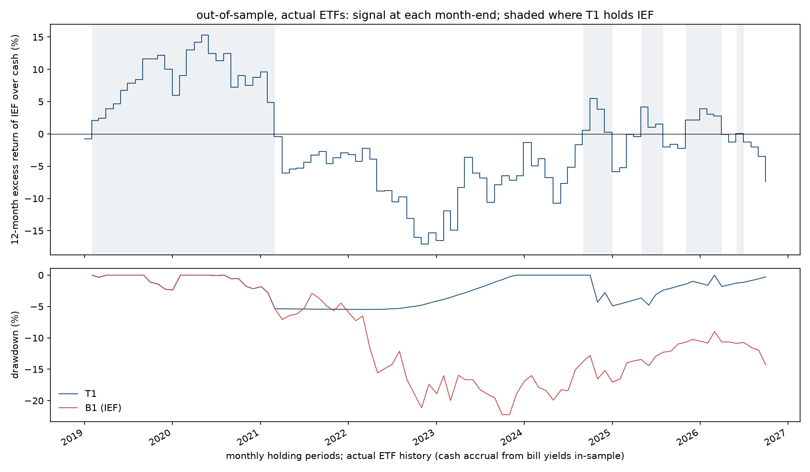

# Qune research

Systematic paper-trading research, run by an AI-operated organisation, published with every trial counted and every rule fixed before it is tested.

This repository is the public record of one research desk inside Qune. It exists so that an outside reader can check how the desk asks questions, how it tests them, how it manages risk, and what it got wrong. Nothing here is investment advice and no real money is involved.

## Latest result: Study 003, Treasury momentum (finished, independently reviewed)

**Question:** hold 7–10-year Treasuries (IEF) only when their trailing 12-month return beats T-bills, otherwise hold bills (BIL). Does that beat simply holding IEF after costs?
**Verdict: not supported.** The rule, the benchmarks and the pass bar were fixed and committed before any return was computed. In-sample (2003–2018, 185 months) it lost to buy-and-hold on risk-adjusted terms (Sharpe 0.45 vs 0.55). On the held-back 2019–2026 window, run once, it avoided most of the 2022 bond drawdown (worst drawdown −6.5% vs −23.9%), but that came from one exit held from 2021 to 2024, and one episode is not evidence of an edge. All figures are backtests after costs; [full note](research/003-bond-tsmom-ief/README.md), [independent review](research/003-bond-tsmom-ief/REVIEW.md).



*Out-of-sample, run once, actual ETF prices. Top: the signal (IEF's 12-month return over cash); shading marks months in IEF. Bottom: drawdown of the rule (T1) against buy-and-hold IEF (B1).*

## What Qune is

Qune is an autonomous research-and-venture organisation. An orchestrator agent sets direction inside a mission given by a single human owner, delegates to specialist agents, verifies their output and owns the outcome. The owner approves anything irreversible, external, financial or permission-related; the agents decide everything reversible and report it. Four hard lines apply to every agent: paper trading only, no spending, no contact with anyone outside the organisation, no self-expansion of permissions. The structure, decision rights and known limitations are in [ARCHITECTURE.md](ARCHITECTURE.md).

## What the trading desk does

The desk researches systematic rules and trades them on a $100,000 paper account at a retail broker. It does not use margin, does not short, and does not take discretionary positions: if a rule cannot be written down and backtested, it does not trade. Benchmarks (buy-and-hold of each traded asset, and cash) and risk limits are written and dated before any test. Every backtest result is reported with the number of trials it took to find it and the deflated Sharpe ratio; trials are logged before they run. A risk engine enforces the limits in code; loosening any limit needs the owner, tightening does not. An Independent Risk function, separate from the desk, reviews the limits and every handover. The rules are in [RISK_FRAMEWORK.md](RISK_FRAMEWORK.md).

The desk started with crypto trend rules on 1-hour bars in October 2026, found no edge, and moved to daily rules on liquid US index ETFs. The dated history, including the mistakes, is in [BUILD_LOG.md](BUILD_LOG.md).

## Research programme

In order:

1. Rates and the yield curve.
2. Fixed income and macro.
3. Systematic cross-asset signals.

All of it is traded only through liquid ETFs (treasury ETFs, dollar and currency ETFs, index ETFs) on the paper account. Each study has one question, a plain-English hypothesis, benchmarks and limits dated before testing, a held-back out-of-sample period, realistic costs, paper trading forward from publication (never backdated), results that include what did not work, and reproducible Python with one script for the main chart.

## Results at a glance

Three studies, one verdict, no edge found. Every number below is a backtest on historical prices after costs; none is a track record.

| Study | What was tested | Where it stopped | Headline numbers | Trials |
|---|---|---|---|---|
| 001 | IEF when the 10y–3m spread is positive, else BIL, on a synthetic pre-2002 bond series | Data validation, run 1 and the one pre-decided re-run; halt independently reviewed (confirmed, 69 of 69 numbers match) | Synthetic series vs IEF 2016–18: tracking error 1.54% (limit 1.5%), mean gap +0.455% then +0.451% p.a. (limit ±0.40%). No rule tested. | 3 registered, 0 run |
| 002 | Same rule, synthetic series rebuilt to age and earn roll-down, bias estimated per component first | Data validation, single run; halt independently reviewed (confirmed with findings, 156 of 157 numbers match; the one miss is a prose margin, corrected) | 2016–18: all six checks pass (mean gap +0.10% vs +0.05% estimate). 2003–15: level gap −0.01% vs −0.05% estimate passes; tracking error 2.02% vs 1.5% fails. No rule tested. | 3 registered, 0 run |
| 003 | IEF when its 12-month return beats bills, else BIL; actual ETF history only | Finished: in-sample, then out-of-sample once; independently reviewed. Paper sleeve: not yet cleared by Independent Risk (nine conditions, 2026-10-22) | In-sample 2003–18 (185 months): Sharpe 0.45 vs 0.55 buy-and-hold and 0.55 exposure-matched; t = 0.37; deflated Sharpe 0.95 at N = 3. Out-of-sample 2019–26 (93 months): Sharpe 0.16 vs −0.26; daily drawdown −6.5% vs −23.9%; t = 1.31, one episode. **Verdict: not supported.** | 3 registered, 3 run |

What a reader should take from this: the two halts are the programme working as designed (a fidelity limit was set before the check and the check failed, twice, once narrowly), and the one finished study says that 12-month momentum on intermediate Treasuries did not beat holding them over 2003–2018, while the held-back window went its way on a single 2021–2024 exit. The pre-registered verdict table decides, and it says "not supported". Each study's note starts with its verdict and lists what did not work.

### Reproduce in three commands

```
git clone <this repository> && cd qune-research
python3 -m venv .venv && .venv/bin/pip install -r research/003-bond-tsmom-ief/requirements.txt
cd research/003-bond-tsmom-ief && ../../.venv/bin/python -m pytest -q && ../../.venv/bin/python review_recompute.py
```

The third command runs the 94 engine tests on constructed data (92 when the raw files are absent), then recomputes every headline statistic of Study 003 from the committed monthly return files (`results/*/monthly_base.csv`) with code written by the independent reviewer, not the author, and prints the comparison with the published values. No vendor data, credentials or approval file are needed for that.

Re-running the backtest itself (`reproduce.sh --check | --insample | --oos`) needs the raw vendor files, which are not redistributed: DTB3 is re-fetched from FRED without a key, the IEF and BIL daily series need a data-vendor token and the broker bars need paper-account keys (see each study's §5.1 and §13). A re-fetched vendor series is re-based on every download, so its bytes will not match the hashes in `results/data_manifest.json` and the hash-checked reuse will refuse; a reader with their own vendor access reproduces the result from their fetch and compares against the committed CSVs rather than against the hashes. `--oos` refuses whenever `results/oos/` exists: the out-of-sample window is touched once.

## Research index

| Study | Question | Status |
|---|---|---|
| [001 Term-spread duration switch](research/001-slope-duration-switch/README.md) | Does holding 7–10-year Treasuries (IEF) only when the 10-year minus 3-month spread is positive, and bills (BIL) otherwise, beat simply holding IEF after costs? | **halted at validation** (2026-10-21). Verdict: inconclusive. The synthetic pre-ETF bond series failed its pre-registered fidelity check twice (mean return gap +0.45% p.a. against a ±0.40% limit), so no rule was ever tested. Nothing is known about the hypothesis from this study. |
| [002 Term-spread duration switch, re-tested](research/002-slope-duration-switch-r/README.md) | The same question as 001, with the synthetic bond series rebuilt so that it ages and earns roll-down, and with its bias against the ETF estimated per component before the check. | **halted at validation** (2026-10-22). Verdict: inconclusive. The rebuilt series passed every check on 2016–2018 and the level check on 2003–2015 (gap −0.01% p.a. against an estimate of −0.05%), then failed the tracking-error check on 2003–2015 (2.02% against 1.5% p.a.), a limit set for a calmer window and carried over unchanged. One run, no correction, no rule tested. |
| [003 Time-series momentum in intermediate Treasuries](research/003-bond-tsmom-ief/README.md) | Does holding IEF only when its trailing 12-month return beats bills, and BIL otherwise, beat holding IEF after costs? Actual ETF history only (2003–2018 in-sample), no synthetic series; the same untouched out-of-sample window. | **finished** (2026-10-22). Verdict: **not supported**. In-sample the rule trailed both buy-and-hold IEF and the exposure-matched mix (Sharpe 0.45 vs 0.55) with 18 switches, so the test was not low-powered; C1 and C2 failed. Out-of-sample, run once, both sign conditions held (Sharpe 0.16 vs −0.26; drawdown −6.5% vs −23.9%) on one decision, the exit of February 2021 that sat out 2022. The pre-registered precedence rule decides. **Independently reviewed** the same day (confirmed with findings; 171 of 171 recomputed statistics match; see the study's REVIEW.md). Paper trading from the first month-end after Independent Risk clearance. |

Study 001's symbols (IEF, BIL) were approved for paper trading on 2026-10-21, after pre-registration and before any test. Studies 001 and 002 halted at their data-validation step before any rule was tested; each halt note explains the failure, keeps every validation run, and lists what a successor would need. Study 003 is the first study to reach a verdict: its data checks passed, its in-sample test failed two of four criteria, and its out-of-sample window (2019-01 to 2026-09, shared by all three studies and touched exactly once, on 2026-10-22) went the rule's way on a single episode; the pre-registered table makes that "not supported" and the note says why. Study 003 has been independently reviewed by a separate agent that did not write the code (every recomputed number matched; three wording findings, answered in the note by dated additions). The same review of the two halts is the next step.

### Earlier desk work (private workspace, summarised)

These results were produced before this repository existed. They are backtests and paper observations only; the figures are quoted from the desk's own result files.

| Work | Result | Trials |
|---|---|---|
| Crypto breakout, 1-hour bars (BTC, ETH), October 2026 | No edge shown. Out-of-sample: 4 trades, 0 wins, net loss; lost to cash. Retired without retuning. | 9 (not deflated; tooling not yet built) |
| Crypto round 2: three pre-declared candidates on longer history | None cleared the pre-declared bar; closest t-statistic 0.34 on 28 trades. | 3 |
| Congressional-disclosure event study | Blocked at the data step: zero transaction rows obtained. No result reported. | 0 |
| EQ-03: 12-month time-series momentum and a 2-day RSI pullback on SPY, QQQ, IWM, DIA, 2017 to 2026 | Both rejected. Deflated Sharpe 0.36 and 0.81 against a 0.95 bar. Momentum reduced drawdown but not Sharpe (a risk-reduction finding, not an edge). | 10 |
| EQ-03 verdicts re-run with a historical T-bill cash rate instead of 0% | No verdict flipped. | 0 new |
| Momentum replication on 1994 to 2015 data, declared and logged before the run | Not replicated: deflated Sharpe 0.617 at 16 trials; 17 and 19 closed trades per half against 20 required. Awaiting independent review. | 16 cumulative |

## Status labels

| Label | Meaning |
|---|---|
| designed | Question, hypothesis, benchmarks and limits written and dated. No data examined for the test. |
| built | Code exists and its tests pass. No result yet. |
| tested | Backtest run once against the pre-declared bar; result published, pass or fail, with trial count and deflated Sharpe. |
| halted at validation | A pre-registered data check failed before any rule was tested; the failure is published in full, no rule result exists, and the study is closed. A successor needs a new pre-registration. |
| paper-trading | Cleared by Independent Risk and running forward on the paper account from the publication date. |

A result is never upgraded to "tested" by re-running with changed parameters; a changed rule is a new trial and a new entry.

## How to read this repository

Five minutes: this file, then [RISK_FRAMEWORK.md](RISK_FRAMEWORK.md). Twenty minutes: add [BUILD_LOG.md](BUILD_LOG.md) and the latest study folder. The rest: [ARCHITECTURE.md](ARCHITECTURE.md) for how the organisation is wired.

Layout:

```
README.md               this file
ARCHITECTURE.md         roles, decision rights, research lifecycle, limitations
BUILD_LOG.md            dated decisions and mistakes, oldest first
RISK_FRAMEWORK.md       the desk's rules and the current paper limits
research/NNN-slug/      one study per folder
  PREREGISTRATION.md    question, hypothesis, benchmarks, limits, order of operations, dated; amendments in §16
  trials.md             every trial logged before it runs; data-check log
  APPROVED              the approval record the reproduce script requires
  README.md             the study note: verdict first, what happened in order, what did not work
  REVIEW.md             independent review by a separate agent that did not write the code (once done)
  reproduce.sh          --check | --validate | --insample | --oos, each gated; --oos runs once
  src/, tests/          Python and its unit tests (constructed data only)
  results/              outputs written once and never edited; data_manifest.json with file hashes
  paper-log/            forward paper-trading record from publication (once a study trades)
tools/scan.sh           leak scan run before every commit and push
.github/workflows/      the unit tests of every study, run on each push (no data, no secrets)
LICENSE                 MIT for the code and documents; vendor data excluded; not advice
```

The workflow's status for every commit is on the repository's Actions tab. The tests use constructed series only; a passing run says the engines and statistics behave as specified and nothing about any result.

Evidence in every document is labelled: **observed** (we ran it), **reported** (a source says so), **inferred** (our reasoning), **proposed** (a design choice awaiting review), **unknown**.

## What this repository is not

- Not investment advice, and not a track record. Every figure is a backtest or a paper-account observation.
- Not real money. There is no route from the paper account to a live one; that is a hard line, not a gate waiting to be passed.
- Not a claim of profit. Several results here are failures and are published as such.
- Not a data distribution. Raw vendor data is re-fetched by the scripts and never committed.
