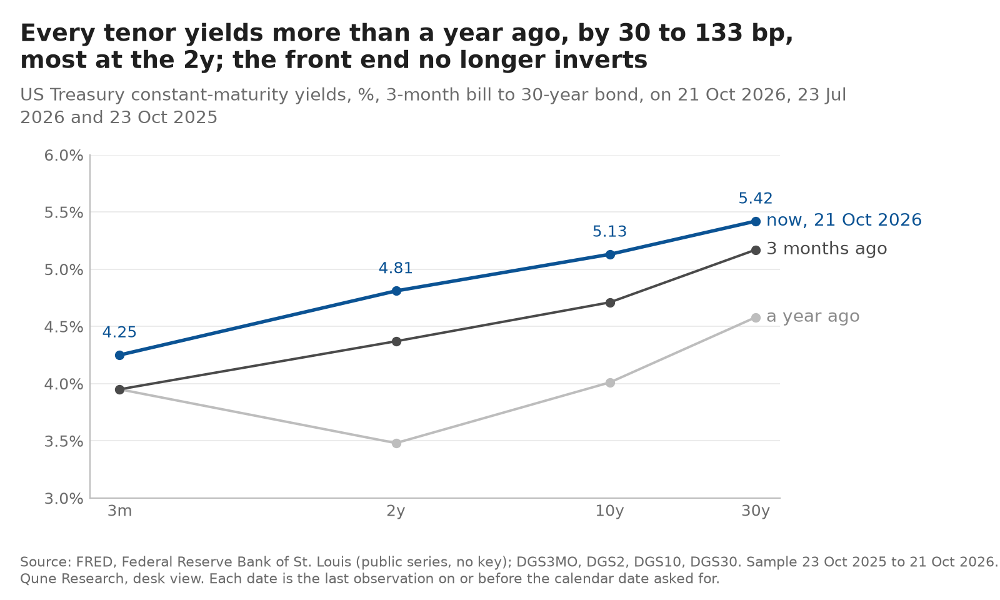
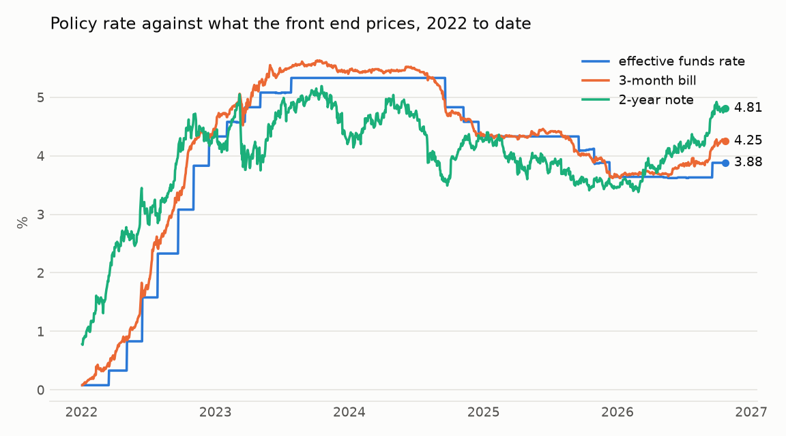
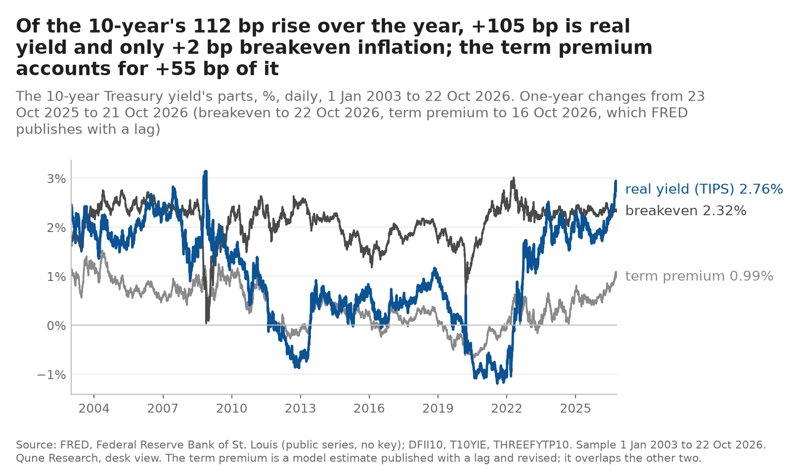
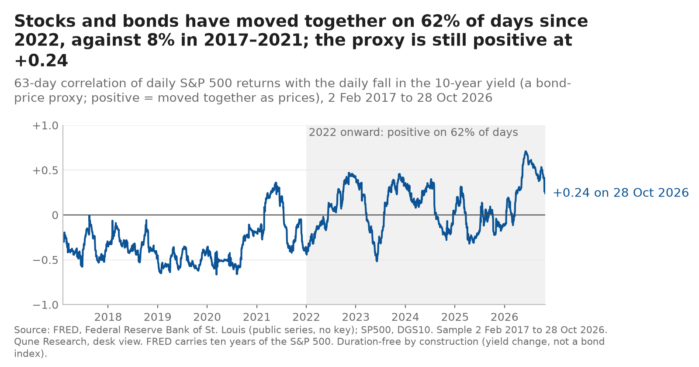

# Desk view: rates and macro, 2026-10-30

The desk's dated reading of the US rates market, built from public FRED series only. Every number on this page is in [`data/numbers_2026-10-30.json`](data/numbers_2026-10-30.json), produced by `build_view.py --asof 2026-10-30` from the series listed in [`data/snapshot_2026-10-30.csv`](data/snapshot_2026-10-30.csv). Market data run to 2026-10-28, the day of the FOMC decision (2026-10-29 for breakevens; 2026-10-23 for the term premium, which FRED publishes with a lag). The previous view (2026-10-23) is kept in [`archive/2026-10-23/`](archive/2026-10-23/DESK_VIEW.md); its five calls stay in [`../predictions/ledger.csv`](../predictions/ledger.csv) as logged and are not edited. Nothing on this page is edited after its date.

Labels: **observed** means the number is in the json; **reported** means a public document says so (linked); **inferred** means the desk's reading. Nothing here is investment advice; the desk trades paper only.

## First: the desk's hike call missed (observed)

Last week's first call, V1, said the FOMC would raise the range by 25 bp on 28 October, at a confidence of 0.70. It held at 3.75–4.00%. The upper limit on 2026-10-29 was 4.00%, and the call was scored a miss in [`../predictions/outcomes.csv`](../predictions/outcomes.csv): Brier score 0.49 for the desk against 0.05 for the bill-implied baseline, which had put the hike at 0.21 ([`../predictions/SKILL.md`](../predictions/SKILL.md)). One call is not a track record, but the direction of the lesson is plain: the desk read a hike off the 3-month bill, 37 bp above the effective rate, while the baseline read the 4-week bill, which matures close to the meeting and showed little of a hike. The 3-month bill's spread carried the December meeting and a term premium as well as October. The desk's reading of the front end was too coarse (inferred).

## Headline (inferred)

The Committee paused, but as a hawkish hold: the vote was 10–2, both dissenters wanted a hike, and the statement still says the Committee "will deliver price stability" while it waits for "the accumulation of more information". The market took it as the end of hikes for now: the 2-year fell 14 bp on the week and the curve steepened from the front. The ten-year still holds 5%, and the year's rise in long yields is still real yield and term premium, not inflation expectations. The desk's year-end curve call (V3, flatter than +32 bp) is now on the wrong side at +38 bp.

## 1. Where we are (observed)

| | 2026-10-28 | 1 week (view of 23 Oct) | 1 month | 3 months | 1 year |
|---|---|---|---|---|---|
| 3-month bill | 4.18% | −7 bp | −2 bp | +36 bp | +26 bp |
| 2-year | 4.67% | −14 bp | −21 bp | +44 bp | +106 bp |
| 10-year | 5.05% | −8 bp | −24 bp | +37 bp | +94 bp |
| 30-year | 5.37% | −5 bp | −27 bp | +16 bp | +72 bp |
| 10-year real (TIPS) | 2.67% | −9 bp | −26 bp | +26 bp | +85 bp |
| 10-year breakeven | 2.35% (29 Oct) | +3 bp | −1 bp | +8 bp | +6 bp |
| 5y5y forward inflation | 2.23% (29 Oct) | +4 bp | −13 bp | −7 bp | +3 bp |
| 10-year term premium (Kim-Wright) | 0.94% (23 Oct) | −5 bp | −14 bp | +10 bp | +44 bp |
| VIX | 16.9 | | | | |

The 1-week column is against the levels the 2026-10-23 view printed (its data ran to 2026-10-21; breakevens to 22 Oct; term premium to 16 Oct). The other columns are against the last observation on or before the same calendar date one month, three months and one year earlier (dates in the json).

- **Policy.** Target range held at 3.75–4.00% on 2026-10-28 by a 10–2 vote; Lisa D. Cook and Beth M. Hammack dissented in favour of a 25 bp hike. The statement: activity "is expanding at a strong pace", "inflation remains elevated", "the accumulation of more information will help the Committee determine the policy stance appropriate", and "the Committee will deliver price stability" (reported: [FOMC statement, 28 October 2026](https://www.federalreserve.gov/newsevents/pressreleases/monetary20261028a.htm)). No reference to policy lags. Next meeting: 9 December.
- **Curve.** 2s10s +38 bp, up from +32 bp a week earlier; 3m–10y +87 bp (observed). The steepening came from the front end falling faster than the long end, a bull steepener, which is what a market pricing out the next hike looks like (inferred).
- **What the front end prices.** The 3-month bill is 30 bp above the effective funds rate (3.88%), down from 37 bp, and the 2-year 79 bp above it, down from 93 bp (observed). Last week the desk read 37 bp as a hike plus part of another; the miss says a good part of that spread was the later meeting and term premium, not October (inferred).

## 2. What the 10-year is made of (observed, then inferred)

| Component | Value | Date |
|---|---|---|
| Nominal 10-year | 5.05% | 2026-10-28 |
| Real 10-year (TIPS) | 2.67% | 2026-10-28 |
| Breakeven inflation | 2.38% | 2026-10-28 |
| Term premium (Kim-Wright) | 0.94% | 2026-10-23 |
| Expected average short rate over ten years (nominal − term premium) | 4.11% | |

Over one year the nominal yield rose 94 bp: 85 bp of it real yield and 9 bp breakeven, with the term premium accounting for 44 bp of the nominal move (observed). The picture is the same as last week's: no inflation scare at the ten-year horizon, a higher real rate and more compensation for duration. The term premium is at the 60th percentile of its history since 1990 (observed). The fall in yields since the 5.31% high of 2026-10-05 is mostly real yield (−26 bp in the month) with breakevens flat, so the market has not started to doubt the Fed's inflation resolve because it paused (inferred).

## 3. Stock-bond correlation regime (observed, then inferred)

The 63-day correlation proxy (daily S&P 500 returns against the daily fall in the 10-year yield, so positive means stock and bond prices moved together) reads **+0.24** on 2026-10-28, down from +0.41 a week earlier. It has been positive on 62% of trading days since the start of 2022 against 8% in 2017–2021 (observed). A falling but still positive reading is what a pause does: with the next hike priced out, bonds rallied over the week while the S&P 500 was roughly flat, which weakens the inflation-driven co-movement. The desk's V5 (positive on 31 December) still holds; the risk named last week, a growth scare, has not appeared in the data this page uses (inferred).

## 4. The calls: where the 2026-10-23 calls stand (observed against the json; scored only on their due dates)

| Id | Call | Confidence | Today | Reading |
|---|---|---|---|---|
| V1 | 25 bp hike on 28 October | 0.70 | held | **Missed** (scored 2026-10-29) |
| V2 | 10-year between 4.60% and 5.30% on 31 December | 0.65 | 5.05% | inside the range |
| V3 | 2s10s below +32 bp on 31 December | 0.60 | +38 bp | wrong side |
| V4 | 10-year breakeven between 2.05% and 2.65% every day to 31 December | 0.75 | 2.35% | inside, no breach so far |
| V5 | Stock-bond proxy positive on 31 December | 0.65 | +0.24 | positive, falling |

The ledger is not edited and the confidences stand as logged; the desk's view now is that V3 is less likely than 0.60, because its basis (hikes lift the 2-year more than the 10-year) assumed the hike that did not come. Last week's page said a hold "with language about lags" would put V3 wrong in direction; the hold came without that language and with two hawkish dissents, so the desk reads the pause as a wait, not an end, and does not abandon the call (inferred).

**No new calls this week.** After one miss on a mechanical reading of the front end, the desk will not add a call on the 9 December meeting from the same reading; a new call will be logged only with a written basis that says how it differs from V1's (inferred).

**What would change the view (inferred):** a 2-year below 4.50% would say the market prices cuts, not a pause, and V3 would be lost; a 10-year back above 5.31% with breakevens flat would say the term premium is the story and V2's range is too tight; a breakeven through 2.65% would say the pause is being read as a loss of resolve.

## 5. Method and limits

- Data: FRED series only (listed in the snapshot csv with their ids), fetched by the shared library's adapter with the download time and hash recorded in `data/manifest.json`; raw files are re-fetched, not committed. `python build_view.py --asof 2026-10-30` reproduces the numbers and the charts from a fresh fetch; `--charts-only` redraws the charts from the local raw files and refuses if any number differs from the committed json.
- Withheld levels: FRED's notes for the S&P 500 (S&P Dow Jones Indices LLC) and the ICE BofA US High Yield OAS (ICE Data Indices) forbid reproduction without the owner's permission, and the repository owner's decision on those series is open ([`../tools/intraday_source_check.md`](../tools/intraday_source_check.md)). From this view on, `build_view.py` writes neither level to the committed numbers or snapshot files: the high-yield spread row is dropped and the S&P 500 is used only inside the correlation proxy, a derived statistic. The 2026-10-23 files are left as published. *Dated addition, 2026-10-30 17:02Z:* decided on 2026-10-30 by Qune (removal; the owner's question stayed open): both series were also withheld from the archived 2026-10-23 view's files and table ([`archive/2026-10-23/DESK_VIEW.md`](archive/2026-10-23/DESK_VIEW.md), addendum).
- Citations: VIXCLS (Chicago Board Options Exchange), EFFR (Federal Reserve Bank of New York), T10YIE and T5YIFR (Federal Reserve Bank of St. Louis) are "Copyrighted: Citation Required" on FRED; each is retrieved from FRED, Federal Reserve Bank of St. Louis, https://fred.stlouisfed.org/series/&lt;id&gt;. The other series are public domain.
- The term premium is a model estimate (Kim-Wright, three-factor), published with a lag and revised; the "expected short rate" is its complement and inherits its model error.
- The market-implied path is read off the bill and the 2-year, not off futures; it mixes expectations with term and liquidity premia. V1's miss is a worked example of how rough that reading is.
- The calls are the desk's judgement, logged to be scored; the desk will be wrong on some of them, and the ledger exists so that the record of that is public.
