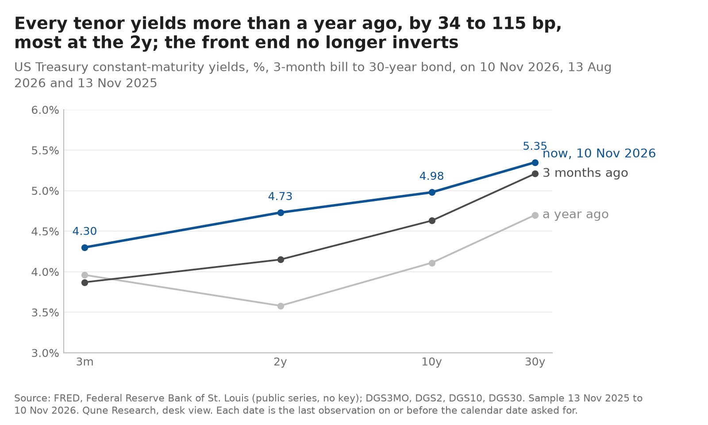
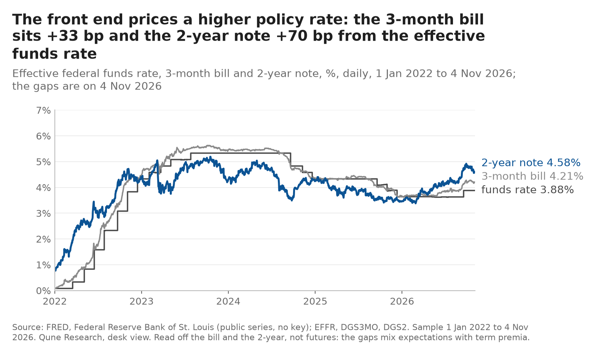
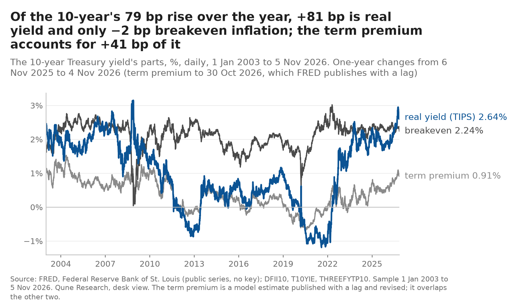
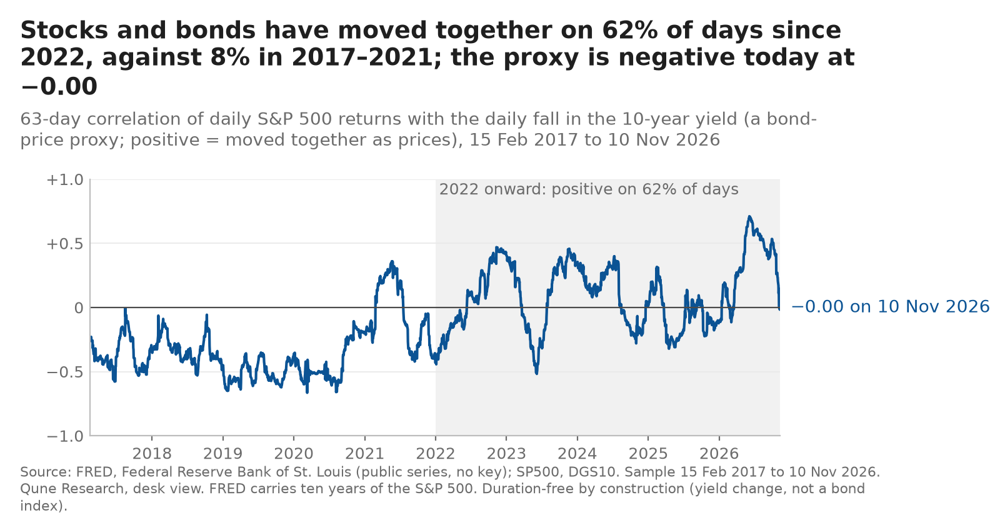

# Desk view: rates and macro, 2026-11-13

The desk's dated reading of the US rates market, built from public FRED series only. Every number on this page is in [`data/numbers_2026-11-13.json`](data/numbers_2026-11-13.json), produced by `build_view.py --asof 2026-11-13` from the series listed in [`data/snapshot_2026-11-13.csv`](data/snapshot_2026-11-13.csv). Market data run to 2026-11-10 (2026-11-12 for breakevens and 2026-11-11 for the VIX; 2026-11-06 for the term premium, which FRED publishes with a lag; FRED carries no 11 November observation for the Treasury series, and the 12 November observations were not yet published at the 06:17 UTC fetch). The previous view (2026-11-06) is kept in [`archive/2026-11-06/`](archive/2026-11-06/DESK_VIEW.md); the five calls of 2026-10-23 stay in [`../predictions/ledger.csv`](../predictions/ledger.csv) as logged and are not edited. Nothing on this page is edited after its date.

Since 2026-11-01 the organisation's programme is prediction markets ([`../RESEARCH_AGENDA.md`](../RESEARCH_AGENDA.md)); this view continues weekly, without new calls, until V2–V5 are scored on 2026-12-31, and the prediction-market view ([`../pm-view/PM_VIEW.md`](../pm-view/PM_VIEW.md)) carries the desk's reading of the December meeting against the market from here on.

Labels: **observed** means the number is in the json; **reported** means a public document says so (linked); **inferred** means the desk's reading. Nothing here is investment advice; the desk trades paper only.

## Headline (inferred)

Last week's rally reversed from the front end: the 2-year rose 15 bp to 4.73%, the 3-month bill 9 bp to 4.30%, the 10-year 8 bp to 4.98% and the 30-year 7 bp. Real yields did the work (the 10-year TIPS yield +14 bp) while the breakeven was unchanged at 2.24%: the week priced the December hike back in and more real rate after it, not more inflation. The curve bear-flattened, 2s10s from +32 bp to +25 bp, so V3 is below its line with 48 days to go. The stock-bond correlation proxy fell through zero to −0.00, so V5 is on the wrong side of its line for the first time. Four calls stand, none has been scored, and the one scored call was a miss.

## 1. Where we are (observed)

| | 2026-11-10 | 1 week (view of 6 Nov) | 1 month | 3 months | 1 year |
|---|---|---|---|---|---|
| 3-month bill | 4.30% | +9 bp | +4 bp | +43 bp | +34 bp |
| 2-year | 4.73% | +15 bp | −6 bp | +58 bp | +115 bp |
| 10-year | 4.98% | +8 bp | −23 bp | +35 bp | +87 bp |
| 30-year | 5.35% | +7 bp | −21 bp | +14 bp | +65 bp |
| 10-year real (TIPS) | 2.78% | +14 bp | −10 bp | +39 bp | +95 bp |
| 10-year breakeven | 2.24% (12 Nov) | 0 bp | −9 bp | 0 bp | −4 bp |
| 5y5y forward inflation | 2.17% (12 Nov) | −5 bp | −16 bp | −10 bp | −2 bp |
| 10-year term premium (Kim-Wright) | 0.87% (6 Nov) | −4 bp | −19 bp | +5 bp | +38 bp |
| VIX | 17.5 (11 Nov) | | | | |

The 1-week column is against the levels the 2026-11-06 view printed (its data ran to 2026-11-04; breakevens to 5 Nov; term premium to 30 Oct). The other columns are against the last observation on or before the same calendar date one month, three months and one year earlier (dates in the json).

- **Policy.** Target range 3.75–4.00%, held on 2026-10-28 by 10–2 with both dissents for a hike (reported: [FOMC statement, 28 October 2026](https://www.federalreserve.gov/newsevents/pressreleases/monetary20261028a.htm)). Next meeting: 9 December. The desk's reading of that meeting against the market is in the prediction-market view, where the bill-implied method reads a hike at 1.00 under a range of [1.000, 1.000] and the market prices it at 0.885; the method's gate is open for the first time and the desk made no call (observed there; the reasons are there).
- **Curve.** 2s10s +25 bp, down from +32 bp; 3m–10y +68 bp, down from +69 bp (observed). The 2-year rose twice as much as the 10-year while the bill rose almost as much as the 10-year: a bear flattener from the front end, the mirror image of last week's bull flattener from the long end (inferred).
- **What the front end prices.** The 3-month constant-maturity bill is 42 bp above the effective funds rate (3.88%), up from 33 bp, and the 2-year 85 bp above it, up from 70 bp (observed). Both spreads widened in the week the prediction market's price of a December hike rose from 0.665 to 0.885: on this page's series the front end priced the hike back in and added to what comes after it (inferred). The prediction-market view reads the secondary-market bill series DTB3 for its method, which sits 18 bp below this page's DGS3MO on the same date (24 bp over funds against 42); the two are not the same number.

## 2. What the 10-year is made of (observed, then inferred)

| Component | Value | Date |
|---|---|---|
| Nominal 10-year | 4.98% | 2026-11-10 |
| Real 10-year (TIPS) | 2.78% | 2026-11-10 |
| Breakeven inflation | 2.20% | 2026-11-10 |
| Term premium (Kim-Wright) | 0.87% | 2026-11-06 |
| Expected average short rate over ten years (nominal − term premium) | 4.11% | |

Over one year the nominal yield rose 87 bp: 95 bp of it real yield and −4 bp breakeven, with the term premium accounting for 38 bp of the nominal move (observed). The year's picture is unchanged: a higher real rate and more compensation for duration, no inflation scare at the ten-year horizon. Over one month the 10-year is down 23 bp, the real yield 10 bp and the breakeven 9 bp (on its own dates), and the term premium is down 19 bp on its lagged print, now at the 56th percentile of its history since 1990, from the 58th (observed). This week's 8 bp rise was all real yield (+14 bp) against a breakeven that did not move; the expected short rate implied by the decomposition rose from 3.99% to 4.11% (observed): the market put back the policy path it had taken out the week before, with the term premium's lagged print still falling (inferred).

## 3. Stock-bond correlation regime (observed, then inferred)

The 63-day correlation proxy (daily S&P 500 returns against the daily fall in the 10-year yield, so positive means stock and bond prices moved together) reads **−0.00** on 2026-11-10 (−0.003 unrounded), down from +0.14 a week earlier, +0.24 two weeks earlier and +0.41 three weeks earlier. It has been positive on 62% of trading days since the start of 2022 against 8% in 2016–2021 (observed). Three weeks of falling readings have taken it through zero: a window in which stocks and bond prices moved in opposite directions on net, for the first time since the call was made. V5 (positive on 31 December) is on the wrong side of its line by a hair, with about 33 trading days still to enter the 63-day window before it is scored, so roughly half of the window that will be scored is not yet observed; the desk's view that the post-2022 regime still holds is now a view against the reading, not with it (inferred).

## 4. The calls: where the 2026-10-23 calls stand (observed against the json; scored only on their due dates)

| Id | Call | Confidence | Today | Reading |
|---|---|---|---|---|
| V1 | 25 bp hike on 28 October | 0.70 | held | **Missed** (scored 2026-10-29) |
| V2 | 10-year between 4.60% and 5.30% on 31 December | 0.65 | 4.98% | inside the range, 32 bp from its top |
| V3 | 2s10s below +32 bp on 31 December | 0.60 | +25 bp | below the line, by 7 bp |
| V4 | 10-year breakeven between 2.05% and 2.65% every day to 31 December | 0.75 | 2.24% | inside, no breach so far |
| V5 | Stock-bond proxy positive on 31 December | 0.65 | −0.00 | **negative**, on the wrong side by 0.003 |

Brier against the market-anchored baseline ([`../predictions/SKILL.md`](../predictions/SKILL.md), rule 3 of the V1 post-mortem): 1 scored call; desk 0.490, baseline 0.045, skill −0.445; descriptive, not evidence, with fewer than thirty scored calls. The three figures are printed from the committed records by [`../tools/check_view_brier.py`](../tools/check_view_brier.py) and held on this page by [`tests/test_view_brier.py`](tests/test_view_brier.py).

The ledger is not edited and the confidences stand as logged. V3 is below its line this week for the mechanism the call named, a front end that rises faster than the long end when a hike is priced; last week it was on the line for a different reason (a long end pricing less inflation). V5 is the call to watch: the proxy's level is set by the whole 63-day window, so a reading of −0.00 today says the window's net co-movement is nil, and the sign on 31 December depends on the trading days still to enter it. The desk notes both now so the post-mortems on 31 December can say which mechanism carried each call (inferred).

**No new calls this week**, by the 2026-11-01 decision: the desk's calls on the December meeting are made, if at all, in the prediction-market view against the market's own price, where this week the gate was open and the desk declined.

**What would change the view (inferred):** a 2-year back below 4.50% would say the market has priced the hike out again and V3 would be at risk from the other direction; a 10-year above 5.30% with the breakeven flat would say the real rate and the term premium are the story and V2 is lost at the top of its range; a correlation proxy that stays below zero into December would say the regime call V5 rests on has ended, and the post-mortem would have to say whether the window or the regime was the error.

## 5. Method and limits

- Data: FRED series only (listed in the snapshot csv with their ids), fetched by the shared library's adapter with the download time and hash recorded in `data/manifest.json`; raw files are re-fetched, not committed. `python build_view.py --asof 2026-11-13` reproduces the numbers and the charts from a fresh fetch; `--charts-only` redraws the charts from the local raw files and refuses if any number differs from the committed json.
- Withheld levels: FRED's notes for the S&P 500 (S&P Dow Jones Indices LLC) and the ICE BofA US High Yield OAS (ICE Data Indices) forbid reproduction without the owner's permission ([`../tools/intraday_source_check.md`](../tools/intraday_source_check.md)); neither level is written to the committed numbers or snapshot files, and the S&P 500 is used only inside the correlation proxy, a derived statistic.
- Citations: VIXCLS (Chicago Board Options Exchange), EFFR (Federal Reserve Bank of New York), T10YIE and T5YIFR (Federal Reserve Bank of St. Louis) are "Copyrighted: Citation Required" on FRED; each is retrieved from FRED, Federal Reserve Bank of St. Louis, https://fred.stlouisfed.org/series/&lt;id&gt;. The other series are public domain.
- The term premium is a model estimate (Kim-Wright, three-factor), published with a lag and revised; the "expected short rate" is its complement and inherits its model error.
- The market-implied path is read off the bill and the 2-year, not off futures; it mixes expectations with term and liquidity premia. V1's miss is a worked example of how rough that reading is; the prediction-market view's method is the version of it that has been scored on its own history.
- The calls are the desk's judgement, logged to be scored; the desk will be wrong on some of them, and the ledger exists so that the record of that is public.
