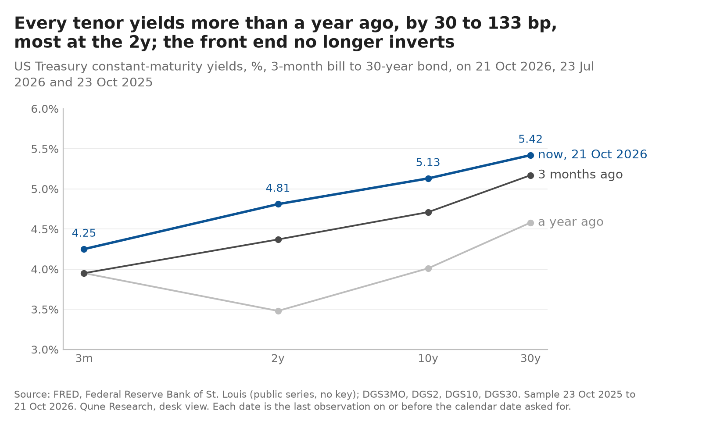
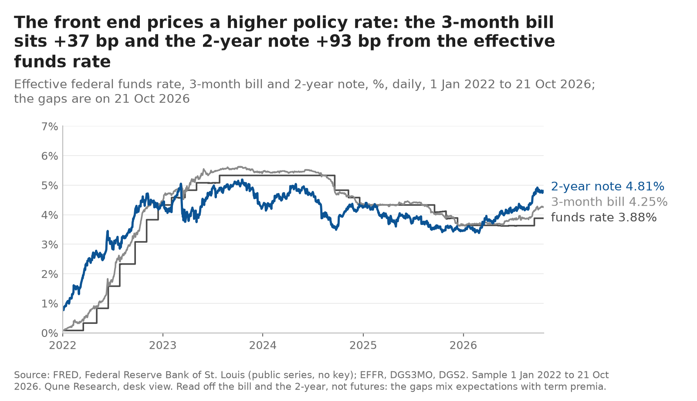
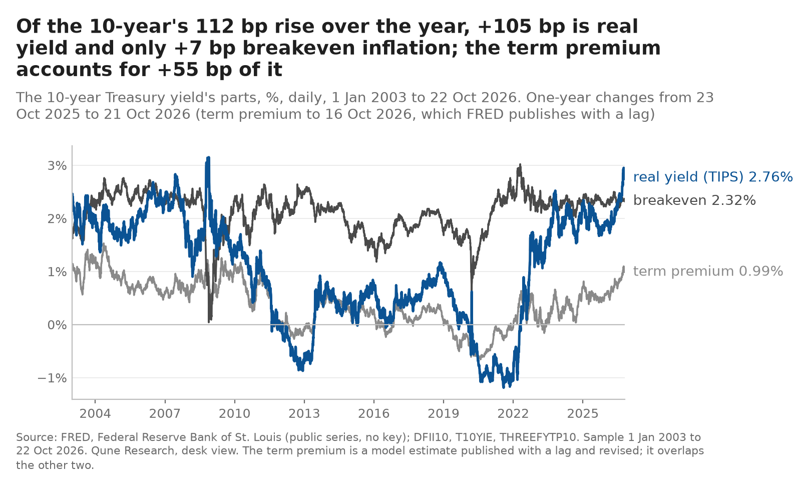
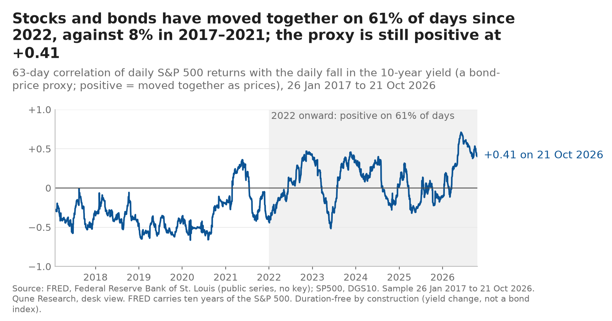

> **Archived 2026-10-30.** Superseded by the view of 2026-10-30 ([`../../DESK_VIEW.md`](../../DESK_VIEW.md)). The text below is as published; only relative link targets were re-pointed for this folder, and `charts/` here holds the charts as they stood on 2026-10-29 (with their `manifest.json`; the data manifest of that build is [`data_manifest.json`](data_manifest.json)). The byte-identical original is `desk-view/DESK_VIEW.md` at commit `ec8eef6`.

# Desk view: rates and macro, 2026-10-23

The desk's dated reading of the US rates market, built from public FRED series only, ending in five falsifiable calls that are logged in [`../predictions/ledger.csv`](../../../predictions/ledger.csv) before their outcome and scored there when due. Every number on this page is in [`data/numbers_2026-10-23.json`](../../data/numbers_2026-10-23.json), produced by `build_view.py` from the series listed in [`data/snapshot_2026-10-23.csv`](../../data/snapshot_2026-10-23.csv) (the series, the observation date used for each, and what it is). Market data run to 2026-10-21 (2026-10-22 for breakevens; 2026-10-16 for the term premium, which FRED publishes with a lag). The view is updated weekly and earlier views are kept as they were written; nothing on this page is edited after its date.

Labels: **observed** means the number is in the json; **reported** means a public document says so (linked); **inferred** means the desk's reading. Nothing here is investment advice; the desk trades paper only.

## Headline (inferred)

The Fed is hiking again into 3.7% inflation, the curve has re-steepened into a 5% ten-year, and the whole of the last year's rise in long yields is real yield and term premium, not inflation expectations. The market has priced the policy path the Fed itself projects. From here the desk expects one more hike next week, a ten-year that ranges rather than trends, a flatter curve by year-end, breakevens that stay anchored, and a stock-bond correlation that stays positive: bonds are not a hedge for equities while inflation is the problem.

## 1. Where we are (observed)

| | 2026-10-21 | 1 month | 3 months | 1 year |
|---|---|---|---|---|
| 3-month bill | 4.25% | +6 bp | +30 bp | +30 bp |
| 2-year | 4.81% | −4 bp | +44 bp | +133 bp |
| 10-year | 5.13% | +2 bp | +42 bp | +112 bp |
| 30-year | 5.42% | +2 bp | +25 bp | +84 bp |
| 10-year real (TIPS) | 2.76% | 0 bp | +33 bp | +105 bp |
| 10-year breakeven | 2.32% (22 Oct) | −3 bp | +4 bp | +2 bp |
| 5y5y forward inflation | 2.19% (22 Oct) | −17 bp | −8 bp | +1 bp |
| 10-year term premium (Kim-Wright) | 0.99% (16 Oct) | −1 bp | +14 bp | +55 bp |
| High-yield OAS | 3.27% | +54 bp | +50 bp | +31 bp |
| VIX | 16.7 | | | |

Changes are against the last observation on or before the same calendar date one month, three months and one year earlier (dates in the json). The 5y5y reading of 2.19% is a one-day fall of 15 bp from 2.34% on 21 Oct; a single print like that is as likely to be a fitting artefact as a move, so the desk reads the 10-year breakeven instead.

- **Policy.** Target range 3.75–4.00% after a 25 bp hike on 2026-09-16, voted 12–0, with the statement "inflation remains elevated ... the Committee will deliver price stability" (reported: [FOMC statement](https://www.federalreserve.gov/newsevents/pressreleases/monetary20260916a.htm)). The cut cycle of 2024–2025 took the range from 5.25–5.50% to 3.50–3.75%; September reversed its last step. The September projections put the median funds rate at 4.1% for end-2026 and end-2027, 3.9% for 2028, PCE inflation at 3.7% for 2026 falling to 2.3% in 2027, unemployment at 4.1% (reported: [SEP](https://www.federalreserve.gov/monetarypolicy/fomcprojtabl20260916.htm)). Next meeting: 2026-10-27/28.
- **Curve.** 3m–10y +88 bp, 2s10s +32 bp (observed). A year ago the 2-year sat 47 bp below the bill; today the curve rises monotonically from 4.25% to 5.42%. The 10-year's 5.31% close on 2026-10-05 is its highest since 2007 (observed, FRED daily series from 2008).
- **What the front end prices.** The 3-month bill is 37 bp above the effective funds rate (3.88%) and the 2-year is 93 bp above it (observed). Read mechanically: a bill that averages the next three months of overnight rates at 37 bp above today's is consistent with a 25 bp hike on 28 October and a fair chance of another on 9 December; the 2-year at 4.81% is above the SEP's 4.1% median for end-2027, so the market's two-year average path is some 50–70 bp above the Committee's, part of which is a term premium (inferred).

## 2. What the 10-year is made of (observed, then inferred)

| Component | Value | Date |
|---|---|---|
| Nominal 10-year | 5.13% | 2026-10-21 |
| Real 10-year (TIPS) | 2.76% | 2026-10-21 |
| Breakeven inflation | 2.37% | 2026-10-21 |
| Term premium (Kim-Wright) | 0.99% | 2026-10-16 |
| Expected average short rate over ten years (nominal − term premium) | 4.14% | |

Over one year the nominal yield rose 112 bp: 105 bp of it real yield, 2 bp breakeven, and the term premium accounts for 55 bp of the nominal move (observed). The market is not pricing an inflation problem ten years out; it is pricing a higher real policy rate for longer and asking more compensation for holding duration. The term premium at 0.99% is only the 62nd percentile of its history since 1990 (observed): high against the 2010s, ordinary against the 1990s. The expected-short-rate figure of 4.14% sits on top of the SEP medians (4.1%, 4.1%, 3.9%), which is the sense in which the path is priced (inferred).

## 3. Stock-bond correlation regime (observed, then inferred)

The desk's proxy is the 63-day correlation of daily S&P 500 returns with the daily fall in the 10-year yield (a bond-price proxy; the sign is flipped so that positive means the two moved together as prices). It reads **+0.41** on 2026-10-21, after a peak near +0.7 in the summer. It has been positive on 61% of trading days since the start of 2022 against 8% of days in 2016–2021 (observed). This is the regime Study 004 found out of sample: in 2022 the trend rule's only advantage came from sitting in bills while equities, Treasuries and credit fell together, and the same regime is why vol-targeting a mixed book did not cut drawdowns. While inflation, not growth, drives the Fed, the desk expects the sign to stay positive; the proxy flips negative within weeks on a growth scare (late 2023, early 2025), which is the risk to that reading.

## 4. The calls (logged 2026-10-23 in `../predictions/ledger.csv`)

| Id | Call | Scored on | Confidence |
|---|---|---|---|
| V1 | The FOMC raises the range by 25 bp on 28 October, to 4.00–4.25% | 2026-10-29 (upper limit series equals 4.25%) | 0.70 |
| V2 | 10-year yield between 4.60% and 5.30% on 31 December | 2026-12-31 | 0.65 |
| V3 | 2s10s below +32 bp on 31 December (flatter than today) | 2026-12-31 | 0.60 |
| V4 | 10-year breakeven between 2.05% and 2.65% on every day to 31 December | 2026-12-31 | 0.75 |
| V5 | Stock-bond correlation proxy still positive on 31 December | 2026-12-31 | 0.65 |

Each row in the ledger carries the basis and the downside case. The first is scored before the reviewers' date; the others at year-end. Confidence is the desk's own probability, written to be judged over many calls, not these five.

**What would change the view (inferred):** a hold on 28 October with language about lags would say the Committee thinks 4% is enough, and V3 would then be wrong in direction; a 10-year above 5.31% with breakevens still flat would say the term premium is the story and the range in V2 is too tight; a jump in breakevens through 2.65% would say the Fed's credibility, not its path, is being priced, and the desk would expect the correlation regime to intensify, not end.

## 5. Method and limits

- Data: FRED series only (listed in the snapshot csv with their ids), fetched by the shared library's adapter with the download time and hash recorded in `data/manifest.json`; raw files are re-fetched, not committed. `python build_view.py --asof 2026-10-23` reproduces the numbers and the charts; `--offline` reuses the raw files.
- The term premium is a model estimate (Kim-Wright, three-factor), published with a lag and revised; the "expected short rate" is its complement and inherits its model error.
- The stock-bond proxy uses the yield change, not a bond index, so it is duration-free; a constant duration would not change a correlation, but convexity and coupon effects would, slightly.
- The market-implied path is read off the bill and the 2-year, not off futures; it mixes expectations with term and liquidity premia and is a rougher reading than fed funds futures would give.
- The charts are static images; the table view is the snapshot csv.
- The calls are the desk's judgement. They are logged to be scored, and the desk will be wrong on some of them; the ledger exists so that the record of that is public.

---

*Addendum, 2026-10-23 (after publication; the text above is unchanged): the four charts were redrawn the same day to the house chart standard (`qune_research/style.py`), from the same raw files, hash-checked against `data/manifest.json`, by `build_view.py --charts-only`, which first recomputed every number in `data/numbers_2026-10-23.json` and found them equal. Each title now states the finding and is chosen by a function in `view_lib.py` from those numbers, not typed; the input hashes and title numbers are in `charts/manifest.json`. The first renders are in git at commit `11e4659`. No number on this page changed.*

*Addendum, 2026-10-23 07:4x, after the Tester chart review ([`../CHART_REVIEW.md`](../../../CHART_REVIEW.md)); the text above is unchanged. Two corrections to how the page's own numbers should be read: (1) the breakeven row in section 1 reads to 22 Oct 2026 (2.32%, +2 bp), as the table states, while the nominal and real rows read to 21 Oct; on the nominal's date the breakeven was 2.37% (the value in the section 2 table), so the one-year change on consistent dates is +7 bp, and 105 + 7 = 112. The decomposition chart now uses that figure. (2) "8% of days in 2016–2021" in section 3: the correlation series begins on 26 Jan 2017 (FRED carries ten years of the S&P 500, and the window needs 63 days), so the period is 2017–2021; the share is unchanged. The chart says 2017–2021.*

*Addendum, 2026-10-24 09:20 (dated addition; the text above is unchanged). Two precisions from a read of this page against `data/numbers_2026-10-23.json`, both manifests and the git record. (1) The addendum above headed "07:4x" was committed at 07:30:48 London (commit `618c209`, the same commit that added `../CHART_REVIEW.md`), so its label is some ten minutes late; the heading is left as written. (2) Section 1, "some 50–70 bp above the Committee's": on the page's own numbers the gap is 4.81% − 4.1% = 71 bp against the SEP's end-2026 and end-2027 medians, and larger against an average path that starts at today's 3.88% effective rate, so the range should read "some 70 bp or more"; the reading that part of it is term premium stands. Every other number on the page was found equal to the json (the section 1 table to the basis point; 2s10s +32 bp, 3m–10y +88 bp, +37 and +93 bp, 4.14%, the 62nd percentile, +0.41, 61% and 8%); the 5y5y fall of 15 bp from 2.34% on 21 Oct is in the raw file; the chart manifest's input hashes equal the data manifest's and the local raw files', and the numbers file's hash equals its manifest entry. Nothing re-run.*

*Addendum, 2026-10-28 03:4xZ (dated addition; the text above is unchanged). Data attribution.* FRED tags four series this page uses as "Copyrighted: Citation Required": the CBOE Volatility Index (VIXCLS; Chicago Board Options Exchange, CBOE Market Statistics; FRED's note: "Copyright, 2016, Chicago Board Options Exchange, Inc. Reprinted with permission"), the effective federal funds rate (EFFR; Federal Reserve Bank of New York) and the 10-year breakeven inflation rate (T10YIE; Federal Reserve Bank of St. Louis), each retrieved from FRED, Federal Reserve Bank of St. Louis, https://fred.stlouisfed.org/series/<id>. The S&P 500 (SP500; S&P Dow Jones Indices LLC) and the ICE BofA US High Yield OAS (BAMLH0A0HYM2; ICE Data Indices) carry notes that forbid reproduction without the owner's permission; this page prints one level of each, and whether they stay is an open owner decision (see [`../tools/intraday_source_check.md`](../../../tools/intraday_source_check.md)). The other series checked are public domain. DGS3MO and T5YIFR were not checked.

*Addendum, 2026-10-28 04:2xZ (dated addition; the text above is unchanged). The two series the note above left unchecked.* DGS3MO (Board of Governors) is public domain, citation requested. T5YIFR, the 5-year, 5-year forward inflation expectation rate this page prints, is "Copyrighted: Citation Required" with no reproduction ban; citation: Federal Reserve Bank of St. Louis, 5-Year, 5-Year Forward Inflation Expectation Rate [T5YIFR], retrieved from FRED, Federal Reserve Bank of St. Louis, https://fred.stlouisfed.org/series/T5YIFR. Read from Internet Archive captures (hashes in [`../tools/intraday_source_check.md`](../../../tools/intraday_source_check.md)).
