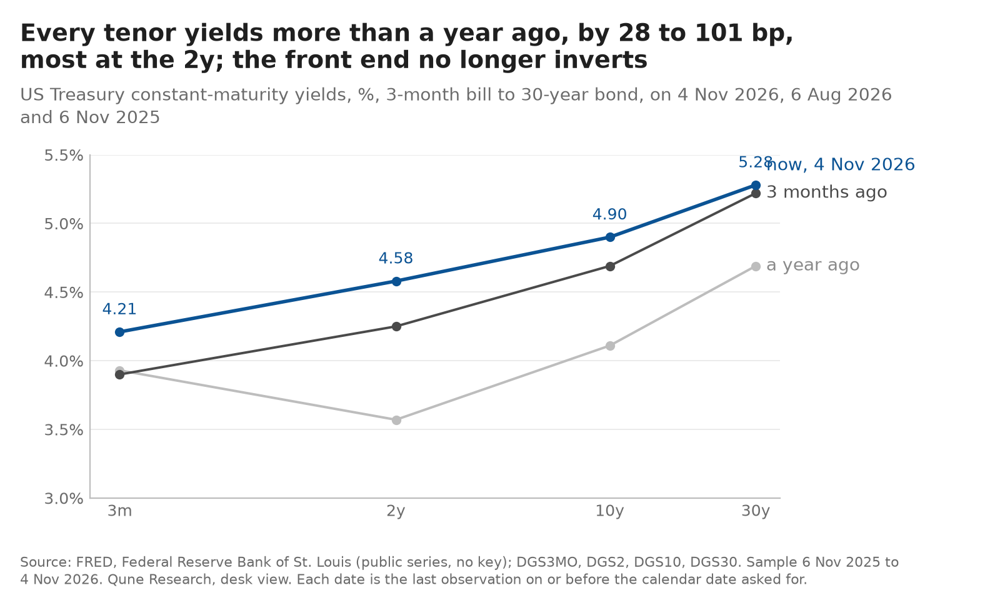
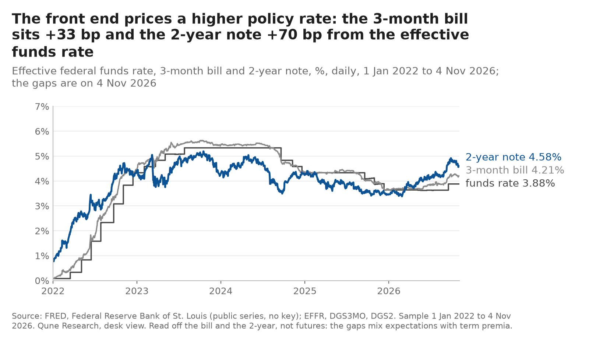
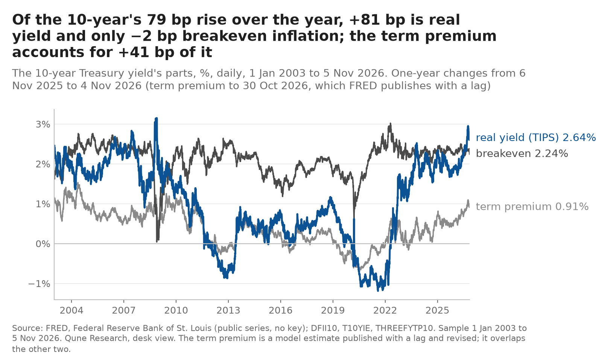
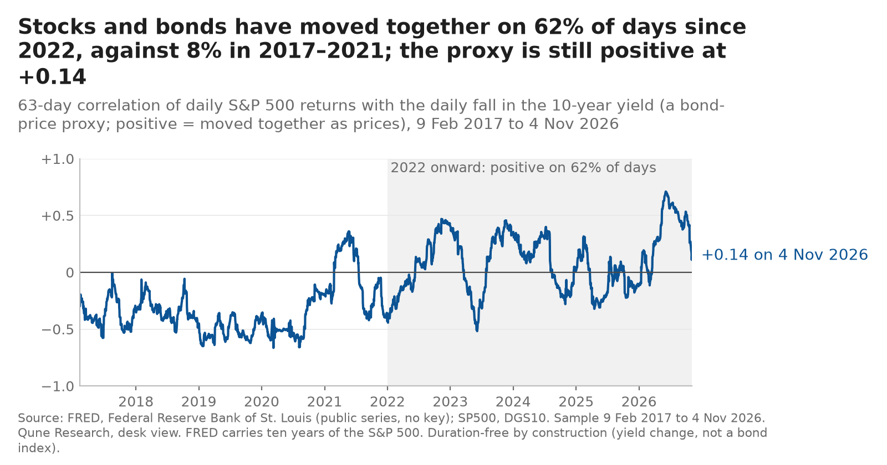

> **Archived 2026-11-13.** Superseded by the view of 2026-11-13 ([`../../DESK_VIEW.md`](../../DESK_VIEW.md)). The text below is as published, with its dated correction of 2026-11-11; only relative link targets were re-pointed for this folder, and `charts/` here holds the charts as they stood on 2026-11-06 (with their `manifest.json`; the data manifest of that build is [`data_manifest.json`](data_manifest.json)). The byte-identical original is `desk-view/DESK_VIEW.md` at commit `2ace7a9`.

# Desk view: rates and macro, 2026-11-06

The desk's dated reading of the US rates market, built from public FRED series only. Every number on this page is in [`data/numbers_2026-11-06.json`](../../data/numbers_2026-11-06.json), produced by `build_view.py --asof 2026-11-06` from the series listed in [`data/snapshot_2026-11-06.csv`](../../data/snapshot_2026-11-06.csv). Market data run to 2026-11-04 (2026-11-05 for breakevens; 2026-10-30 for the term premium, which FRED publishes with a lag). The previous view (2026-10-30) is kept in [`archive/2026-10-30/`](../2026-10-30/DESK_VIEW.md); the five calls of 2026-10-23 stay in [`../predictions/ledger.csv`](../../../predictions/ledger.csv) as logged and are not edited. Nothing on this page is edited after its date.

Since 2026-11-01 the organisation's programme is prediction markets ([`../RESEARCH_AGENDA.md`](../../../RESEARCH_AGENDA.md)); this view continues weekly, without new calls, until V2–V5 are scored on 2026-12-31, and the prediction-market view ([`../pm-view/PM_VIEW.md`](../../../pm-view/PM_VIEW.md)) carries the desk's reading of the December meeting against the market from here on.

Labels: **observed** means the number is in the json; **reported** means a public document says so (linked); **inferred** means the desk's reading. Nothing here is investment advice; the desk trades paper only.

## Headline (inferred)

The curve bull-flattened from the long end this week: the 10-year fell 15 bp to 4.90%, breakevens fell 11 bp, the 2-year fell 9 bp and the 3-month bill rose 3 bp. Last week's move was the front end pricing out a hike; this week's is the long end pricing less inflation, with real yields almost unchanged. The 10-year is now 41 bp below its 5 October high and 2s10s is back to +32 bp, exactly the level V3 needs it to be below on 31 December. Four calls stand, none has been scored, and the one scored call was a miss.

## 1. Where we are (observed)

| | 2026-11-04 | 1 week (view of 30 Oct) | 1 month | 3 months | 1 year |
|---|---|---|---|---|---|
| 3-month bill | 4.21% | +3 bp | 0 bp | +31 bp | +28 bp |
| 2-year | 4.58% | −9 bp | −21 bp | +33 bp | +101 bp |
| 10-year | 4.90% | −15 bp | −37 bp | +21 bp | +79 bp |
| 30-year | 5.28% | −9 bp | −36 bp | +6 bp | +59 bp |
| 10-year real (TIPS) | 2.64% | −3 bp | −27 bp | +21 bp | +81 bp |
| 10-year breakeven | 2.24% (5 Nov) | −11 bp | −12 bp | −2 bp | −4 bp |
| 5y5y forward inflation | 2.22% (5 Nov) | −1 bp | −13 bp | −7 bp | +3 bp |
| 10-year term premium (Kim-Wright) | 0.91% (30 Oct) | −3 bp | −18 bp | +7 bp | +41 bp |
| VIX | 16.6 | | | | |

The 1-week column is against the levels the 2026-10-30 view printed (its data ran to 2026-10-28; breakevens to 29 Oct; term premium to 23 Oct). The other columns are against the last observation on or before the same calendar date one month, three months and one year earlier (dates in the json).

- **Policy.** Target range 3.75–4.00%, held on 2026-10-28 by 10–2 with both dissents for a hike (reported: [FOMC statement, 28 October 2026](https://www.federalreserve.gov/newsevents/pressreleases/monetary20261028a.htm)). Next meeting: 9 December. The desk's reading of that meeting against the market is in the prediction-market view, where the bill-implied method scored on its own history reads a hike at 1.00 under a range of [0.585, 1.000] and the market prices it at 0.665, inside the range, so no call (observed there; inferred here that the market and the bills disagree about December more than they did a week ago).
- **Curve.** 2s10s +32 bp, down from +38 bp; 3m–10y +69 bp, down from +87 bp (observed). This week's flattening came from the 10-year falling faster than the 2-year while the bill rose: a bull flattener from the long end, the opposite shape to last week's bull steepener (inferred).
- **What the front end prices.** The 3-month constant-maturity bill is 33 bp above the effective funds rate (3.88%), up from 30 bp, and the 2-year 70 bp above it, down from 79 bp (observed). The bill's spread over funds rose while the market's price of a December hike fell; on this page's series the front end did not price out the hike this week, the 2-year priced out some of what comes after it (inferred). The prediction-market view reads the secondary-market bill series DTB3 for its method, which sits 18 bp below this page's DGS3MO today; the two are not the same number.

## 2. What the 10-year is made of (observed, then inferred)

| Component | Value | Date |
|---|---|---|
| Nominal 10-year | 4.90% | 2026-11-04 |
| Real 10-year (TIPS) | 2.64% | 2026-11-04 |
| Breakeven inflation | 2.26% | 2026-11-04 |
| Term premium (Kim-Wright) | 0.91% | 2026-10-30 |
| Expected average short rate over ten years (nominal − term premium) | 3.99% | |

Over one year the nominal yield rose 79 bp: 81 bp of it real yield and −2 bp breakeven, with the term premium accounting for 41 bp of the nominal move (observed). The year's picture is unchanged: a higher real rate and more compensation for duration, no inflation scare at the ten-year horizon. The month's picture is new: the 10-year is down 37 bp over one month, the real yield 27 bp and the breakeven 12 bp (on its own dates), and the term premium is down 18 bp on its lagged print; the term premium is at the 58th percentile of its history since 1990, from the 60th (observed). This week's 15 bp fall is mostly breakeven (−11 bp against −3 bp real): the long end has started to price less inflation, not only less term premium (inferred). The expected short rate implied by the term-premium model, 3.99%, is now at the top of the current target range: the ten-year no longer prices a policy rate above today's over its life (inferred).

## 3. Stock-bond correlation regime (observed, then inferred)

The 63-day correlation proxy (daily S&P 500 returns against the daily fall in the 10-year yield, so positive means stock and bond prices moved together) reads **+0.14** on 2026-11-04, down from +0.24 a week earlier and +0.41 two weeks earlier. It has been positive on 62% of trading days since the start of 2022 against 8% in 2016–2021 (observed). Two weeks of falling readings with bonds rallying is the pattern of a correlation on its way to zero; the desk's V5 (positive on 31 December) is still on the right side, with 57 days to go and a reading that has lost two thirds of its level in two weeks. The downside case named in October, a growth scare that flips the sign within weeks, is the one to watch; the breakeven fall this week is consistent with it and does not prove it (inferred).

## 4. The calls: where the 2026-10-23 calls stand (observed against the json; scored only on their due dates)

| Id | Call | Confidence | Today | Reading |
|---|---|---|---|---|
| V1 | 25 bp hike on 28 October | 0.70 | held | **Missed** (scored 2026-10-29) |
| V2 | 10-year between 4.60% and 5.30% on 31 December | 0.65 | 4.90% | inside the range, near its middle |
| V3 | 2s10s below +32 bp on 31 December | 0.60 | +32 bp | on the line: the call needs it below |
| V4 | 10-year breakeven between 2.05% and 2.65% every day to 31 December | 0.75 | 2.24% | inside, no breach so far |
| V5 | Stock-bond proxy positive on 31 December | 0.65 | +0.14 | positive, falling |

Brier against the market-anchored baseline ([`../predictions/SKILL.md`](../../../predictions/SKILL.md), rule 3 of the V1 post-mortem): 1 scored call; desk 0.490, baseline 0.045, skill −0.445; descriptive, not evidence, with fewer than thirty scored calls.

*Correction, 2026-11-11 06:2x UTC.* From 6 to 11 November the line above read "baseline 0.046": a round by hand of SKILL.md's four-decimal 0.0455, where the record's figure (`baselines.csv`, V1 at 0.2133, scored a miss) is 0.04549689, which is 0.045 at three decimals. Nothing read the line back. The three figures are now printed from the committed records by [`../tools/check_view_brier.py`](../../../tools/check_view_brier.py) (`--print`), held there in `make lint` and CI, and held on this page by [`tests/test_view_brier.py`](../../tests/test_view_brier.py). The digit is the only change to the text above ([`../predictions/POST_MORTEMS.md`](../../../predictions/POST_MORTEMS.md), "A Brier figure rounded twice").

The ledger is not edited and the confidences stand as logged. V3's basis (hikes lift the 2-year more than the 10-year) assumed the October hike that did not come; it is back on the line this week for a different reason, a long end pricing less inflation, which is not the mechanism the call named. A call that comes right for the wrong reason scores the same and teaches less; the desk notes it now so the post-mortem on 31 December can say which it was (inferred).

**No new calls this week**, by the 2026-11-01 decision: the desk's calls on the December meeting are made, if at all, in the prediction-market view against the market's own price, where this week the gate refused one.

**What would change the view (inferred):** a 2-year below 4.50% would say the market prices cuts, not a pause, and V3 would be lost; a 10-year back above 5.31% with breakevens flat would say the term premium is the story and V2's range is too tight; a breakeven through 2.05% would say the growth scare has arrived, and V5 would be the next to go.

## 5. Method and limits

- Data: FRED series only (listed in the snapshot csv with their ids), fetched by the shared library's adapter with the download time and hash recorded in `data/manifest.json`; raw files are re-fetched, not committed. `python build_view.py --asof 2026-11-06` reproduces the numbers and the charts from a fresh fetch; `--charts-only` redraws the charts from the local raw files and refuses if any number differs from the committed json.
- Withheld levels: FRED's notes for the S&P 500 (S&P Dow Jones Indices LLC) and the ICE BofA US High Yield OAS (ICE Data Indices) forbid reproduction without the owner's permission ([`../tools/intraday_source_check.md`](../../../tools/intraday_source_check.md)); neither level is written to the committed numbers or snapshot files, and the S&P 500 is used only inside the correlation proxy, a derived statistic.
- Citations: VIXCLS (Chicago Board Options Exchange), EFFR (Federal Reserve Bank of New York), T10YIE and T5YIFR (Federal Reserve Bank of St. Louis) are "Copyrighted: Citation Required" on FRED; each is retrieved from FRED, Federal Reserve Bank of St. Louis, https://fred.stlouisfed.org/series/&lt;id&gt;. The other series are public domain.
- The term premium is a model estimate (Kim-Wright, three-factor), published with a lag and revised; the "expected short rate" is its complement and inherits its model error.
- The market-implied path is read off the bill and the 2-year, not off futures; it mixes expectations with term and liquidity premia. V1's miss is a worked example of how rough that reading is; the prediction-market view's method is the version of it that has been scored on its own history.
- The calls are the desk's judgement, logged to be scored; the desk will be wrong on some of them, and the ledger exists so that the record of that is public.
