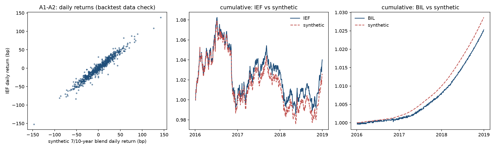

# Study 001 — Term-spread duration switch (IEF vs BIL)

**Verdict: inconclusive — halted permanently at the data validation (§5.3) on 2026-10-21, before any rule was tested.** Under the pre-registered verdict table (§9.5) a study that halts at validation is "inconclusive". The hypothesis (hold IEF when the 10-year minus 3-month spread is positive, bills otherwise; §1) was neither supported nor refuted: **no return of T1, T2, T3 or any benchmark was ever computed.** `results/insample/` and `results/oos/` do not exist, and the out-of-sample window (2019-01 to 2026-09) was never touched.

What happened, in order (all on 2026-10-21; every step is a dated commit):

1. The owner approved the pre-registration and the symbols IEF and BIL (`APPROVED`, [trials.md](trials.md)).
2. `./reproduce.sh --validate` compared the synthetic 10-year par-bond series against actual IEF returns over 2016–2018 and failed two of six thresholds (A3 tracking error 1.540% against ≤ 1.5%; A4 mean difference +0.455% p.a. against ±0.40%). The study halted as §5.3 requires and an amendment was proposed in §16 of [PREREGISTRATION.md](PREREGISTRATION.md).
3. The orchestrator, under authority delegated by the owner, adopted the proposed correction: an equal-weight 7-year/10-year par-bond blend (DGS7 and DGS10) and an in-sample start of 1969-08, with **one** re-validation allowed and a permanent halt if it failed. The decision was committed before the re-run.
4. The blend was implemented and unit-tested (101 tests), committed, and `./reproduce.sh --validate` was run a second and final time. A3 now passed (1.145%) and the slope A2 moved from 0.82 to 0.95, but **A4 was essentially unchanged at +0.451% p.a. and failed again.** The study is halted for good.

Everything on this page is a backtest data comparison of instrument returns. Nothing here is a strategy result, a track record, or investment advice.

The question, hypothesis, data, exact rule, trials, sample split, benchmarks, metrics and decision criteria are fixed in [PREREGISTRATION.md](PREREGISTRATION.md) and are not repeated here.

## Validation results (backtest data check, §5.3; not a performance test)

Window 2016-01-04 to 2018-12-31, 753 NYSE trading days common to both series, instrument returns only, no rule applied. Both runs are committed in full: the first (10-year par bond alone) in `results/validation/run1-ten-year-only/`, the second (7/10-year blend) in `results/validation/` (`validation.json`, `validation.md`, `validation.png`).

| Check | Statistic | Threshold | Run 1: 10-year alone | Run 2: 7/10 blend |
|---|---|---|---|---|
| A1 | Correlation of daily returns, IEF vs synthetic | ≥ 0.95 | 0.966 pass | 0.970 pass |
| A2 | OLS slope of IEF on synthetic | in [0.80, 1.05] | 0.821 pass (edge of band) | 0.946 pass |
| A3 | Annualised tracking error, IEF vs synthetic | ≤ 1.5% p.a. | 1.540% **fail** | 1.145% pass |
| A4 | Annualised mean difference, IEF − synthetic | within ±0.40% p.a. | +0.455% **fail** | +0.451% **fail** |
| B1 | Annualised mean difference, BIL − synthetic cash | within ±0.30% p.a. | −0.110% pass | −0.110% pass |
| B2 | Annualised tracking error, BIL vs synthetic cash | ≤ 0.50% p.a. | 0.288% pass | 0.288% pass |

Sources: `results/validation/run1-ten-year-only/validation.json` and `results/validation/validation.json`. The duration/convexity cross-check of the exact repricing (§5.2) agrees to 0.000 bp per day on average in both runs (1.6 × 10⁻⁸ and 1.2 × 10⁻⁸ in return units against an acceptance of 0.5 bp), so the bond arithmetic is not the problem. The cash leg is not at issue.



### Reading of the failure (inferred; written after both runs; not used to change anything)

The blend did what it was meant to do: the ETF's day-to-day moves are now matched almost one for one (slope 0.95, tracking error down by a quarter). What it did not touch is the **level** of the gap: IEF earned about 45 bp a year more than the synthetic in both runs, in each of the three years (0.47%, 0.50% and 0.38% p.a. in 2016, 2017 and 2018, computed from the same aligned daily series). A gap that survives a large change in duration, and is stable year by year, is not a duration effect and not noise. It is a systematic term the construction leaves out.

The most likely candidate is **roll-down**. §5.2 reprices a par bond whose maturity is held constant, and states that ignoring the one day of ageing per day is "of order 1/3650 of a year of roll-down and far below the approximation error". That is true per day and false per year: the term is tiny but always of the same sign, and a real 7–10-year portfolio holds bonds that age along an upward-sloping curve. Over the window the 10-year minus 7-year spread averaged 14 bp, which gives a roll-down of roughly modified duration × (y₁₀ − y₇)/3 ≈ 0.43% p.a. for the 10-year leg, 0.31% for the 7-year leg and about **0.37% p.a. for the blend**, close to the observed gap. (This is the same roll-down term that trial T3 would have used in its signal; it was never computed as a return.) Smaller contributions may come from securities-lending income and from the index holding seasoned bonds with coupons away from par; none of these was measured. The reading is an inference from yields, not a test, and it is recorded here so that a successor study can set its thresholds and its construction with the term included from the start.

Why the construction was not changed a third time: the decision in §16 allowed exactly one correction so that the synthetic series could not be iterated towards a pass after seeing the comparison. The correction chosen (a shorter duration) addressed the failure that was understood (A2 and A3) and not the one that was not (A4). That was a design error, and the rule that prevents a third attempt is working as intended.

## What did not work

- **A4 failed twice** (+0.455% and +0.451% p.a. against ±0.40%). The ±0.40% allowance was set before any data were looked at and was narrower than the systematic bias the §5.2 construction carries. Shortening the duration did not move it.
- **A3 failed once** (1.540% against 1.5% p.a.) and A2 passed by 0.02 in the first run; the blend fixed both. The first failure was correctly diagnosed; the second was not.
- **The §5.2 claim that roll-down is negligible was wrong** in the mean, as explained above. The pre-registration's own T3 variant treats roll-down as large enough to be a signal; the instrument construction treated it as too small to matter. These two positions were inconsistent and nobody noticed before the data did.
- **A unit test caught a real bug in the blend before it ran:** the first implementation charged the expense ratio on each leg at half weight and then halved it again in the blend, so only half the fee was deducted. The test on flat yields (carry minus fee) failed and the bug was fixed before validation. It is noted because it is the kind of error that would have flattered the synthetic series by 7.5 bp a year.
- **Three tests failed after approval** because `test_reproduce_refuses_without_approval` asserted that no `APPROVED` file exists; it now runs on a copy of the script (§16, first post-approval entry).
- **`reproduce.sh` could not run as written** on the day: it required Alpaca credentials the run environment does not have, and FRED served an HTML maintenance page instead of the CSV during both validation runs (the second run, like the first, fell back to the files already in `data/raw/`; provenance in `results/data_manifest.json`). Both fallbacks are recorded in §16. No return was computed in either case.
- **Cosmetic:** the date labels on `validation.png` overlapped in the first run; the second run renders year ticks. The first run's figure is kept as it was.

## Limitations of what can be concluded

- Nothing about the hypothesis. The slope rule may or may not work; this study produced no evidence either way, and should not be cited as a failure of the rule.
- The validation window is three years of one regime (2016–2018, rising yields from a low base). A different window could have passed A4 by chance; that would not have made the construction right.
- The designer's prior knowledge of 2019–2026 (§2.4) is unaffected by the halt and would apply to any successor study with the same out-of-sample window.
- The roll-down reading above is a back-of-envelope estimate from two yield series, not a decomposition of the ETF's return.

## What a successor study would need

A new pre-registration (a new study number), not an amendment here. It would need an instrument construction whose expected bias against the ETF is written down before validation, with thresholds set around it: either a constant-maturity series that ages its bond and reprices it on an interpolated curve (which needs DGS5 and DGS7 as well as DGS10), or a published index history, or a shorter sample that uses ETF data only (from 2002 for IEF, which forfeits the pre-ETF history that motivated the synthetic series). The question in §1 stands.

## Paper trading

Not started and will not start under this study. §8.4 and §11 start paper trading from the publication date of a study note with results; there is no such note. Nothing is backdated.

## Earlier preparation (dates only, no returns)

- FRED series DGS10, DTB3 and DGS7 downloaded into `data/raw/` (git-ignored); provenance (URL, UTC timestamp, rows, SHA-256, first and last valid date) in `results/data_manifest.json`. Row and missing counts match §5.4. Alpaca bars for IEF and BIL (`adjustment='all'`, 2016-01-04 to 2026-10-21) fetched the same day; only row counts and hashes are in the manifest.
- The signal-to-execution date mapping (§6.3) on the real FRED calendar gives 593 in-sample (from the §16 start of 1969-08) and 93 out-of-sample holding periods, with no month lacking a signal. `python -m src.calendar` writes the mapping to `results/execution_calendar.csv`.

## How to reproduce the validation

From this folder, with the repository's virtual environment (`pip install -r requirements.txt`):

```
python -m pytest -q          # 101 unit tests on toy data; no network, no real returns
./reproduce.sh --validate    # §5.3 data check  -> results/validation/  (fails, as reported)
```

`reproduce.sh` requires a file named `APPROVED` in this folder, re-fetches the data on every run (falling back to the files already in `data/raw/` if FRED is unreachable or the Alpaca credentials are not set; §16), and refuses `--oos` if `results/oos/` already exists. `--insample` and `--oos` are implemented and tested but were never run on real data, and must not be run under this study.

### Credentials

Alpaca market data (ETF bars, `adjustment='all'`, SIP feed) is fetched by `src/alpaca_bars.py`, which reads the API key pair from the environment variables `APCA_API_KEY_ID` and `APCA_API_SECRET_KEY` and from nowhere else. Without them the script reuses bars already in `data/raw/`. Bars are licensed and are never committed; only their row count and hash enter the manifest. FRED needs no key.

## Layout

The layout follows §13. Modules are run as `python -m src.<module>` from this folder so that `src/calendar.py` (the name fixed in §13) is imported as `src.calendar` and never shadows the standard-library `calendar` module. Two files are not in §13: `src/config.py`, which holds every pre-registered constant with its section reference (including the §16 blend and sample-start constants), and `conftest.py`, which makes the folder importable for pytest.

| Module | Pre-registration section |
|---|---|
| `src/fred.py` | §5.1 download, parsing, manifest |
| `src/alpaca_bars.py` | §5.1 ETF bars, `adjustment='all'` |
| `src/bey.py` | §5.1 bond-equivalent yield; §5.2, §7 par-bond price, duration, convexity |
| `src/synthetic.py` | §5.2 synthetic cash returns and duration leg (7/10-year blend per §16; 10-year alone before 1969-07), duration/convexity cross-check |
| `src/validate.py` | §5.3 checks A1–A4, B1–B2 and plots |
| `src/calendar.py` | §6.3 signal dates (FRED calendar) and execution dates (NYSE calendar) |
| `src/signal.py` | §6.1 T1; §7 T2, T3 |
| `src/backtest.py` | §6.4–§6.6 monthly loop and costs; §9.1 benchmarks B0–B3 (never run on real data) |
| `src/stats.py` | §9.3 metrics, Newey–West, Ledoit–Wolf, stationary bootstrap; §9.4 PSR/DSR (never run on real data) |
| `src/report.py` | §8, §9.5, §9.6 runs, tables, criteria, figures (never run on real data) |
| `src/paper_trade.py` | §11.2, §11.5 decision record and order plan (no order submission; not started) |

Random seed for every bootstrap: 20261021 (§13).

## Implementation notes (readings of the pre-registration made while implementing; none changes a number or a rule)

1. **T3 units.** `D_mod(DGS10_t) × (DGS10_t − DGS7_t)/3` is computed with both yields as decimals, consistent with `spread_t`, which §6.1 defines in decimals.
2. **Initial purchase.** No strategy or benchmark is charged for the position assumed to be in place at the first execution date; §6.6 starts with `holding = BIL` without a cost and §9.1 exempts B0 and B1 "after the initial purchase". The cost of switching is charged on both legs as `(1 − c)²` on equity (§6.6); a static mix pays `(1 − c·x)²` on the drifted fraction x (§9.1).
3. **Synthetic index on NYSE-only days.** When an execution date is an NYSE trading day but not a FRED business day, the synthetic index is taken as of the last FRED observation on or before it (the same as-of rule compounds the synthetic series onto NYSE intervals in §5.3).
4. **NYSE calendar.** No NYSE calendar source is named in §5; `src/calendar.py` is rule-based (regular holidays with their observance rules and the exchange's unscheduled closures since 1962). Out-of-sample execution dates are additionally resolved against the bars actually present (§6.5).
5. **T2 start.** T2 needs 21 valid daily spreads; if that leaves the first signal date undefined, T2 starts at the first month where it is defined. T3 starts at the 1969-07 signal month (§7), which after §16 is also the start for T1 and T2.
6. **Ledoit–Wolf standard errors** use a Bartlett kernel with 6 lags (the Newey–West bandwidth of §9.3) in the sample and in every resample; Sharpe ratios inside the test use population moments as in the paper.
7. **Blend calendar.** The 7-year and 10-year legs are repriced on the dates where both DGS7 and DGS10 are observed; in the data these coincide on every date from 1969-07-01, so nothing is dropped.
8. **Literature DOIs** (§3) were checked against the Crossref API on 2026-10-21; see the table below.

## Literature verification (2026-10-21)

Each §3 citation was looked up by title and authors in the Crossref registry. "Confirmed" means the registry entry matches the journal, volume, issue and pages in §3. Years are the print year used in §3; where the registry lists an earlier online-first year it is noted.

| §3 citation | DOI | Result |
|---|---|---|
| Fama and Bliss (1987), AER 77(4) | none registered | Not verified: the 1987 AER volume is not in Crossref and the JSTOR record cannot be read by an automated client. Left as cited. |
| Campbell and Shiller (1991), RES 58(3) | 10.2307/2298008 | Confirmed |
| Cochrane and Piazzesi (2005), AER 95(1) | 10.1257/0002828053828581 | Confirmed |
| Koijen, Moskowitz, Pedersen and Vrugt (2018), JFE 127(2) | 10.1016/j.jfineco.2017.11.002 | Confirmed |
| Moskowitz, Ooi and Pedersen (2012), JFE 104(2) | 10.1016/j.jfineco.2011.11.003 | Confirmed |
| Asness, Moskowitz and Pedersen (2013), JF 68(3) | 10.1111/jofi.12021 | Confirmed |
| Brooks and Moskowitz (2017), SSRN working paper | 10.2139/ssrn.2956411 | Confirmed (working paper, 2017) |
| Ilmanen (2011), *Expected Returns*, Wiley | book, no DOI checked | Not checked (book) |
| Bauer and Hamilton (2018), RFS 31(2) | 10.1093/rfs/hhx096 | Confirmed; registry year 2017 (online first), print 2018 |
| Stambaugh (1999), JFE 54(3) | 10.1016/s0304-405x(99)00041-0 | Confirmed |
| Welch and Goyal (2008), RFS 21(4) | 10.1093/rfs/hhm014 | Confirmed; registry year 2007 (online first), print 2008 |
| Estrella and Mishkin (1998), REStat 80(1) | 10.1162/003465398557320 | Confirmed |
| McLean and Pontiff (2016), JF 71(1) | 10.1111/jofi.12365 | Confirmed |
| Harvey, Liu and Zhu (2016), RFS 29(1) | 10.1093/rfs/hhv059 | Confirmed; registry year 2015 (online first), print 2016 |
| Bailey and López de Prado (2014), JPM 40(5) | 10.3905/jpm.2014.40.5.094 | Confirmed |
| Ledoit and Wolf (2008), JEF 15(5) | 10.1016/j.jempfin.2008.03.002 | Confirmed |
| Newey and West (1987), Econometrica 55(3) | 10.2307/1913610 | Confirmed (registry lists first page 703 only) |
| Politis and Romano (1994), JASA 89(428) | 10.1080/01621459.1994.10476870 | Confirmed |
| Henriksson and Merton (1981), JB 54(4) | 10.1086/296144 | Confirmed (registry lists first page 513 only) |
| Swinkels (2019), *Data* 4(3), 91 | 10.3390/data4030091 | Confirmed |
| Federal Reserve H.15 release notes | web page | Checked 2026-10-21 as stated in §3 |

Page numbers and journal details were not changed. The two "online first" years are registry conventions, not citation errors.

## Independent review (2026-10-22)

Reviewed on 2026-10-22 by a separate agent session that did not write the code, the pre-registration or this note: [REVIEW.md](REVIEW.md). Headline: **confirmed.** The reviewer reran the test suite (101 passed with the raw files present), recomputed every statistic in both validation outputs and every derived number on this page from the raw files with its own code (69 of 69 match), verified the manifest hashes, and checked from the commit times that every pre-registration, approval, amendment and decision commit precedes the result it governs, including the chain run 1 failed → decision committed → implemented → run 2. No blocking or should-fix findings; six notes. Author's response, in the reviewer's order: (1) the delegation is recorded in the organisation's decision log outside this repository, as the reviewer says; (2) agreed, the remedy was the one §5.3 had named; (3) the A2 margin is 0.021, "0.02" is a rounding; (4) the pre-registration header is left as written, by the document's own rule, and the §16 entry of 2026-10-22 is the pointer for a reader at HEAD; (5) and (6) no change. Author's rerun of the reviewer's script: 69 of 69; `pytest`: 101 passed. Nothing re-run, no number on this page changed.
