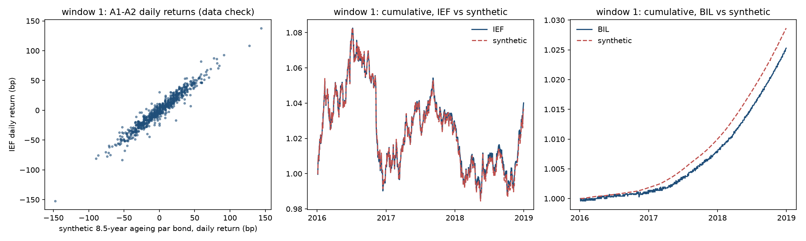
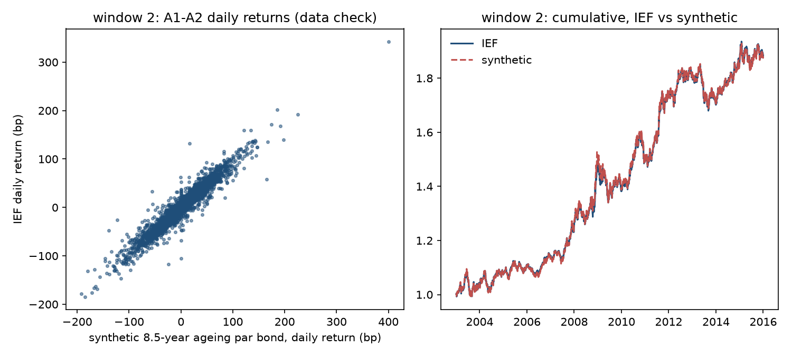

# Study 002 — Term-spread duration switch, re-tested with a roll-down-aware synthetic series (IEF vs BIL)

**Verdict: inconclusive — halted permanently at the data validation (§5.3) on 2026-10-22, before any rule was tested.** Under the pre-registered verdict table (Study 001 §9.5, inherited) a study that halts at validation is "inconclusive". The hypothesis (hold IEF when the 10-year minus 3-month spread is positive, bills otherwise; §1) was neither supported nor refuted: **no return of T1, T2, T3 or any benchmark was ever computed**, under this study or Study 001. `results/insample/` and `results/oos/` do not exist, and the out-of-sample window (2019-01 to 2026-09) was never touched.

What happened, in order (every step is a dated commit; times are London):

1. 2026-10-21, 23:2x: pre-registration committed (`64c3e36`) with the construction, the ex-ante bias table, the threshold rule, and a second validation window conditional only on data availability. No validation, no return.
2. 2026-10-22, 00:1x: the window-2 data decision (§5.3.4 steps 1–2). The second vendor's IEF series was fetched, checked against Alpaca over 2016–2018 (correlation 0.9996; mean difference +0.049% p.a., a pass by 0.6 bp against ±0.05%), and **window 2 was accepted** (`95c6939`, `45743fa`). The acceptance was committed before any synthetic series existed.
3. 2026-10-22, 04:28: code and tests committed (`a2b713b`; 131 tests, including the five §5.2 unit tests), then the `APPROVED` record and the trial-log entry (`9714ab6`). A first `reproduce.sh --validate` refused before computing anything because FRED served a maintenance page; a hash-checked reuse of Study 001's FRED files was added (`25a69a4`).
4. 2026-10-22, 04:31: `reproduce.sh --validate`, the single permitted run. **Window 1 passed all six checks. Window 2 passed A1, A2 and A4 and failed A3** (tracking error 2.016% p.a. against ≤ 1.5%). The study halted as §5.3.5 requires. Outputs committed untouched (`033a47b`).

Everything on this page is a backtest data comparison of instrument returns. Nothing here is a strategy result, a track record, or investment advice.

The question, hypothesis, construction, ex-ante bias estimate, thresholds and order of operations are fixed in [PREREGISTRATION.md](PREREGISTRATION.md) (and, for the sections it inherits, in [Study 001's](../001-slope-duration-switch/PREREGISTRATION.md)); they are not repeated here. The trial log is [trials.md](trials.md).

## Validation results (backtest data check, §5.3; not a performance test)

Instrument returns only, no rule applied. Daily, on the ETF's trading days, with the synthetic series compounded onto the same intervals. The ex-ante central estimate of §5.3.1 is shown next to the observed A4 as §5.3.5 requires.

### Window 1: 2016-01-04 to 2018-12-31, IEF and BIL from Alpaca (`adjustment='all'`), 753 days

| Check | Statistic | Threshold | Observed | Result |
|---|---|---|---|---|
| A1 | Correlation of daily returns, IEF vs synthetic | ≥ 0.95 | 0.970 | pass |
| A2 | OLS slope of IEF on synthetic | in [0.80, 1.05] | 0.940 | pass |
| A3 | Annualised tracking error, IEF vs synthetic | ≤ 1.5% p.a. | 1.159% | pass |
| A4 | Annualised mean difference, IEF − synthetic | in [−0.25%, +0.35%] p.a. (ex-ante centre **+0.05%**) | **+0.100%** | pass |
| B1 | Annualised mean difference, BIL − synthetic cash | within ±0.30% p.a. | −0.110% | pass |
| B2 | Annualised tracking error, BIL vs synthetic cash | ≤ 0.50% p.a. | 0.288% | pass |

D1 (descriptive, no decision weight), IEF minus synthetic by year against the roll-down the construction earned that year: 2016 −0.06% vs 0.53%; 2017 +0.15% vs 0.44%; 2018 +0.22% vs 0.15%. Source: `results/validation/window1/validation.json`.

### Window 2: 2003-01-02 to 2015-12-31, IEF from the second vendor (split- and distribution-adjusted close), 3,272 days

| Check | Statistic | Threshold | Observed | Result |
|---|---|---|---|---|
| A1 | Correlation of daily returns, IEF vs synthetic | ≥ 0.95 | 0.960 | pass |
| A2 | OLS slope of IEF on synthetic | in [0.80, 1.05] | 0.926 | pass |
| A3 | Annualised tracking error, IEF vs synthetic | ≤ 1.5% p.a. | **2.016%** | **FAIL** |
| A4 | Annualised mean difference, IEF − synthetic | in [−0.45%, +0.35%] p.a. (ex-ante centre **−0.05%**) | **−0.008%** | pass |

No cash check on this window (§5.3.4). Source: `results/validation/window2/validation.json`. The duration/convexity cross-check of the exact repricing (§5.2) agrees to 0.010 and 0.013 bp per day on average against an acceptance of 0.5 bp, so the bond arithmetic is not the problem.

### Reading of the failure (inferred; written after the run; not used to change anything)

**The level problem that halted Study 001 is solved.** Study 001's construction under-earned the ETF by 0.45% p.a. on 2016–2018 under two variants. This construction, with roll-down inside it, sits 0.10% p.a. below the ETF on that window against an estimate of 0.05% written before the comparison, and **on thirteen years the designer had never seen (2003–2015), where the roll-down term to get right was about 1.0% p.a. rather than 0.37%, the gap is −0.008% p.a. against an estimate of −0.05%.** The per-component bias table in §5.3.1 was, as far as the level goes, right.

**What failed is the tracking-error limit on window 2, and the reading is that the limit was specified for the wrong regime.** §5.3.2 kept A1–A3 "unchanged from Study 001 because they test tracking rather than level, they were met there by the 7/10 blend whose duration this construction matches, and changing them would be tuning". That reasoning never asked whether an *absolute* tracking error of 1.5% p.a., set against a window in which IEF's daily volatility was 4.6% p.a., should carry over to a window in which it averaged about 7% and reached 10% in 2008 and 2009. The post-hoc breakdown (`results/validation/window2/posthoc_by_year.md`, descriptive, reproducible with `posthoc_by_year.py`) shows:

| Period | Tracking error | Correlation | IEF volatility | TE / IEF vol |
|---|---|---|---|---|
| Window 1 (2016–2018) | 1.16% | 0.970 | 4.6% | 0.25 |
| Window 2 (2003–2015) | 2.02% | 0.960 | 6.9% | 0.29 |
| Window 2 without 2008–2009 | 1.76% | 0.962 | | |
| 2008 alone | 3.56% | 0.945 | 9.8% | 0.36 |
| 2011 alone | 2.81% | 0.940 | 8.2% | 0.34 |
| Calmest years (2005, 2012, 2014) | 1.36–1.37% | 0.962–0.970 | 4.9–5.6% | |

Relative to the ETF's own volatility the synthetic series tracked window 2 about as well as window 1, and the correlation check, which is scale-free, passed. The largest single-day gaps (about 90–115 bp on 2011-08-09, 2011-08-10, 2011-10-10, 2009-02-26 and three days in October 2008) fall on days of acute stress in the Treasury market, when an exchange-traded fund's closing price and a constant-maturity yield fixing can part company; that is the expected behaviour of the two series, not an error in either. Excluding 2008–2009 does not bring the window under the limit (1.76%), so the failure is not only the crisis: it is a limit that does not scale.

**Why the halt stands anyway.** §5.3.5 says that if any threshold fails the study halts permanently and no correction is allowed. A tracking limit that scaled with volatility would very likely have passed, and the author now knows that. That is exactly why it cannot be adopted here: a threshold changed after seeing the result is the thing this programme refuses to do, whatever the reason given. The study is halted. The reading above is recorded so that a successor can set its tracking thresholds by a rule stated before the data are seen, and so that the reader can judge whether the construction deserves another attempt.

## What did not work

- **A3 failed on window 2** (2.016% against ≤ 1.5% p.a.). The limit was transferred from a three-year, low-volatility window to a thirteen-year window containing the 2008 crisis without a rule for how a tracking error should scale, and §5.3.2 called the transfer "unchanged" as if that settled it. The strong test did its job, in a direction the design had not anticipated.
- **Everything else passed**, including the check this study was built to pass (A4, both windows). The construction's level is validated on sixteen years in two regimes. That is worth stating plainly because it is also the reason a reader might suspect the halt is excessive. The rule is the rule; see above.
- **The second-vendor check passed by 0.6 bp** (§5.3.4 step 2, +0.049% against ±0.05% p.a.). It was accepted as pre-registered and disclosed as narrow before the run. It does not bear on A3 (the vendors' daily returns differ by 0.13% p.a. in tracking error against Alpaca over 2016–2018, an order of magnitude below the gap that failed).
- **FRED served an HTML maintenance page** at both validation attempts, as it did during Study 001's. The first attempt refused before computing anything; the run then reused Study 001's FRED files of 2026-10-21 after a SHA-256 check against its manifest, recorded in `results/data_manifest.json`. The yields for 2003–2018 do not change between fetches, but a reader reproducing this should expect `reproduce.sh` to fetch fresh files when FRED is up.
- **Two unit-test tolerances were set too tight at first** (the roll-down approximation in §5.2 test (iv) at 0.1% relative, and a worst-day cross-check bound on toy yields that jump far more than real ones) and were loosened before the code was committed; the pre-registered 0.5 bp mean cross-check was never at issue (0.010 and 0.013 bp). Noted because the fix happened before validation and could otherwise look like tuning.

## Limitations of what can be concluded

- Nothing about the hypothesis. The slope rule may or may not work; two studies have now produced no evidence either way, and neither should be cited as a failure of the rule.
- The reading of A3 is post hoc. The year-by-year table was computed after the run, from the same series, to explain a result, and it has no decision weight.
- Window 2's ETF returns come from a second vendor whose distribution adjustment differs slightly from Alpaca's (+0.05% p.a. over the overlap). A4 on window 2 would read about 0.05% lower on Alpaca-convention returns; A3 is unaffected at the first decimal.
- The designer's prior knowledge now includes both windows' statistics under this construction, in addition to Study 001's. Any successor using the same construction and windows must disclose that its tracking thresholds were set knowing 2.016% and 0.960.

## What a successor would need

A new pre-registration (a new study number), not an amendment here. Three routes, with their trade-offs, for the orchestrator to decide and record in the workspace decision log:

1. **Same construction, tracking thresholds set by a stated rule that scales with the window** (for example, tracking error relative to the ETF's realised volatility, or correlation alone, both of which passed here). Cheapest; keeps 1969–2018 in-sample. Its weakness is disclosed above: the designer knows what the rule must clear, so the validation would be a formality and the note would have to say so. The out-of-sample window would still be clean.
2. **Primary test on actual ETF history (IEF from 2002, BIL from 2007, with a bill proxy before), synthetic series as a secondary, lower-weight analysis.** Removes the fidelity gate from the critical path entirely. Costs 33 years of history and most of the yield-curve inversions; the in-sample test would have low power and the criteria would need to be re-derived for it.
3. **A different question** in the programme's second strand (fixed income and macro), leaving the term-spread question with the two halt notes and a validated construction for later.

The question in §1 stands. The construction in §5.2 is, on the evidence of two windows, a sound synthetic history for the level of 7–10-year Treasury ETF returns; its day-to-day tracking in stressed markets is what a successor has to decide how to judge.
