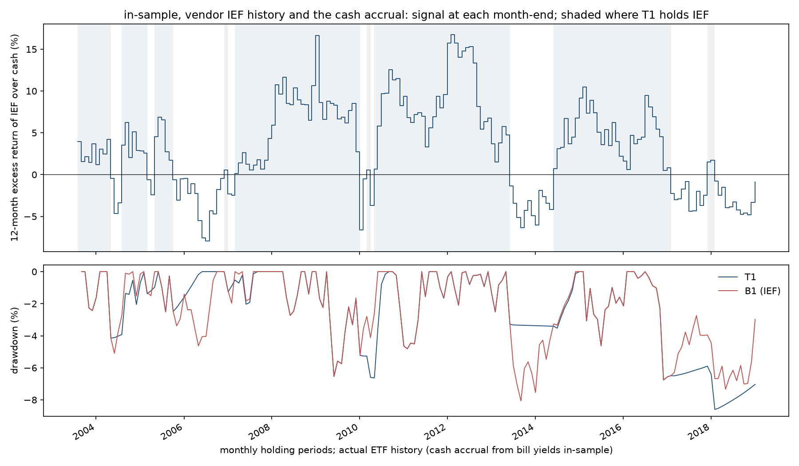

# Study 003 — Time-series momentum in intermediate Treasuries (IEF vs BIL)

**Verdict: not supported** (pre-registered table, Study 001 §9.5, inherited; published 2026-10-22). **In-sample (2003-08 to 2018-12, 185 monthly holding periods) the rule did not beat its benchmarks:** holding IEF only when its trailing 12-month return exceeded bills (T1) earned an annualised Sharpe ratio of 0.45 after costs, against 0.55 for buy-and-hold IEF (B1) and 0.55 for the constant mix with the same average IEF exposure (B3); criteria **C1 and C2 fail**, C3 passes by 0.001, C4 passes. **Out-of-sample (2019-01 to 2026-09, 93 months, run once) both sign conditions hold:** T1's Sharpe ratio was 0.16 against −0.26 for B1 and B3, its daily maximum drawdown −6.5% against −23.9%, because it held bills for the 42 months from February 2021 to July 2024 and sat out the 2022 sell-off. Under the pre-registered table a failure of any in-sample criterion is "not supported", and the precedence rule fixed before any result (not supported > inconclusive > supported) decides. The out-of-sample window went the rule's way on the one episode it exists for, with a t-statistic of 1.3; the table was written so that the author could not re-weight the criteria after seeing that, and this note does not.

The in-sample test was **not** low-powered by the pre-registered standard (§9.6): T1 switched 18 times (the author's prior was 10–20) and was in cash in 31% of months (prior 20–35%). The question was answerable on that sample, and the answer on that sample is no. The forward paper-trading record (§11) is the only clean test left, and it starts after Independent Risk clearance.

Everything on this page is a backtest on historical ETF prices and bill yields. Nothing here is a track record, a forecast or investment advice. The question, hypothesis, benchmarks, costs, criteria and order of operations are fixed in [PREREGISTRATION.md](PREREGISTRATION.md) (and, for the sections it inherits, in [Study 001's](../001-slope-duration-switch/PREREGISTRATION.md)); they are not repeated here. The trial log is [trials.md](trials.md).

What happened, in order (every step is a dated commit; times are London):

1. 2026-10-22, 06:2x: pre-registration committed (`b7f7b63`): question, hypothesis, the three trials, the ex-ante estimate for the one modelled series (the cash accrual), every data-check branch. No fetch, no check, no return.
2. 2026-10-22, 06:27: BIL vendor decision (§5.3.2): second-vendor BIL fetched (`521e033`), overlap against Alpaca 2016–2018 passed on the single pre-registered threshold (mean difference −0.0001% p.a. against ±0.05%), vendor accepted (`e03064d`).
3. 2026-10-22, 08:30: engine and 92 tests committed (`987b161`), including the six engine checks of §5.3.4; `APPROVED` and the pre-run trial-log row (`8076ecc`).
4. 2026-10-22, 08:31: data checks D0 and D2, the single run: **both passed** (`5dfe8cf`). D0: the vendor IEF file covers all 4,134 NYSE trading days of the in-sample period. D2: BIL minus the cash accrual over 2007-06 to 2018-12 is +0.037% p.a. against a ±0.30% gate and an ex-ante estimate of 0.00 ± 0.20.
5. 2026-10-22, 08:32: T1–T3 run dates logged (`106696e`), then `reproduce.sh --insample`, the single in-sample run. Results below.
6. 2026-10-22, 08:37: the in-sample section of this note committed (`7e44a4c`), then `reproduce.sh --oos`, the single out-of-sample run. Results below. The window had never been touched by any study.

## Data checks (§5.3; backtest data check, not a performance test)

| Check | Statistic | Threshold | Observed | Result |
|---|---|---|---|---|
| D0 | Vendor IEF bars on NYSE trading days 2002-07-31 to 2018-12-31; first bar | all days, ≤ 3 consecutive missing; first bar ≤ 2002-07-31 | 4,134 of 4,134; longest gap 0; first bar 2002-07-26 | pass |
| D2 / B1 | Annualised mean difference, BIL − cash accrual, 2007-06-04 to 2018-12-31 (2,916 days) | within ±0.30% p.a. (ex-ante **0.00 ± 0.20**) | **+0.037%** | pass |
| D2 / B2 | Annualised tracking error of the same difference | descriptive; reference 0.50%, 2016–2018 reading 0.288% | 0.586% | descriptive |

B2 is above its historical reference, and the by-year table in `results/checks/data_checks.md` shows why: 0.90% in 2007, 1.56% in 2008, 0.68% in 2009, then 0.21–0.31% in every year from 2010. The level by year moved the other way to what the daily noise might suggest: +0.26 to +0.32% p.a. in 2007–2009 while bill rates fell fast (the fund's portfolio yield lagged the spot rate) and −0.07 to −0.12% in 2016–2018 while they rose, both signs inside the ex-ante band and the pattern the largest component of the §5.3.3 table described in advance. This is the regime effect that made B2 descriptive rather than a gate in this study (§2.5), decided before the number was seen. Source: `results/checks/data_checks.json`; chart `results/checks/cash_check.png`.

## In-sample results (§8.1; 2003-08-01 to 2019-01-02; base costs 2 bp per side)

Instruments: IEF from the vendor's adjusted close throughout (one vendor, no splice), cash from the §5.2 accrual. Every execution date fell on a bar (no slippage logged). The B3 weight, frozen here for the out-of-sample run, is **w = 0.692** (T1 held IEF in 128 of 185 months).

| | Ann. return | Ann. vol. | Sharpe | Max DD (monthly) | Max DD (daily) | Hit rate (excess > 0) | Switches | Share in IEF |
|---|---|---|---|---|---|---|---|---|
| **T1** 12-month excess return sign | 3.66% | 5.82% | **0.452** | −8.6% | −10.4% | 0.39 | 18 | 0.69 |
| T2 12-1 | 3.34% | 5.72% | 0.406 | −8.6% | −10.4% | 0.37 | 24 | 0.67 |
| T3 10-month moving average | 2.76% | 5.47% | 0.318 | −10.1% | −12.4% | 0.37 | 37 | 0.68 |
| B0 cash | 1.14% | 0.47% | — | −0.4% | | | | 0 |
| B1 buy-and-hold IEF | 4.51% | 6.27% | **0.555** | −8.1% | −10.4% | 0.57 | 0 | 1 |
| B2 50/50 rebalanced | 2.86% | 3.15% | 0.554 | −4.1% | | 0.57 | | 0.5 |
| B3 constant mix, w = 0.692 | 3.50% | 4.34% | **0.554** | −5.6% | | 0.57 | | 0.69 |

Source: `results/insample/metrics_base.csv`, `summary.json`. Sharpe ratios are of monthly returns in excess of B0, annualised by √12. The daily maximum drawdown is from daily indices inside the holding periods (§9.3 item 4).

### Inference (§9.3 items 7–9) and criteria (§9.5), T1

| | vs B1 (buy-and-hold) | vs B3 (same exposure, no timing) |
|---|---|---|
| Mean monthly return difference, annualised | −0.85% p.a. | **+0.23% p.a.** |
| Newey–West t (6 lags) | −1.47 | **0.37** |
| Ledoit–Wolf Sharpe difference (annualised), bootstrap p | −0.103, p = 0.24 | −0.103, p = 0.24 |

T1's annualised Sharpe ratio has a stationary-bootstrap 95% interval of [0.02, 0.83]. The Sharpe difference against B1 and against B3 is the same number because B3 is a constant mix of B1 and cash, which leaves the Sharpe ratio of excess returns unchanged; that is the point of B3, and it is why C1 asks for a margin above both.

| Criterion | Requirement | Observed | Result |
|---|---|---|---|
| C1 | Sharpe(T1) ≥ Sharpe(B1) + 0.10 and ≥ Sharpe(B3) + 0.10 | 0.452 vs 0.655 and 0.654 | **FAIL** |
| C2 | Newey–West t of T1 − B3 ≥ 2.0 | 0.37 | **FAIL** |
| C3 | Deflated Sharpe ratio at N = 3 ≥ 0.95 | 0.951 (PSR 0.968; at N = 10: 0.932) | pass (by 0.001) |
| C4 | Sign of mean(T1 − B3) unchanged at 4 bp per side | +0.23% → +0.18% p.a. | pass |

Deflation inputs: variance of monthly Sharpe ratios across the three trials 0.000256 (floor not applied); expected maximum Sharpe (monthly) 0.0137 at N = 3, 0.0252 at N = 10. C3 is a statement that T1's Sharpe is distinguishable from zero after the three-trial search, not that it beats anything; with C1 and C2 failed it carries no weight in the verdict.

T2 and T3 against the same criteria: T2 fails C1, C2 and C3 (DSR 0.929), passes C4; T3 fails C1, C2 and C3 (DSR 0.866), passes C4. T3 is the only trial whose return is lower than B1's at conventional significance (Newey–West t −2.23 against B1; Ledoit–Wolf p = 0.058). Under the stress cost case (4 bp per side) every number moves by a few hundredths and no conclusion changes (`metrics_stress.csv`); the switching cost of T1 was about 5 bp p.a. in the base case.

### Mechanism (§9.6, descriptive)

The rule can add value only in the months it is out of IEF. There were 57 such months in 9 episodes (mean length 6.3 months). In those months IEF returned 0.38% per month on average and cash 0.16%: **the months the rule stepped aside were, on average, months in which IEF beat cash by 0.22% per month**, and cash beat IEF in only 42% of them. Episode by episode (IEF total return minus cash over the episode, from the holding-period returns):

| Cash episode (signal months) | Length | IEF − cash over the episode |
|---|---|---|
| 2004-04 to 2004-06 | 3 | +1.20% |
| 2005-02 to 2005-03 | 2 | +1.75% |
| 2005-09 to 2006-10 | 14 | **−0.12%** |
| 2006-12 to 2007-01 | 2 | +0.70% |
| 2009-12 to 2010-01 | 2 | +2.57% |
| 2010-03 | 1 | +1.60% |
| 2013-05 to 2014-04 | 12 | +0.11% |
| 2017-01 to 2017-10 | 10 | +2.04% |
| 2018-01 to 2018-11 | 11 | +2.21% |

Only the 2005–2006 episode, the long hiking cycle the hypothesis is built on, saw cash hold its own against IEF, and only by 0.12%. The two long episodes of 2017 and 2018 (the normalisation) each forwent about 2% as IEF's coupon outran its price decline. The whipsaw episodes of 2004, 2005, 2006–07 and 2009–10 each cost a rally. T1's three worst months (2016-10, 2004-03, 2009-11; −4.6%, −4.2%, −3.6%) are IEF's three worst months: the rule was long in every one of them. The supervisory-stop descriptive of §11.4 (IEF closing 5% below its entry close inside a holding period) was touched in 0 of 185 periods.

### Sub-periods (§9.6, descriptive; by execution month)

| Period | T1 Sharpe | B1 Sharpe | B3 Sharpe | T1 share in IEF | T1 switches |
|---|---|---|---|---|---|
| 2003-08 to 2008-12 (hiking cycle and crisis), 65 months | 0.575 | 0.653 | 0.652 | 0.68 | 9 |
| 2009-01 to 2015-12 (zero lower bound and QE), 84 months | 0.553 | 0.621 | 0.621 | 0.82 | 6 |
| 2016-01 to 2018-12 (normalisation), 36 months | −0.208 | 0.122 | 0.122 | 0.42 | 3 |

T1 trailed B1 and B3 in all three sub-periods. The normalisation, the regime in which a momentum rule on Treasuries is supposed to earn its keep, is where it did worst: in cash for 58% of the months while IEF still returned 1.44% p.a. against 0.95% for cash. T3 was the only trial with a positive Sharpe there (0.284), on 8 switches in 36 months; it was the worst of the three overall.

### Power statement (§9.6, pre-registered)

18 switches (prior 10–20); 30.8% of months in cash (prior 20–35%); 9 cash episodes. The in-sample test is labelled **as registered**, not low-powered: the signal changed sign often enough for C2 to have been reachable, and the prior in §2.4 was accurate. The failure of C1 and C2 is therefore a result, not an artefact of too few switches.

## What did not work

- **The hypothesis, on this sample.** The sign of IEF's past 12-month excess return did not predict the sign of its next month's excess return well enough to beat holding the average exposure without timing: +0.23% p.a. against B3 with a t-statistic of 0.37, and −0.85% p.a. against buy-and-hold. Huang, Li, Wang and Zhou's (2020) objection in §2.3, that time-series momentum on a single asset is mostly the asset's drift, is what the exposure-matched benchmark was built to test, and on 2003–2018 it is what the data say.
- **The cash months were the wrong months.** The mechanism check is the clearest statement of the failure: IEF beat cash in 58% of the months the rule held cash, by 0.22% per month on average. The rule exited after sell-offs that had already happened (2013, 2017, 2018) and re-entered after rallies that had already happened (2004, 2005, 2010).
- **The canonical variants did worse, not better.** Skipping the most recent month (T2) and the 10-month moving average (T3) each switched more often and earned less; T3 is below buy-and-hold at conventional significance. The conclusion does not depend on the exact trend definition.
- **Tails were not reduced.** The rule's excess returns have higher kurtosis than IEF's (7.3 against 5.5) and the same three worst months, because it was long in each of them. The drawdown protection a trend rule is supposed to offer did not show up in fifteen years of monthly data; whether it shows up in the one episode the out-of-sample window holds (2022) is what §8.2 will report, once, without changing the in-sample verdict.
- **C3 passed by 0.001.** Had it failed the note would say the same thing; it is recorded because a reader checking the criteria against `summary.json` should not take it as support.
- **Nothing in the engineering failed.** No execution date slipped, D0 and D2 passed with the level inside the ex-ante band, the switching cost was 5 bp p.a. Two test tolerances were fixed before the code was committed (a test compared an unresolved with a resolved schedule; a sub-period count included the schedule row that starts no holding period); both were errors in the tests, found by the tests, before any data were touched. Noted so that they are not mistaken for tuning.

## Limitations of what can be concluded (in-sample)

- One asset, fifteen years, three or four rate cycles, a secular bull market in Treasuries. The result is about a long-only, unlevered, single-asset sign rule on IEF; it says nothing about the published multi-asset, volatility-scaled strategies, and it should not be cited as a refutation of time-series momentum in general.
- The in-sample cash leg is modelled (the §5.2 accrual), with a level within 0.04% p.a. of actual BIL over 2007–2018; a level error of that size moves T1's annualised return by about a basis point. The out-of-sample window uses actual BIL.
- The vendor's adjusted close carries a known +0.05% p.a. offset against Alpaca's convention (Study 002 §5.3.4); it is immaterial to a sign rule and applies equally to T1 and B1.
- The author knew the broad history of US rates before designing the study (§2.4). The rule has no parameter, so that knowledge could not be used to tune it; it could have been used to choose the question, and the pre-registered power statement exists so that the reader can judge whether the sample was adequate (it was).

## Out-of-sample results (§8.2; 2019-01-02 to 2026-10-01, 93 holding periods; run once; base costs)

Instruments and signal entirely from Alpaca `adjustment='all'` bars (Study 001's fetch, SHA-256 verified); B3 weight frozen at 0.692 from in-sample. Every execution date fell on a bar. The in-sample section above was committed before this run (`7e44a4c`); `results/oos/` was written once and `reproduce.sh --oos` now refuses.

| | Ann. return | Ann. vol. | Sharpe | Max DD (monthly) | Max DD (daily) | Hit rate (excess > 0) | Switches | Share in IEF |
|---|---|---|---|---|---|---|---|---|
| **T1** 12-month excess return sign | 3.21% | 3.89% | **0.157** | −5.5% | **−6.5%** | 0.20 | 10 | 0.41 |
| T2 12-1 | 2.58% | 4.20% | 0.002 | −11.3% | −11.6% | 0.19 | 12 | 0.42 |
| T3 10-month moving average | 1.36% | 4.80% | −0.241 | −14.4% | −15.2% | 0.24 | 16 | 0.62 |
| B0 cash (actual BIL) | 2.66% | 0.59% | — | −0.2% | | | | 0 |
| B1 buy-and-hold IEF | 0.45% | 7.39% | **−0.259** | −22.2% | **−23.9%** | 0.44 | 0 | 1 |
| B2 50/50 rebalanced | 1.61% | 3.74% | −0.259 | −10.8% | | 0.44 | | 0.5 |
| B3 constant mix, w = 0.692 | 1.18% | 5.14% | **−0.259** | −14.9% | | 0.44 | | 0.69 |

Cumulative over the 93 months: T1 +27.7%, cash +22.5%, B3 +9.5%, B1 +3.5%. Source: `results/oos/metrics_base.csv`, `summary.json`.

| T1 | vs B1 | vs B3 |
|---|---|---|
| Mean monthly return difference, annualised | +2.51% p.a. | **+1.93% p.a.** |
| Newey–West t (6 lags) | 1.29 | **1.31** |
| Ledoit–Wolf Sharpe difference (annualised), bootstrap p | +0.42, p = 0.33 | +0.42, p = 0.33 |

| Criterion | Requirement | Observed | Result |
|---|---|---|---|
| O1 | mean(T1 − B3) > 0 | +1.93% p.a. (t = 1.31) | holds |
| O2 | Sharpe(T1) > Sharpe(B1) | 0.157 > −0.259 | holds |
| Drawdown clause ("not supported" if T1's out-of-sample maximum drawdown exceeds B1's) | | −6.5% vs −23.9% | not triggered |
| **Verdict for T1** | supported needs C1–C4 and O1–O2 all to hold | C1, C2 failed in-sample | **not supported** |

O1 and O2 also hold for T2 and T3. The deflated Sharpe ratio of T1 on this window is 0.52 at N = 3 (descriptive; it is not an out-of-sample criterion). Stress costs change nothing (`metrics_stress.csv`). Two reported intervals for T1 came out NaN (the stationary-bootstrap Sharpe interval and the Ledoit–Wolf interval): T1's excess return over cash is exactly zero in 50 of 93 months because it held the cash benchmark itself, and a bootstrap resample drawn only from those months has no Sharpe ratio. The point estimates, t-statistics and p-values are unaffected. Dropping the degenerate resamples (1 of 10,000 and 4 of 10,000) gives [−0.70, 0.95] for T1's annualised Sharpe and [−0.46, 1.43] for the Sharpe difference against B3; computed post hoc by `posthoc_bootstrap_nan.py` into `results/oos/posthoc_bootstrap_nan.md`, with the published files untouched.

### Mechanism (§9.6, descriptive)

55 cash months in 6 episodes (mean length 9.2 months). In those months IEF returned −0.1% per month on average and cash +0.2%; cash beat IEF in 60% of them. Episode by episode (IEF total return minus cash over the episode; T1's own return over the episode):

| Holding | Signal months | Length | IEF − cash | T1 |
|---|---|---|---|---|
| IEF | 2019-01 to 2021-01 | 25 | +12.3% | +14.5% |
| **BIL** | **2021-02 to 2024-07** | **42** | **−19.0%** | **+10.1%** |
| IEF | 2024-08 to 2024-11 | 4 | −5.4% | −3.9% |
| BIL | 2024-12 to 2025-03 | 4 | +3.0% | +1.3% |
| IEF | 2025-04 to 2025-06 | 3 | +0.3% | +1.3% |
| BIL | 2025-07 to 2025-09 | 3 | +0.8% | +1.0% |
| IEF | 2025-10 to 2026-02 | 5 | −1.5% | 0.0% |
| BIL | 2026-03 to 2026-04 | 2 | −0.9% | +0.6% |
| IEF | 2026-05 | 1 | −0.1% | +0.1% |
| BIL | 2026-06 to 2026-08 | 3 | −4.9% | +0.9% |

The whole of T1's out-of-sample advantage is one decision: the signal turned negative at the January 2021 month-end, the rule went to bills on 2021-02-01 and stayed there until 2024-08-01, through a 19-percentage-point shortfall of IEF against cash. Outside that episode the rule was whipsawed (it re-entered IEF in August 2024 and lost 3.9% in four months; it missed a 3-point rally in bills in early 2025) and ended roughly level with cash. The 10 switches and 59% of months in cash are outside the in-sample prior (10–20 switches; 20–35% in cash), as the window's composition (a rally, then the largest sell-off in IEF's history, then a range) would lead one to expect; §8.3 said in advance that this window would be decided by one episode, and it was. At the September 2026 month-end the signal was −7.4% and all three trials were in bills for October 2026.

## What did not work (continued, out-of-sample)

- **The out-of-sample window went the rule's way and the verdict is still "not supported".** That is the pre-registration working as designed, not a failure of the data: C1 and C2 were in-sample conditions on a sample that had enough switches to answer them, and they were not met. A reader who weights 93 months with one decisive episode above 185 months with 18 switches would call this inconclusive or better. The author wrote the table so as not to be able to become that reader after seeing the numbers.
- **One episode.** T1's edge out-of-sample is the single exit of February 2021. A t-statistic of 1.3 on 93 months cannot distinguish the rule from a lucky exit, and a 42-month stretch in cash is also what a rule with no information would have produced if it had happened to exit then. Study 001 §9.5 says what this window can and cannot establish; it is the reason "inconclusive" exists in the table, and in this study it did not get the chance to apply.
- **Whipsaw outside the episode.** The August 2024 re-entry cost 3.9% in four months; the early-2025 exit missed a 3-point rally. Net of the big episode the rule did about as well as cash and worse than it would have by staying in bills throughout the range.
- **Two confidence intervals were undefined** for a reason the inherited statistic did not anticipate (a strategy that holds the cash benchmark for most of a window). Disclosed above with the post-hoc values; a successor should define the Sharpe ratio of a zero-variance resample before running.

## Limitations of what can be concluded (continued)

- The out-of-sample result rests on one episode, and the author knew before designing the study that the window contained it (§2.4, §8.3). The window was inherited from Study 001, fixed on 2026-10-21 for a different hypothesis, and never touched before this run; that is the protection, and it is disclosed rather than claimed to be complete.
- "Not supported" is a statement about the pre-registered claim (a Sharpe margin of 0.10 over an exposure-matched benchmark on 2003–2018, confirmed in sign on 2019–2026). It is not a statement that the rule is worthless: on the one sell-off in its history it did what it is meant to do. Both halves of that sentence are in the tables above.

## Paper trading (§11, §8.4)

The verdict does not switch off the paper-trading plan: §11 starts it at the first scheduled signal date after publication, and the forward record is the only test that no one has seen. It begins only after Independent Risk clearance is recorded in `RISK_CLEARANCE.md` in this folder (§12). The next signal date is the last NYSE trading day of October 2026, with execution on the first NYSE trading day of November; the starting position is BIL. Every decision record and fill goes to `paper-log/`, never backdated. Nothing is traded with real money.

## Reproduce

From this folder, with the repository's virtual environment (`requirements.txt`) and an `APPROVED` file present: `./reproduce.sh --check`, `./reproduce.sh --insample`, `./reproduce.sh --oos` (refuses if `results/oos/` exists). Vendor data are not redistributed; the script re-fetches DTB3 from FRED and reuses the ETF files by hash when the vendor credentials are absent. `python -m pytest` runs the 92 engine tests on constructed data only.
