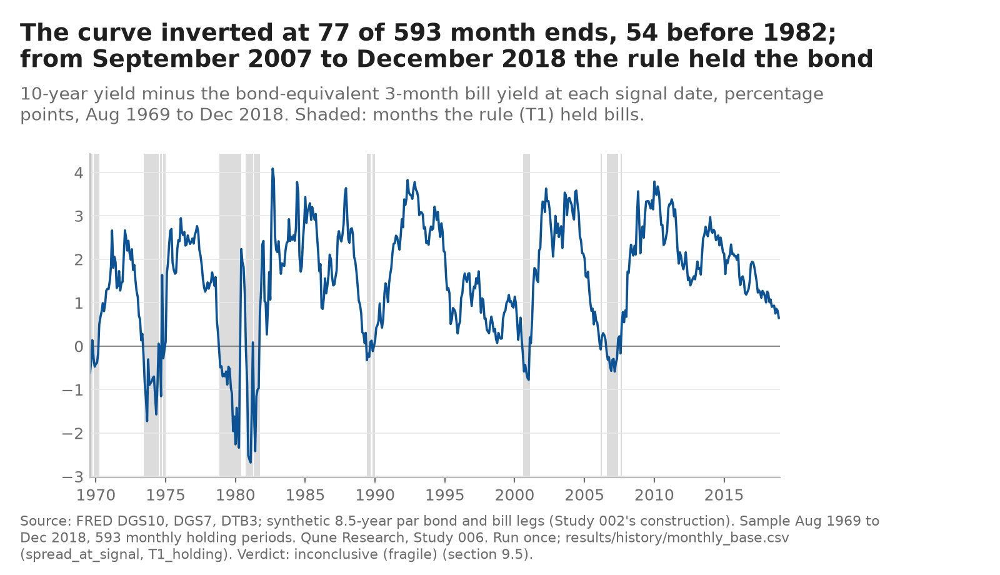
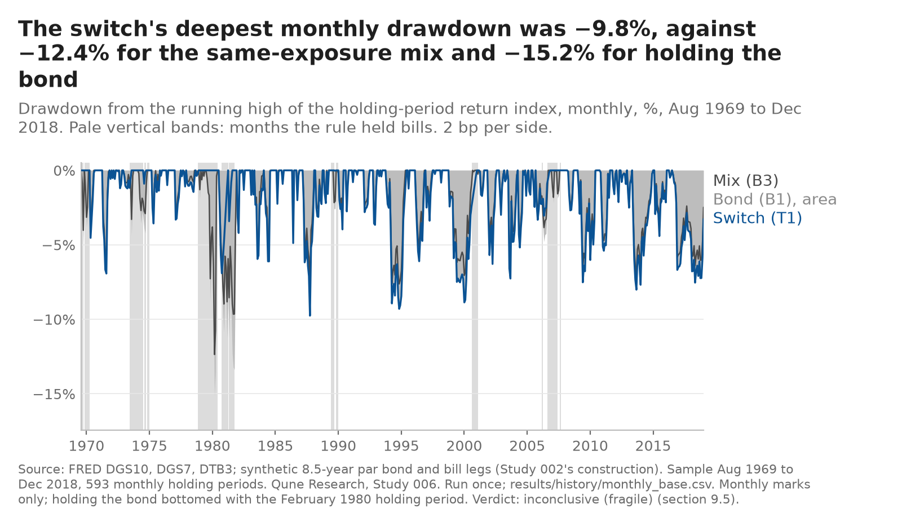
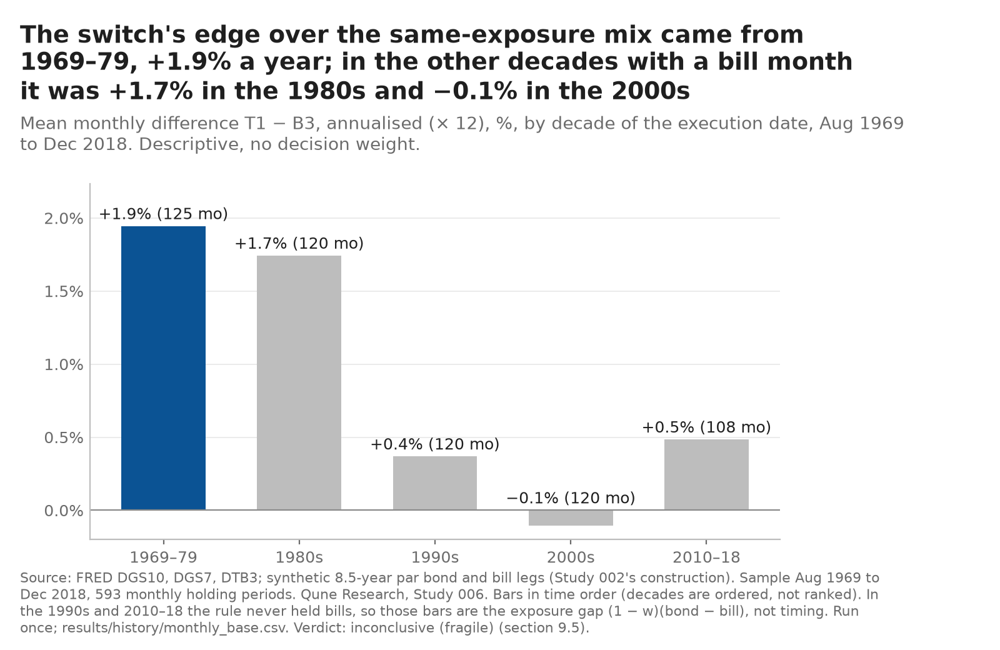

# Study 006 — Term-spread duration switch on the long history (1969–2018)

**In one screen** (added 2026-10-26 after the [second cold read](../../COLD_READ.md#second-cold-read-2026-10-26), points 3, 4 and 10; the note below it is unchanged, and the operational detail stays there)

- **Verdict:** inconclusive (fragile): T1 cleared the t ≥ 2.0 bar by 0.06 and its two registered variants missed it (t 1.97 and 1.91).
- **Effect (post hoc, descriptive; [`tools/effect_lines.txt`](../../tools/effect_lines.txt)):** edge over the exposure-matched mix B3 **+0.90% a year, 95% interval +0.04% to +1.76%**, 593 months; 86% of it earned by 1985.
- **Where it came from:** the rising-rate years 1969–1981; from 1982 to 2008 the rule lagged holding the bond, and from 2009 it simply held the bond. Doubling costs to 4 bp moved t from 2.06 to 2.01 (0.55 switches a year).
- **Limits:** one of three signals tried in turn on one synthetic 7–10-year leg and one window (Studies 006–008), now declared spent for duration timing, so the three are one in-sample look at one sample ([RESEARCH_AGENDA.md](../../RESEARCH_AGENDA.md), 2026-10-26); **the leg's fidelity before 2003, where most of the gain sits, is unmeasured** (the gate compares it with IEF over 2003–2018 only); costs are the ETF era's (2 bp a side, 4 bp stress) across every decade, which is optimistic for the 1970s and was not stated before; turnover is low, but costs several times higher were not tested; the deflated Sharpe ratio (C3) passes easily at these trial counts and sample lengths (it passed for every primary rule here, including 008's, which failed everything else), so read it as descriptive ([METHODS §2.1](../../METHODS.md)).
- **What would change the view:** only data the rule has not seen. The forward record (from 2026-10-30, scored once after 60 months) can see about 3% a year and may read "not testable" while the curve stays upright (Next, item 4); the pooled forward check of 006–008 ([Study 009](../009-pooled-forward-duration-timing/PREREGISTRATION.md)) can see about 1% to 2.75% a year. Neither can reliably see an edge of 0.9% a year.

**Verdict: inconclusive (fragile)** (pre-registered row, §9.5; history run once on 2026-10-25). *Gate redesigned after Study 002's halt ([cold read](../../COLD_READ.md), point 7).* The rule holds an intermediate Treasury position (a synthetic 8.5-year bond) when the 10-year minus 3-month spread is positive at month end and synthetic bills otherwise. **Over 593 months, August 1969 to December 2018, the primary rule T1 met all four pre-registered criteria**: Sharpe 0.463 against 0.338 for holding the bond (B1) and 0.338 for the same average exposure held throughout (B3, w = 0.870); Newey–West t of the monthly difference to B3 **2.06** (+0.075% a month, about 0.9% a year); deflated Sharpe ratio 0.999 at N = 3; the sign unchanged at double costs (t 2.01). **The two registered variants did not**: the 21-day average of the spread (T2) and the carry-with-roll-down signal (T3) reached t 1.97 and 1.91 against the 2.0 bar, so by the fragility rule written before the run the result is not called supported. The volatility check passed (σ 7.75% a year against a 10.18% bar), so this is not a "low-power" label: the test could see an edge of about 1.5% a year; it could not see one of 1% or less.

**Read this before the numbers.** The verdict is a near miss in both directions: T1 cleared t = 2.0 by 0.06 and its variants missed it by 0.03 and 0.09. Most of the advantage comes from one regime, the rising-rate years 1969–1981 (T1 Sharpe 0.105 against −0.271 for holding the bond); from 1982 to 2008 the rule lagged holding the bond (0.599 against 0.629), and from 2009 to 2018 the curve never inverted at a month end, so the rule simply held the bond. The author knew before the run that the curve inverted in the late 1970s and early 1980s and that rates were most volatile then (§2.4 of the pre-registration). No paper order; the only clean test is the forward record, which starts at the 2026-10-30 month end and is scored once after 60 months, when it can see an edge of about 3% a year (§11.4). Published 2026-10-25; the 2019–2026 episode (no decision weight) and a separate-session recomputation follow.

Everything on this page is a backtest on synthetic constant-maturity series built from FRED yields, after costs. Nothing here is a track record, a forecast or investment advice. The question, the trials, the benchmarks, the criteria, the gate, the volatility bar and the order of operations were fixed in [`PREREGISTRATION.md`](PREREGISTRATION.md) before any file was read (`a67ef8d`); the trial log is [`trials.md`](trials.md).

What happened, in order (every step is a dated commit; times are London, which left BST at 02:00 on this date, so London equals UTC):

1. 2026-10-25, 00:1x: the power bar committed first ([`tools/power_candidate6.txt`](../../tools/power_candidate6.txt), `21f850b`): the test counts only if the duration leg's excess-return volatility is at most 10.18% a year. 01:1x–01:4x: question note (`07962f7`, `1f20f16`).
2. 02:1x–02:20: pre-registration and trial log pushed before any file was read (`a67ef8d`). 02:21: data step, seven files copied from Studies 002 and 004 after a SHA-256 match, dates only (`edec076`).
3. 02:2x–03:2x: code and tests (`e505e28`, `a693069`, `2f1884f`): Study 002's construction, signal, calendar, engine and statistics copied unchanged (14 of 16 modules syntax-identical to `a2b713b`; checked by [`src_provenance.py`](src_provenance.py)); the gate, the volatility check, the history and episode wrappers new; 163 tests. Two §16 clarifications before any run, the second on a sub-period month convention in the copied code (below).
4. 03:22: `APPROVED` and the gate's trial-log row, pushed (`392b7e1`); then **the gate, run once: PASS** (`8286e25`).
5. 03:23: the volatility check's row (`ff50d9f`), then **the volatility check, run once: σ 7.75%, criteria stand** (`9e9d9b5`).
6. 03:23–03:24: T1–T3 run dates and the programme-family re-count logged and pushed (`abb7023`); then **the history run, once** (03:24:57Z), committed as written (`662630c`).
7. This note: the publication (the commit carrying this line). *Precision, added 2026-10-25 07:4x GMT: 03:27 London, `3663b77`.*
8. 2026-10-25, 03:29: the episode, run once (`94be69f`). 04:2x: forward-record code (`016fa69`). 04:26: charts (`b868f5d`); 05:22: charts after the Tester chart check (`2d0889a`, `6d32efb`). 07:18–07:35 GMT: separate-session recomputation published (`REVIEW.md`, §14 step 10): **confirmed with findings, no must-fix**; answered in the Independent review section below.

## The gate (§5.3; instrument returns and the signal path only, no rule return)

The gate asks how much error the synthetic series puts into the quantity the verdict rests on, the monthly differential T1 − B3, over the 192 months in which an ETF exists to compare with (2003–2018): e_t = (h_t − w)·g_t, where h_t is T1's holding and g_t the synthetic-minus-ETF gap in the duration-over-cash return. A gap that is constant cancels in e; only a gap that coincides with the rule's positions moves the decision.

| Check | Observed | Bound | Result |
|---|---|---|---|
| G1, bias: \|mean(e)\| × 12 | 0.008% a year | ≤ 0.18% | pass |
| G2, noise: sd(g) / sd(x_ETF) | 0.131 | ≤ 0.32 | pass |

Beside it, no decision weight: level gap mean(g) × 12 0.002% a year; corr(g, x_ETF) 0.223; 2003–2007 G1 0.064%, G2 0.115; 2008–2018 G1 0.000%, G2 0.138. Full output: [`results/gate/gate.md`](results/gate/gate.md). **What the pass does not show:** T1 held the bond in every period from 2008 to 2018, so the bias check rests on the 12 cash months of 2003–2007, one inversion episode; G2's bound assumed g uncorrelated with the differential and the observed correlation with x_ETF is 0.22, so that bound is approximate; G2 was expected to pass (§5.3.5); and before 2003 there is no ETF, so fidelity in 1969–2002 is an assumption, not a measurement.

## Results: the test window, 1969-08 to 2018-12 (593 months, synthetic legs, base costs 2 bp a side)

| | T1 (spread sign) | T2 (21-day mean) | T3 (carry) | B1 (hold the bond) | B3 (same exposure, w 0.870) | B2 (50/50) |
|---|---|---|---|---|---|---|
| Annual return (geometric) | 7.98% | 7.94% | 7.99% | 7.31% | 7.03% | 6.15% |
| Sharpe ratio | 0.463 | 0.463 | 0.468 | 0.338 | 0.338 | 0.338 |
| Deepest monthly drawdown | −9.8% | −9.8% | −9.8% | −15.2% | −12.4% | −4.3% |
| Mean difference to B3, a month | +0.075% | +0.072% | +0.076% | | | |
| Newey–West t to B3 (C2 ≥ 2.0) | **2.06** | **1.97** | **1.91** | | | |
| Newey–West t to B1 | 1.16 | 1.09 | 1.09 | | | |
| DSR at N = 3 (C3 ≥ 0.95) | 0.999 | 0.999 | 0.999 | | | |
| t to B3 at stress costs (4 bp) | 2.01 | 1.94 | 1.86 | | | |
| C1 / C2 / C3 / C4 | pass / pass / pass / pass | pass / **fail** / pass / pass | pass / **fail** / pass / pass | | | |

T1 switched 27 times (0.55 a year; the low-powered label applies below 8) and held the bond in 87.0% of months. Its stationary-bootstrap 95% interval for the Sharpe ratio is [0.21, 0.71]; the Ledoit–Wolf test of its Sharpe ratio against B3's gives p = 0.097 (descriptive, §9.3). The deflated Sharpe ratio at N = 10 is 0.997; the programme-level family count (§9.4: every trial of a term-spread or curve-slope duration rule whose return had been seen, in the desk's registry and the public trial logs) is this study's three trials, so the family figure equals the N = 3 figure; the three trials' Sharpe ratios are so close that the variance floor was applied. The observed ratio of the Newey–West to the i.i.d. standard error of T1 − B3 is **0.963**, against the 0.972 the power file assumed; the power statement stands. Full output: [`results/history/verdict.md`](results/history/verdict.md), [`summary.json`](results/history/summary.json), monthly returns in [`monthly_base.csv`](results/history/monthly_base.csv) and [`monthly_stress.csv`](results/history/monthly_stress.csv).

### Sub-windows and sub-periods (descriptive, no decision weight; by the month in which each holding period starts)

| Window | Months | T1 Sharpe | B1 Sharpe | B3 Sharpe | T1 in the bond |
|---|---|---|---|---|---|
| 1969-08 to 2002-12 (before any ETF) | 401 | 0.444 | 0.279 | 0.278 | 83.8% |
| 2003-01 to 2018-12 (the gate's overlap) | 192 | 0.508 | 0.499 | 0.499 | 93.8% |
| 1969-08 to 1981-12 (rising rates) | 149 | 0.105 | −0.271 | −0.271 | 63.8% |
| 1982-01 to 2008-12 (disinflation) | 324 | 0.599 | 0.629 | 0.629 | 92.9% |
| 2009-01 to 2018-12 (zero lower bound and QE) | 120 | 0.452 | 0.452 | 0.452 | 100% |

Study 002's copied engine also writes Study 001's three sub-periods by signal month, one month earlier than the registered definition (key `subperiods` in `summary.json`; §16 clarification of 2026-10-25 03:3x); the table above uses the registered definition (`subperiods_by_execution_month`). The two differ by one month at each boundary and give the same picture (rising-rate T1 0.076 against −0.274).

**Mechanism check (§9.6).** The spread was at or below zero at 77 month ends in 14 episodes (mean 5.5 months). In those months the synthetic bond returned 0.38% a month on average and synthetic bills 0.76%; bills beat the bond in 55% of them. That is the hypothesis's mechanism (an inverted curve precedes poor bond excess returns), and it is what the late-1970s and early-1980s episodes supply.

## 2019–2026 episode (no decision weight)

*Added 2026-10-25 03:3x London, after the episode was run once at 03:29 (`results/episode/`, logged and pushed first, `d1ffbbd`); nothing above was changed.* This window is the programme's shared held-back window, but it is not a test here: the 2022–24 inversion is common knowledge and the author's general knowledge covers it (§8.2). With actual IEF and BIL over 93 months (January 2019 to October 2026) and B3 at the frozen w 0.870, **T1 lost to its benchmarks**: Sharpe −0.494 against −0.259 for holding IEF and for B3; mean T1 − B3 −0.065% a month (Newey–West t −0.61); deepest daily drawdown −22.6% against −23.9% for IEF. The curve was inverted at 37 month ends in 5 episodes; in those months IEF returned 0.46% a month and bills 0.36%, the opposite of the mechanism in the long history. T2 (t +0.20) and T3 (t +0.97) were closer to flat. The synthetic series gives the same picture (T1 − B3 −0.074% a month, t −0.69), as the gate implied. The episode carries no decision weight and changes no verdict; it is reported because a reader would ask, and it is the most recent evidence against the rule.

## What did not work

- **The fragility rule bit.** The registered variants, which change only how the spread is read (a 21-day average; adding roll-down), missed C2 at t 1.97 and 1.91. A timing edge that depends on the exact definition of the signal is the case the rule was written for; the note does not re-weight it after seeing how close they came.
- **One regime carries the result.** Against B3 the rule gained in 1969–1981 and lost in 1982–2008; since 2009 it made no decision at all. Read as a test of "inversions precede poor bond returns", the evidence is a handful of inversions in a single rising-rate era that the author knew about beforehand.
- **Against simply holding the bond the gain is not distinguishable from zero** (t 1.16). C2 is defined against the exposure-matched B3 on purpose, but a reader comparing with B1 should know this.
- **The effect is below the design size.** The observed +0.9% a year sits under the 1.5% a year the test could detect with 80% power; an estimate that clears t = 2 at below-design size is likely to overstate the true effect (inferred, not measured).
- **The gate is thinner than its pass suggests** (12 cash months behind G1; fidelity before 2003 assumed).
- **Charts:** the engine's diagnostic chart ([`results/history/main_chart.png`](results/history/main_chart.png)) is Study 002's unchanged code and not to the house standard; the §9.6 charts in house style are not drawn yet. *(2026-10-25 04:2x London: drawn, see the Charts section below; Tester chart check not yet run.)*

## Next

1. ~~The 2019–2026 episode~~ run once on 2026-10-25 (section above).
2. Separate-session recomputation (`review_recompute.py`, `REVIEW.md`), as Studies 001–005; house-style charts with a chart check. *(2026-10-25 04:2x London: charts drawn; chart check and recomputation still to come.)* *(2026-10-25 07:4x GMT: both done; chart check in [`CHART_REVIEW.md`](../../CHART_REVIEW.md), recomputation in the Independent review section below.)*
3. The forward record (§11): decision records from the 2026-10-30 month end, shadow lines after each execution, scored once after 60 periods. Its code is not built yet; it must be before 2026-10-30. *(2026-10-25 04:2x London: built and tested, `src/forward.py`, 16 tests; see `paper-log/README.md` and the §16 entry of the same time. Not yet run on a forward month.)*
4. *Dated addition, 2026-10-26 (second cold read, point 2).* **The forward record may well read "not testable".** §11.4 calls a block not testable when T1 holds the same leg in all 60 periods, because d is then (1 − 0.8702) × the leg's excess return, an exposure bet, not a timing decision. T1 holds IEF while the 10-year yield is above the 3-month bill yield on a bond-equivalent basis (`src/signal.py`), and on the latest desk view it is (5.13% against a 4.25% discount yield, [desk-view/DESK_VIEW.md](../../desk-view/DESK_VIEW.md)). If the curve stays upright at every signal date to about 2031, this record says nothing about the rule; it continues to a second block as §11.4 provides. The same rule drops Study 006 from the pooled forward check ([Study 009](../009-pooled-forward-duration-timing/PREREGISTRATION.md), §2) for that block.

## Independent review (§14 step 10)

*Added 2026-10-25 07:4x GMT.* A separate Tester agent session that did not write the code, the pre-registration or this note reviewed the study at commit `df477ba` (07:18–07:35 GMT, Fable 5.1, isolated, no network) and published [`REVIEW.md`](REVIEW.md) with [`review_recompute.py`](review_recompute.py): **confirmed with findings, no must-fix.** The reviewer rebuilt the synthetic legs, the NYSE calendar, the spread, the holdings and every monthly return of B0–B3 and T1–T3 from the raw FRED, Tiingo and Alpaca files with its own engine (max abs diff 1e−13), recomputed the gate statistics, σ, the twelve metrics, the Newey–West t-statistics, the bootstrap intervals with the pre-registered seed, the DSR, the sub-windows, the mechanism check, the episode and the four chart titles, applied the §9.5 rows itself (inconclusive (fragile) for T1) and checked that every trial-log row and amendment was committed before the result it governs. 1,854 compared rows: 1,842 match, 0 mismatch, 12 informational. The author reran the script and both suites before this commit (exit 0; study 179, library 134 tests). "Independent" here means a separate session on the same model and machine, as the review's §2 says.

- **Should-fix 1 (time labels).** Corrected readings from git: the §16 entry labelled "03:3x London, clarification during implementation" was committed at **03:21:42** (`2f1884f`), and this note quoted the same label; the episode section's "Added 03:3x" was committed at **03:29:42** (`94be69f`); the question note's two commits were both at **01:20** (+01:00), inside the "01:1x–01:4x" range given above and in `trials.md`. Dated corrections are appended to §16 and to `trials.md`; the order of events is unchanged (review §5).
- **Should-fix 2 (trial-log rows rewritten in place).** In `abb7023` and `662630c` the three T1–T3 rows of `trials.md` changed from "registered, not run" to their run date, code commit and outputs, and the closing sentence was replaced, where §7 says additions are appended with a date. The pre-run text is in git (`a67ef8d`); a dated note under the table now says so. Future studies append an outcome row instead.
- **Notes 3–8.** The charts were rendered a third time in `df477ba` (SVG id salt only; PNGs byte-identical), stated in that commit and in the BUILD_LOG, now here too. Four episode Ledoit–Wolf p-values against B1 differ from the reviewer's by one resample in 10,000 (no decision weight). `NaN` literals in `summary.json` and empty cells in `metrics_*.csv` are left as written. The first-period cost convention is inherited from Study 001 §6.6. The 2008–2018 split's G1 of exactly 0 is the disclosed limit, not evidence of fidelity. Later commits edited this note by dated notes only (verified by the reviewer). Recorded, nothing to change.

## Charts (§9.6, added 2026-10-25 04:2x London; descriptive, no decision weight)

Drawn by [`charts/make_charts.py`](charts/make_charts.py) from the committed history files only (`results/history/monthly_base.csv`, `metrics_base.csv`); every title is computed from the numbers, which are listed with the input hashes in [`charts/manifest.json`](charts/manifest.json). Nothing was re-run. Tester chart check not yet run. *(2026-10-25 05:2x GMT: Tester chart check run, no chart passed (three must-fix, one should-fix: "beat" in the growth title, a drawdown cut quoted against holding the bond only, "came from 1969–79" where 1969–89 carries the edge, "never left the bond"); all fixed and re-rendered from the same files, see the third section of [CHART_REVIEW.md](../../CHART_REVIEW.md). The titles below are the corrected ones.)*

The decade chart separates timing from exposure: in the 1990s and 2010–2018 the rule never held bills, so those two bars are only the gap between holding the bond and the 87% mix, (1 − w)(bond − bill). The timing advantage sits in 1969–1989 (+1.9% and +1.7% a year against the same-exposure mix); in the 2000s, the only later decade with bill months, it was −0.1%.

## Errors found after commit (counted 2026-10-26 02:23Z, second cold read point 5; nothing above changed)

Counted: everything committed for this study that was wrong, missing or mislabelled when committed and found later, by the author or a separate reviewer (every must-fix, every should-fix and every reviewer note of that kind, plus the author's own corrections). Not counted: reviewer notes that are informational only, chart-check should-fix items (requests for clearer charts, answered in [CHART_REVIEW.md](../../CHART_REVIEW.md)), and cosmetic markdown fixes. **Major** means that, uncaught, it could have changed a result, a forward record or a sentence about the verdict. Time-label slips are counted per correction, not per label. No item changed a verdict or a number in a committed results file. From Study 009 on, a separate session reviews each pre-registration's design before it is committed ([009 DESIGN_REVIEW.md](../009-pooled-forward-duration-timing/DESIGN_REVIEW.md)); Studies 006–008 had no such review.

**Total 8: 4 major, 4 minor.**

| # | Kind | What was wrong | Found by | Where fixed or disclosed |
|---|---|---|---|---|
| 1 | code, major | `forward.py` treated the signal date t as final without a row on t in all three FRED series; a lagging DGS7 on 2026-10-30 would have held T3 for good | Study 007's separate code review | `187038f`, §16 dated entry |
| 2–4 | charts, major | Three chart titles claimed more than the results: "beat holding the bond" beside an inconclusive (fragile) verdict; a drawdown cut measured against the bond only; "came from 1969–79" when 1969–89 carry the edge | Tester chart check | `2d0889a`; [CHART_REVIEW.md](../../CHART_REVIEW.md), third review |
| 5 | time labels, minor | Several time labels entered as estimates and not corrected | Separate-session recomputation, should-fix 1 | [REVIEW.md](REVIEW.md); `6a0fce9` |
| 6 | process, minor | Three trial-log rows rewritten in place instead of appended | Recomputation, should-fix 2 | REVIEW.md; note under the table, `6a0fce9` |
| 7 | text, minor | The chart section names two of the three renders | Recomputation, note 3 | REVIEW.md |
| 8 | code, minor | `summary.json` carries `NaN` literals, which strict JSON parsers reject | Recomputation, note 5 | REVIEW.md |
