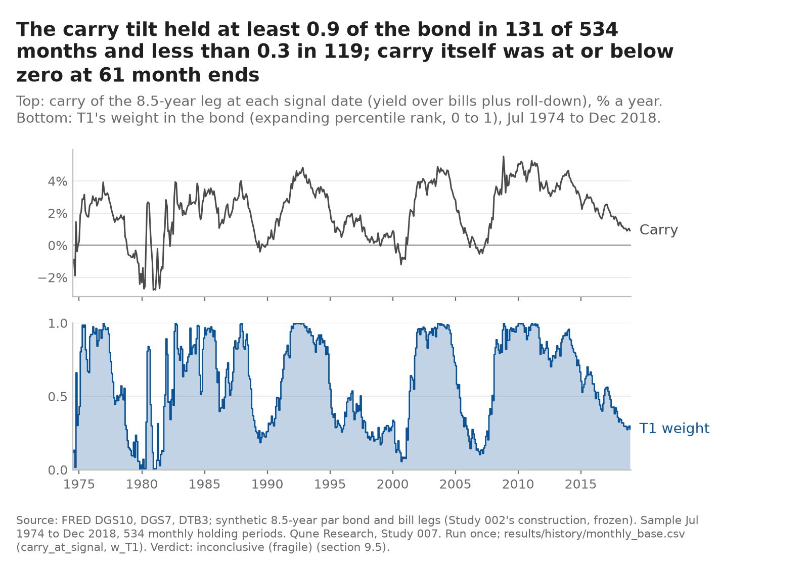
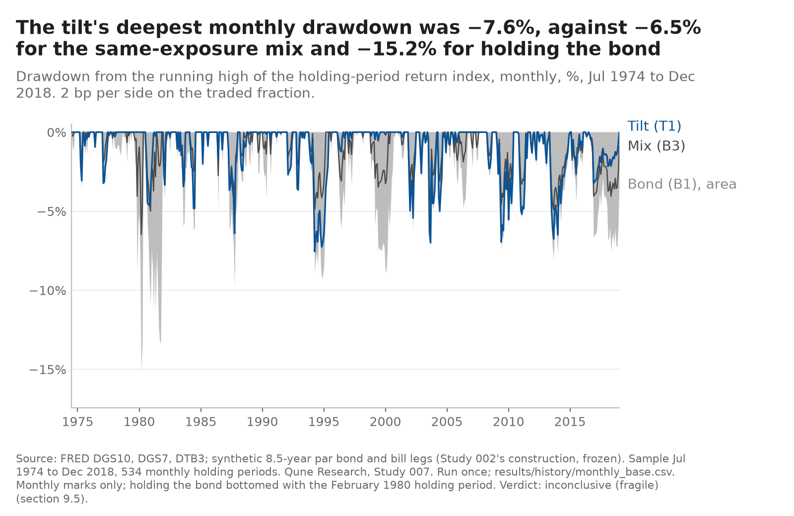
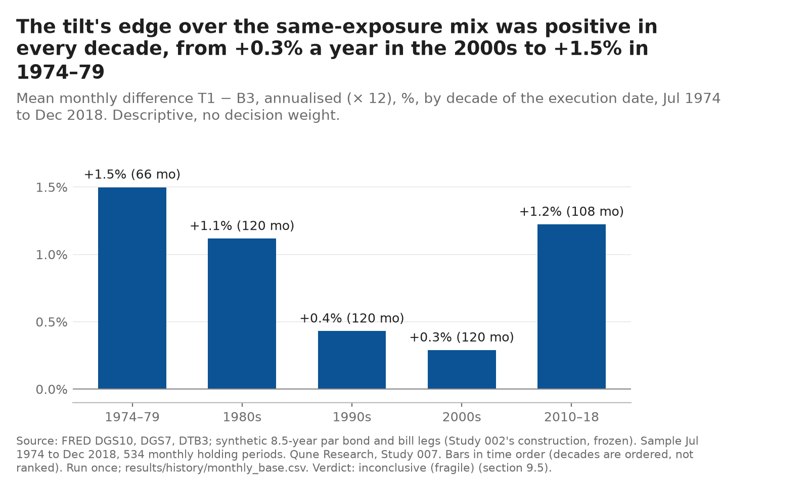
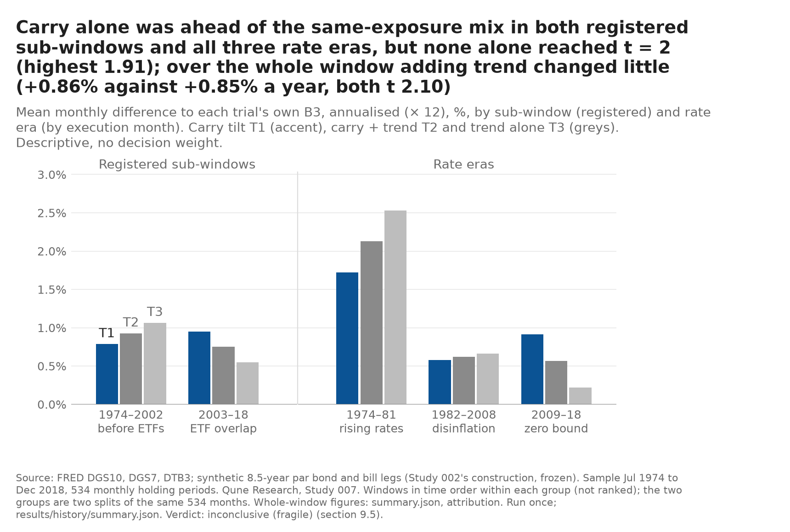

# Study 007 — Bond carry tilt by level on the long history (1974–2018)

**Verdict: inconclusive (fragile)** (pre-registered row, §9.5; history run once on 2026-10-25 at 12:39:33Z). **Read the disclosure first:** the test window had been seen by Study 006 (the same synthetic leg, 1969–2018, including the sign of carry) and the trend's 2003–2026 path by Studies 003 and 004, and the form of this rule was chosen after seeing them (§2.4 of the pre-registration). A design miss also weakens the robustness rule: **the companion T1a (36-month minimum history) has exactly the same weights as T1 on the test window, and T1b (120 months) differs from T1 only by starting in 1979**, because an expanding rank does not depend on its minimum history once that history is reached; this was found at the gate and disclosed before any return existed (trials.md, §16), and nothing was changed. So the fragility clause rests on one sub-window, not on a parameter. The rule holds a weight between 0 and 1 in a synthetic 8.5-year Treasury position and the rest in synthetic bills; the weight is the expanding percentile rank of the leg's carry (yield over bills plus roll-down) at each month end. **Over 534 months, July 1974 to December 2018, the primary rule T1 met all four criteria**: Sharpe 0.493 against 0.382 for holding the bond (B1) and 0.381 for the same average exposure held throughout (B3, w̄ = 0.606); Newey–West t of the monthly difference to B3 **2.10** (+0.070% a month, about 0.85% a year); deflated Sharpe ratio 0.998 at the programme family count of 14; the sign unchanged at double costs (t 2.04). **On 1979–2018 (474 months) the same weights reach t 1.95**, so companion T1b fails C2 by 0.05 and, by the fragility rule written before the run, the result is not called supported. The volatility check passed (σ 7.81% a year against the 10.18% bar), so this is not a "low-power" label.

**What it does and does not show.** The tilt earned its Sharpe advantage by holding less of the bond, not by earning more from it: against holding the bond outright, its mean excess return was lower (t −0.54), and the Ledoit–Wolf test of its Sharpe ratio against B3 gives p = 0.15 (descriptive). Unlike Study 006, the edge over the exposure-matched mix is not one regime's: it is positive in every decade (+1.5%, +1.1%, +0.4%, +0.3%, +1.2% a year) and in all three rate eras, though in 1982–2008 the rule still had a lower Sharpe than holding the bond (0.612 against 0.629). The 12-month trend adds nothing on top of carry (T2: same mean difference and the same t), and trend alone (T3) is not supported. The level mechanism is not monotone: the top fifth of weights carries the result. No paper order; the only clean test is the forward record, which starts at the 2026-10-30 month end and is scored once after 60 months, when it can see about 0.36 Sharpe (2.8% a year) at the uniform-rank dispersion, close to the 0.303 the rule showed in history (§11.4). Published 2026-10-25; the 2019–2026 episode was run once the same day (below, no decision weight: T1 − B3 +0.56% a year, t 0.59); charts and a separate-session recomputation followed the same day (confirmed with findings, no must-fix; section below, added 13:51 GMT).

Everything on this page is a backtest on synthetic constant-maturity series built from FRED yields, after costs. Nothing here is a track record, a forecast or investment advice. The question, the trials, the benchmarks, the criteria, the gate, the volatility bar and the order of operations were fixed in [`PREREGISTRATION.md`](PREREGISTRATION.md) before any file was read (`e4c21e5`); the trial log is [`trials.md`](trials.md).

What happened, in order (every step is a dated commit; times are London, which equals UTC on this date):

1. 2026-10-25, 09:2x: power first for the agenda's next questions ([`tools/power_next.txt`](../../tools/power_next.txt), `6cc65fb`): the ETF-era form failed the 2% bar, so the question moved to Study 006's frozen long-history leg. 10:21: question note (`7692356`).
2. 11:23: pre-registration and trial log pushed before any file was read (`e4c21e5`). 11:26: data step, Study 006's seven files copied after a SHA-256 match, dates only (`1cb9b28`).
3. 11:34–12:32: code and tests (`b529994`, `c9a27f3`, `8a304e4`): Study 006's code and tests copied byte-identical, the carry rank, tilt engine, gate, volatility check, history and episode wrappers new; 242 tests. A §16 entry before any run moved the forward-record code to before its first use and wrote down three code decisions inside the registered rules.
4. 12:32: `APPROVED` and the gate's trial-log row (`96af276`); then **the gate, run once: PASS, no trial dropped** (`4b2b7fd`), with the T1a/T1b disclosure.
5. 12:34: the volatility check's row (`ae0cfa7`), then **the volatility check, run once: σ 7.81%, criteria stand** (`04c77e0`).
6. 12:37: family re-counted at 14 and the five run rows logged and pushed (`4af5b84`); then **the history run, once** (12:39:33Z), committed as written (`b43c825`).
7. This note: the publication (the commit carrying this line).

## The gate (§5.3; signal paths and instrument returns only, no rule return)

Study 006's gate, extended to a fractional weight: the error the synthetic series puts into the monthly differential T_k − B3 over the 192 months in which an ETF exists to compare with (2003–2018), e_t = (w_t − w̄)·g_t, with g_t the synthetic-minus-ETF gap in the duration-over-cash return.

| Check | T1 | T1a | T1b | T2 | T3 | Bound | Result |
|---|---|---|---|---|---|---|---|
| G1, bias: \|mean(e)\| × 12 | 0.019% | 0.019% | 0.019% | 0.021% | 0.061% | ≤ 0.18% a year | pass |
| G2, noise: sd(g) / sd(x_ETF) | 0.131 (inherited from Study 006, reproduced exactly) | | | | | ≤ 0.32 | pass |

Full output: [`results/gate/gate.md`](results/gate/gate.md). **What the pass does not show:** before 2003 there is no ETF, so the series' fidelity over 1974–2002 (342 of the 534 months) is an assumption carried from Studies 002 and 006, not a measurement.

## Results: the test window, 1974-07 to 2018-12 (534 months, synthetic legs, base costs 2 bp a side on the traded fraction)

| | T1 (carry rank, m 60) | T1b (m 120, 1979–2018) | T2 (½ carry + ½ trend) | T3 (trend alone) | B1 (hold the bond) | B3 (same exposure, w̄ 0.606) | B2 (50/50) |
|---|---|---|---|---|---|---|---|
| Months | 534 | 474 | 534 | 534 | 534 | 534 | 534 |
| Annual return (geometric) | 7.37% | 7.34% | 7.39% | 7.38% | 7.56% | 6.50% | 6.21% |
| Volatility | 5.43% | 5.60% | 5.50% | 6.08% | 7.82% | 4.79% | 3.99% |
| Sharpe ratio | **0.493** | 0.516 | 0.493 | 0.449 | 0.382 | 0.381 | 0.381 |
| Same-window B1 / B3 Sharpe | 0.382 / 0.381 | 0.406 / 0.405 | 0.382 / 0.381 | 0.382 / 0.381 | | | |
| Deepest monthly drawdown | −7.6% | −7.6% | −8.2% | −8.9% | −15.2% | −6.5% | −4.3% |
| Mean difference to own B3, a year | +0.85% | +0.88% | +0.86% | +0.88% | | | |
| Newey–West t to own B3 (C2 ≥ 2.0) | **2.10** | **1.95** | **2.10** | **1.60** | | | |
| Newey–West t to B1 | −0.54 | −0.62 | −0.51 | −0.41 | | | |
| DSR at the family count 14 (C3 ≥ 0.95); at N = 5 / 10 | 0.998; 0.999 / 0.998 | 0.997; 0.999 / 0.998 | 0.997; 0.999 / 0.998 | 0.993; 0.996 / 0.994 | | | |
| t to own B3 at stress costs, 4 bp (C4: sign) | 2.04 | 1.90 | 2.02 | 1.52 | | | |
| C1 / C2 / C3 / C4 | pass / pass / pass / pass | pass / **fail** / pass / pass | pass / pass / pass / pass | **fail** / **fail** / pass / pass | | | |
| Verdict on own criteria | supported in history (before the companion clause) | not supported | **secondary: supported in history; forward record pending** | **secondary: not supported** | | | |

T1a is not a column because it is T1: same weights, same 534 months, every figure identical (disclosed at the gate). Each trial's B3 holds that trial's own mean weight throughout (T1 0.606, T1b 0.604, T2 0.609, T3 0.612). One-way turnover over the window: T1 29.8 units (0.67 a year), T1b 25.2, T2 36.1, T3 46.0; the low-powered label applies below 8, so none carries it. T1's stationary-bootstrap 95% interval for the Sharpe ratio is [0.22, 0.74]; the Ledoit–Wolf test of its Sharpe ratio against B3 gives p = 0.15 (descriptive, §9.3). The family count (§9.4: every trial of a duration-timing rule on the 7–10-year leg over an overlapping window whose return had been seen) was re-counted before the run at 14: Studies 003, 005 and 006 three each, this study five; the trials' Sharpe ratios are so close that the variance floor was applied, so at these counts the DSR mainly tests whether the leg carries a premium (as METHODS §2.1 says). Full output: [`results/history/verdict.md`](results/history/verdict.md), [`summary.json`](results/history/summary.json), monthly returns and weights in [`monthly_base.csv`](results/history/monthly_base.csv) and [`monthly_stress.csv`](results/history/monthly_stress.csv).

**Why the companion decides, and what that means here.** T1 reported on T1b's 474 months (descriptive, §7) has Sharpe 0.516 and the same weights as T1b except for the entry month, so the fragile verdict says: the result does not survive dropping the first 60 months, 1974-07 to 1979-06. Those months were not the source of the edge (T1 − B3 averaged +0.62% a year in them; computed for this note from `monthly_base.csv`); on the remaining 474 the mean difference is slightly higher (+0.88% a year) and the t falls to 1.95 because the sample is shorter. It is a sample-length sensitivity, not evidence that the rule depends on its one free choice; the pre-registration intended a parameter check and, through the design miss above, got a window check instead.

### Sub-windows and rate eras (descriptive, no decision weight; by the month in which each holding period starts)

| Window | Months | T1 Sharpe | B1 Sharpe | B3 Sharpe | T1 − B3, a year (t) | T2 − B3 (t) | T3 − B3 (t) | T1 mean weight |
|---|---|---|---|---|---|---|---|---|
| 1974-07 to 2002-12 (before any ETF) | 342 | 0.469 | 0.333 | 0.332 | +0.79% (1.40) | +0.93% (1.61) | +1.06% (1.38) | 0.568 |
| 2003-01 to 2018-12 (the gate's overlap) | 192 | 0.533 | 0.499 | 0.499 | +0.95% (1.91) | +0.75% (1.51) | +0.55% (0.82) | 0.672 |
| 1974-07 to 1981-12 (rising rates) | 90 | −0.099 | −0.364 | −0.365 | +1.72% (1.24) | +2.13% (1.40) | +2.53% (1.36) | 0.492 |
| 1982-01 to 2008-12 (disinflation) | 324 | 0.612 | 0.629 | 0.629 | +0.58% (1.18) | +0.62% (1.32) | +0.66% (1.00) | 0.596 |
| 2009-01 to 2018-12 (zero lower bound and QE) | 120 | 0.513 | 0.452 | 0.452 | +0.92% (1.51) | +0.57% (0.90) | +0.22% (0.26) | 0.716 |

T1 − B3 by decade of the execution date (computed for this note from `monthly_base.csv`, columns T1 and B3_T1): 1974–79 +1.50% a year (66 months), 1980s +1.12% (120), 1990s +0.43% (120), 2000s +0.29% (120), 2010–18 +1.22% (108). Each trial's sub-window rows for every metric are in `summary.json` (keys `sub_windows`, `rate_eras`).

### Attribution: does the trend add anything to carry? (§9.6; the question's second half, answered from these three rows only)

| | Mean T − B3, a year | Newey–West t |
|---|---|---|
| T1, carry alone | +0.85% | 2.10 |
| T2, ½ carry + ½ trend | +0.86% | 2.10 |
| T3, trend alone | +0.88% | 1.60 |

Correlation of T1's and T3's weight paths: 0.325. **No:** blending in the trend leaves the mean difference and its t where carry alone put them; trend alone has a similar mean with more noise (its weight is 0 or 1, so its sd(w) is 0.487 against T1's 0.303) and fails C1 and C2. After 2009 the trend added least (+0.22% a year alone). T2's "supported in history" row is secondary by registration and is never the headline; it is the same evidence as T1 diluted, not a second result.

### Mechanism (§9.6): the level, not the sign

The leg's mean excess return over bills, a year, in the periods grouped by the quintile of T1's weight (all five rows, as registered):

| T1 weight quintile | Weight range | Months | Leg excess over bills, a year | Leg beat bills |
|---|---|---|---|---|
| Q1 (lowest carry rank) | 0.000–0.288 | 107 | −0.93% | 47.7% |
| Q2 | 0.289–0.492 | 107 | +2.59% | 53.3% |
| Q3 | 0.495–0.788 | 106 | +3.10% | 57.5% |
| Q4 | 0.789–0.933 | 107 | **−2.29%** | 46.7% |
| Q5 (highest carry rank) | 0.936–1.000 | 107 | **+12.45%** | 65.4% |

By the sign of carry: 61 months with carry ≤ 0, leg excess −3.9% a year; 473 months with carry > 0, +3.9% a year. **The hypothesis says excess returns rise with the carry rank; they do not rise steadily.** Q1 is negative and Q5 is strongly positive, as the hypothesis expects, but Q4 is the second-worst quintile, so the result rests on the top fifth of carry ranks. That is a weaker mechanism than a monotone one: a rule that moved its weight in proportion to the rank was right at both ends of the range and not consistently in between. The sign split repeats what Study 006 already showed for the sign of carry (disclosed, §2.4).

### Power, after the fact (§9.6)

- Observed Newey–West to i.i.d. ratio of T1 − B3: **0.981**, against the 0.972 the power file assumed (T1b 0.999, T2 0.960, T3 0.950).
- Realised sd(w − w̄) for T1: **0.303**, against the design figure 0.5 and the uniform-rank figure 1/√12 = 0.289. The rule's weights were nearly as dispersed as a uniform rank, so the registered statement nearest to what happened is the uniform-rank one (MDE 0.93% a year, or 0.120 Sharpe), not the 1.6% at sd 0.5. Computed for this note from the committed Newey–West standard error of T1's mean difference (0.0335% a month, 0.40% a year): C2's bar of t = 2.0 sat at about **0.80% a year**, which the observed 0.85% cleared narrowly, and the effect the test would detect four times in five (K = 2.842, as registered) is about **1.14% a year**: above the registered uniform-rank 0.93% (the differential was noisier than the uniform-rank calculation assumed; why is not examined here) and below the 1.6% at sd 0.5. In return units a less dispersed weight makes a given timing skill both a smaller return and a smaller tracking error, so the MDE in return units falls with sd(w), not rises.

## 2019–2026 episode (no decision weight)

*Added 2026-10-25 13:2x GMT, after the note above was committed (`6cbfa6c`); run once at 13:23:27Z (code `5dc2d38`, outputs `5b7632b`).* Actual IEF and BIL, 93 holding periods (January 2019 to September 2026), the carry rank still expanding (687 months of history by the end), each trial's B3 at its frozen weight from the history run. Never quoted in a verdict sentence; for T2 and T3 the trend part of this window had been published by Studies 003 and 004, so for them it is a recomputation on a known window.

| | T1 | T2 | T3 | B1 (hold IEF) | B3 (w 0.606) | Bills |
|---|---|---|---|---|---|---|
| Mean weight in the bond | 0.256 | 0.332 | 0.409 | 1 | 0.606 | 0 |
| Annual return (geometric) | 2.03% | 2.63% | 3.21% | 0.45% | 1.38% | 2.66% |
| Deepest monthly drawdown | −6.5% | −6.0% | −5.5% | −22.2% | −13.1% | |
| Mean T − own B3, a year (NW t) | +0.56% (0.59) | +1.17% (1.22) | +1.78% (1.28) | | | |

Carry ranked low against its own history for most of the episode, so the tilt held mostly bills: about 0.4 of the bond going into 2022 and below 0.2 from the July 2022 signal on; over the ten holding periods signalled from December 2021 to September 2022 it lost 3.6% against 16.1% for holding IEF (computed for this note from `results/episode/actual/monthly_base.csv`). It still earned less than bills (Sharpe −0.33 against −0.26 for holding IEF: with a negative excess return the lower-volatility position shows the lower Sharpe, so the Sharpe comparison means little here). The difference to the exposure-matched mix went the rule's way but is small against its noise (t 0.59; 0.52 on the synthetic series alongside). T1a and T1b repeat T1. The weights at the 2026-09 signal, which the forward record starts from: T1 0.411 (carry 1.42%), T2 0.206, T3 0. Full output: [`results/episode/summary.json`](results/episode/summary.json).

*Correction, 2026-10-25 13:51 GMT (separate-session review, should-fix 1):* "below 0.2 from the July 2022 signal on" holds only until the November 2024 signal; T1's weight was back above 0.2 from the December 2024 signal (0.257) and stood at 0.387 at the last episode period (0.406 at the 2026-07 signal). The −3.6% against −16.1% for the periods signalled December 2021 to September 2022 is correct. The sentence above is left as published.

## Separate-session recomputation (§14 step 10)

*Added 2026-10-25 13:51 GMT.* A separate Tester agent on Opus 5.5 that did not write the study ([`REVIEW.md`](REVIEW.md), [`review_recompute.py`](review_recompute.py)) rebuilt carry, the three rank paths, the trend and both legs from the raw FRED and ETF files and recomputed the engines, statistics, gate, volatility check, sub-windows, mechanism, episode, 262 numbers typed in this note and the five chart titles: **confirmed with findings, no must-fix**; 1,141 rows, 1,128 match, 1 mismatch, 12 informational; 242 study and 134 library tests pass; the 21 commits are in order. Qune reran the script (same counts) and both suites (242, 134) before accepting. Answers, by dated addition only:
- **Should-fix 1 (the mismatch):** the episode's "below 0.2 from the July 2022 signal on" was wrong after November 2024; corrected by the dated note in the episode section.
- **Should-fix 2:** the trial-log row "Implementation, part 2" is labelled 12:4x; its commit `c9a27f3` is 12:22:47. A dated precision is appended to `trials.md`. Same cause as the earlier precisions: times estimated, not read.
- **Note, C1 is narrow too:** T1 clears C1 by 0.011 (0.493 against B1 + 0.10 = 0.482) and T1b by 0.010. This note said the C2 margin (0.10) and not the C1 margin; both criteria are near misses in the making.
- **Note, the DSR variance:** C3 uses the spread of this study's five Sharpe ratios, raised to the variance floor, not the spread across the 14-trial family; the reviewer finds C3 would fail only if the family's annual Sharpe ratios had a standard deviation above about 0.147. Stated here so the 0.998 is not read as stronger than it is.
- **Note, wording:** in the first paragraph, "close to the 0.303 the rule showed" means the weight dispersion sd(w − w̄), not a Sharpe ratio.
- **Note, the fragility is a window effect:** T1 run with its carried-in holdings on T1b's 474 periods gives t 1.9508, so the companion's failure is not an entry-cost artefact; this agrees with "Why the companion decides" above.
- **Note, a gate label:** the gate output's split labelled "2002–2007" holds the 60 periods executed in 2003–2007; the label is the engine's, the numbers are right.

## What did not work

- **The robustness rule, as designed.** The two companions were meant to move the rule's only free choice both ways; one of them (T1a) cannot change anything on the test window and the other (T1b) changes only the start date. The miss was in the pre-registration's reasoning about an expanding rank and was caught at the gate, not before registration. A successor that wants a parameter check on a rank rule needs a trailing window, not a minimum history.
- **The near miss decides again.** As in Study 006, the primary rule clears t = 2.0 (by 0.10) and its companion misses it (by 0.05). Two studies on the same leg and the same 1970s–2010s history now end on the same side of the same line; the programme should not read the two as independent confirmations, because the leg, the window and the sign of carry are shared (the family count of 14 is there for that reason).
- **No gain over holding the bond.** Every trial earned less excess return than holding the bond (t −0.41 to −0.62); the Sharpe advantage is a lower-volatility position earning nearly the same return. Against the exposure-matched mix the gain is the timing; against an investor who simply holds the bond and accepts its volatility, there is nothing here.
- **The trend leg.** Twelve-month trend, alone or blended, added nothing measurable to carry on 1974–2018, the only stretch of its path that was unseen (1974–2002: T3 − B3 +1.06% a year, t 1.38).
- **The mechanism is not monotone** (Q4 negative), so the level component of carry is supported only at the top of its range.
- **A wrong sentence in the published outcome row.** The history run's outcome row in [`trials.md`](trials.md), written straight after the run, says the realised dispersion makes the MDE "about 1.6 × the registered 1.6% a year at sd 0.5". In the units the row uses (a year of mean difference) that is the wrong way round: the realised MDE is about 1.14% a year (see Power, after the fact). The row is not rewritten; a dated correction is appended below it. No verdict depends on the sentence.

## Charts (§9.6, added 2026-10-25 13:28 GMT; descriptive, no decision weight; Tester chart check done: CHART_REVIEW.md, fourth section)

Drawn from the committed history files by [`charts/make_charts.py`](charts/make_charts.py); every number in a title is computed by the script and listed with the input hashes in [`charts/manifest.json`](charts/manifest.json). SVG beside each PNG.

## Next

1. ~~The 2019–2026 episode~~: run once 2026-10-25 13:23Z, above.
2. ~~Charts~~: drawn 2026-10-25 13:28 GMT and through the Tester chart check (one must-fix, eight should-fix, all fixed; [CHART_REVIEW.md](../../CHART_REVIEW.md), fourth section).
3. ~~Separate-session recomputation~~: done 2026-10-25 13:51 GMT (above): confirmed with findings, no must-fix.
4. The forward-record code (`forward007.py`, before step 11), first record at the 2026-10-30 month end, scored once after 60 months; no paper order.
