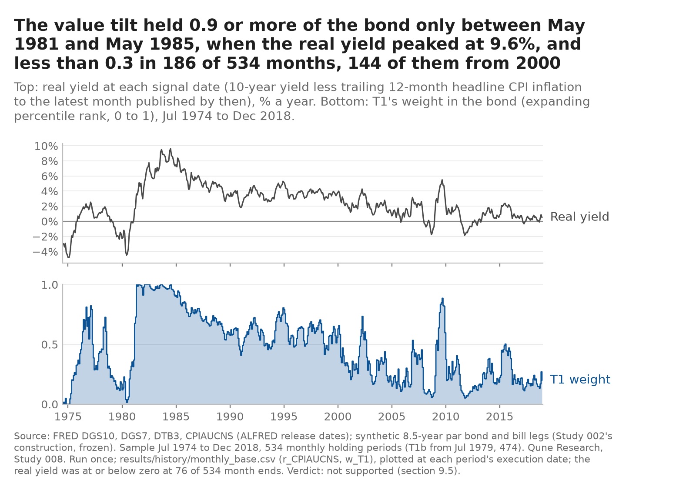
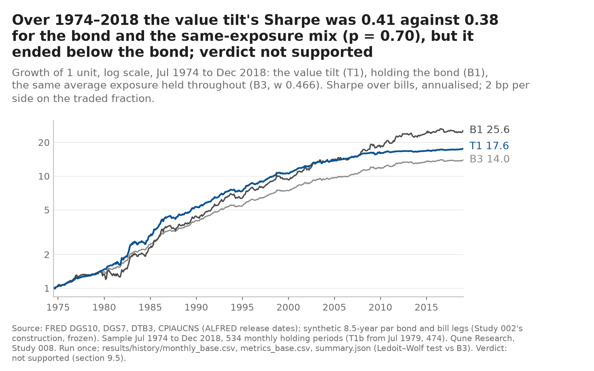
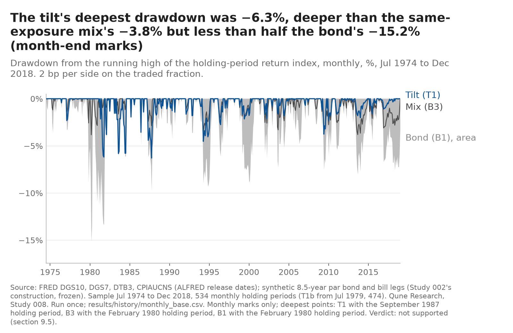
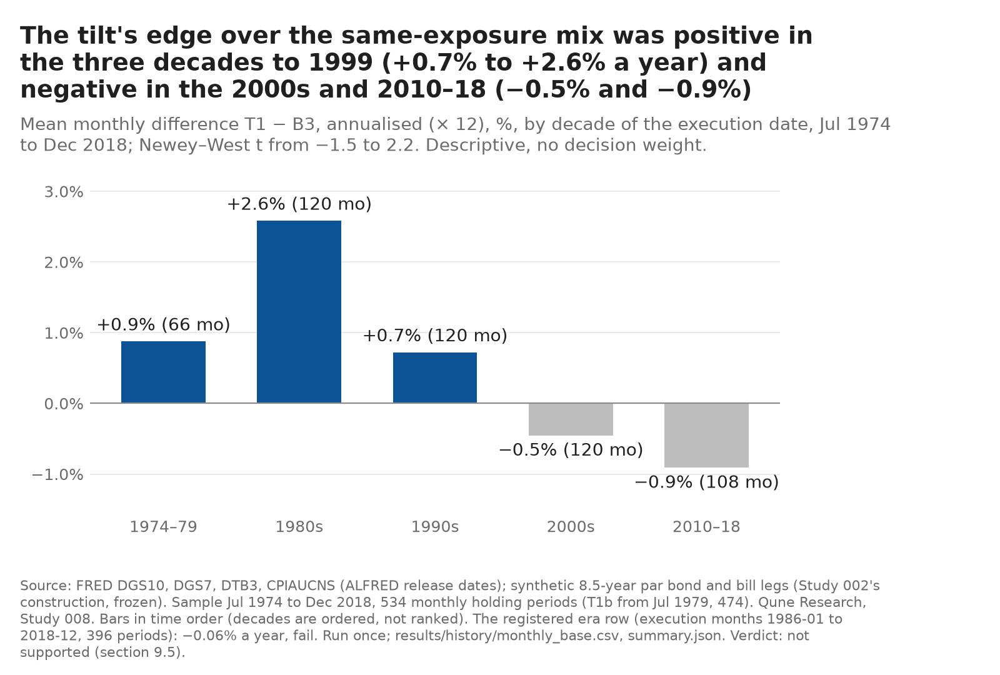
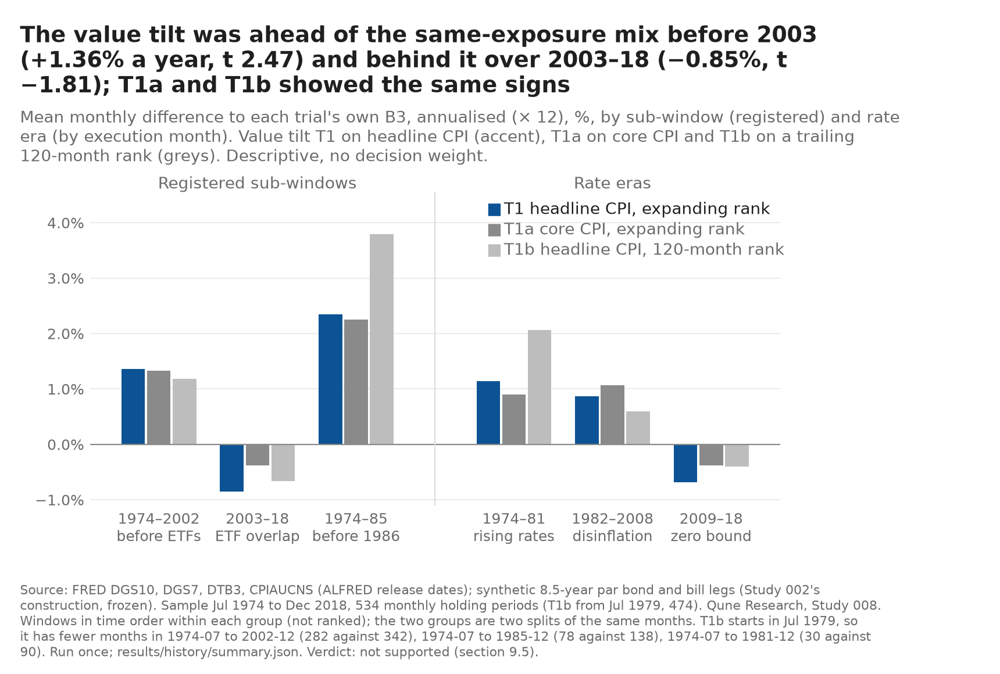

# Study 008 — Bond value tilt by the real yield on the long history (1974–2018)

**In one screen** (added 2026-10-26 after the [second cold read](../../COLD_READ.md#second-cold-read-2026-10-26), points 3, 4 and 10; the note below it is unchanged, and the operational detail stays there)

- **Verdict:** not supported: C1 and C2 fail (t 1.38), both companions fail, and the registered era row fails (1986–2018: −0.06% a year against B3).
- **Effect (post hoc, descriptive; [`tools/effect_lines.txt`](../../tools/effect_lines.txt)):** edge over the exposure-matched mix B3 **+0.56% a year, 95% interval −0.24% to +1.37%**, 534 months; more than all of it earned by 1985 (107%).
- **Where it came from:** 1974–2002, before any ETF (+1.36% a year); 2003–2018 was negative (−0.85% a year). Doubling costs to 4 bp moved t from 1.38 to 1.33 (one-way turnover 0.54 a year).
- **Limits:** one of three signals tried in turn on one synthetic 7–10-year leg and one window (Studies 006–008), now declared spent for duration timing, so the three are one in-sample look at one sample ([RESEARCH_AGENDA.md](../../RESEARCH_AGENDA.md), 2026-10-26); **the leg fails an independent fidelity check for 1974–1982, where most of the gain sits**: against monthly 5–10-year sector returns built from Treasury Bulletin bond prices (Stocker 2025, not FRED yields), the leg's errors flatter this rule's monthly differential by +0.77% a year over those years, 4.3 times the gate's 0.18% bound (+0.59% after a post-hoc duration match; about +0.14% a year if spread over the full window, against the +0.56% effect); 1983–2002 have no readable independent total-return series: repriced on the Federal Reserve Board's off-the-run curve, the leg agrees within both gate bounds there, but that curve-based twin shares most of the leg's 1969–1982 error against real bonds, so it checks the yield inputs, not the construction, which stays unmeasured for 1983–2002 ([`tools/fidelity_gsw.txt`](../../tools/fidelity_gsw.txt), COLD_READ point 3, 2026-10-28); and the gate's own comparison with IEF covers 2003–2018 only ([COLD_READ.md](../../COLD_READ.md), point 3, 04:22Z addition; [`tools/fidelity_stocker.txt`](../../tools/fidelity_stocker.txt)); costs are the ETF era's (2 bp a side, 4 bp stress) across every decade, which is optimistic for the 1970s and was not stated before; turnover is low, but costs several times higher were not tested; the deflated Sharpe ratio (C3) passes easily at these trial counts and sample lengths (it passed for every primary rule here, including 008's, which failed everything else), so read it as descriptive ([METHODS §2.1](../../METHODS.md)).
- **What would change the view:** a forward record (from 2026-10-30, scored once after 60 months; it can see about 2.8–4.8% a year) or the pooled forward check of 006–008 ([Study 009](../009-pooled-forward-duration-timing/PREREGISTRATION.md), about 1% to 2.75% a year). Neither can reliably see an edge of 0.56% a year.

**Verdict: not supported** (pre-registered row, §9.5; history run once on 2026-10-25 at 21:19:39Z). **Read the disclosure first:** the test window had been seen twice on this leg, by Studies 006 and 007, and the drift of real yields (low in the 1970s, highest in the early 1980s, falling for most of the decades after) is general knowledge the author had before choosing this form (§2.4 of the pre-registration). The rule holds a weight between 0 and 1 in a synthetic 8.5-year Treasury position and the rest in synthetic bills; the weight is the expanding percentile rank of the real yield at each month end, where the real yield is the 10-year yield less the trailing 12-month CPI inflation that had been published by that date. **Over 534 months, July 1974 to December 2018, the primary rule T1 had a Sharpe ratio of 0.415 against 0.382 for holding the bond and 0.381 for the same average exposure (w̄ 0.466) held throughout. Its mean gain over that exposure-matched mix was +0.56% a year with a Newey–West t of 1.38, so C1 (a Sharpe margin of 0.10) and C2 (t ≥ 2.0) fail.** Both registered companions also fail C1 and C2 on their own criteria: core CPI in place of headline (T1a, t 1.78) and a trailing 120-month rank in place of the expanding one (T1b, 1979–2018, t 0.91). The registered era row fails as well: from 1986 to 2018 T1 earned −0.06% a year against the exposure-matched mix.

**What it does and does not show.** Whatever gain the full window shows sits in the years before any ETF existed, and mostly before 1986: +1.36% a year over 1974–2002 (t 2.47, descriptive) and −0.85% a year over 2003–2018 (t −1.81); +2.34% a year over 1974–1985 (t 1.92). That is the pattern §2.4 said was partly foreseeable from the history of real yields, and the reason the era row was registered. The bond's excess return over bills does rise across the fifths of T1's weight (from 0.84% a year in the lowest fifth to 6.88% in the highest), but the monthly gain over the same average exposure is too noisy to tell from zero. The signal is close to independent of the two earlier studies on this leg (the gate's weight correlations 0.115 with Study 007's carry tilt and 0.161 with Study 006's switch; the monthly gains correlate 0.193 with Study 007's), so it is a third, largely separate question with a negative answer, not a restatement. No paper order; the forward record starts at the 2026-10-30 month end and is scored once after 60 months. The 2019–2026 episode was run once the same evening (below, no decision weight: T1 − B3 +0.78% a year, t 0.85); the separate-session recomputation followed the same evening (confirmed with findings, no must-fix; below); the charts follow.

Everything on this page is a backtest on synthetic constant-maturity series built from FRED yields and CPI, after costs. Nothing here is a track record, a forecast or investment advice. The question, the trials, the benchmarks, the criteria, the gate, the volatility bar, the era row and the order of operations were fixed in [`PREREGISTRATION.md`](PREREGISTRATION.md) before any CPI file was read (`ca2432a`); the trial log is [`trials.md`](trials.md).

What happened, in order (every step is a dated commit; times are commit times read back from git, UTC, which equals London on this date):

1. 2026-10-25 16:24: question note (`1d1daeb`), after the agenda refresh gave four candidates their detectable edges first ([`tools/power_refresh.txt`](../../tools/power_refresh.txt)).
2. 17:20: pre-registration and trial log pushed before any CPI file was read (`ca2432a`). 17:25: data step, dates part (`be162c1`), after a §16 correction of a wrong series ID (`CPIAUCNSA` for `CPIAUCNS`) found by an HTTP 404 before any CPI data were received.
3. 18:18–18:27: the CPI vintage and release-date check, logged before it ran (`ac42f2d`, outcome `245613c`): 1,045 ALFRED vintages read; the previous month's CPI was not yet public at the signal date in one test-window month (signal month 1996-01, which therefore uses November 1995) and in the episode's 2025-11; December vintages 1995–2018 equal today's files. Two §6.1 clarifications before any real yield was computed (`dcf5cd1`).
4. 18:34–20:36: code and tests (`0dec256` to `7d7dc03`); a separate code review (Opus Tester, isolated, constructed data only) failed it on one must-fix (a trial dropped at the gate would still have run in the history), fixed with tests and re-checked (pass); 319 tests pass, 2 skipped by name.
5. 20:43: `APPROVED` and the gate's trial-log row (`e9169dd`); then **the gate and overlap check, run once: PASS, no trial dropped** (`172c456`).
6. 20:44: the volatility check's row (`fe94ff7`), then **the volatility check, run once: σ 7.81%, Study 007's figure reproduced exactly; the criteria stand** (`2902e22`).
7. 21:18: family re-counted at 17 and the history-run row logged and pushed (`031c134`); then **the history run, once** (21:19:39Z), committed as written (`ef7f4bd`); outcome row (`b111b0e`).
8. This note: the publication (the commit carrying this line).

## The gate (§5.3, §5.6; signal paths and instrument returns only, no rule return)

Study 007's gate for a fractional weight path: the error the synthetic series puts into the monthly differential T_k − B3 over the 192 months in which an ETF exists to compare with (2003–2018), e_t = (w_t − w̄)·g_t, with g_t the synthetic-minus-ETF gap in the duration-over-cash return.

| Check | T1 | T1a | T1b | Bound | Result |
|---|---|---|---|---|---|
| G1, bias: \|mean(e)\| × 12 | 0.021% | 0.024% | 0.062% | ≤ 0.18% a year | pass |
| G2, noise: sd(g) / sd(x_ETF) | 0.131 (inherited from Study 006, reproduced exactly) | | | ≤ 0.32 | pass |
| Overlap: corr(w, Study 007 T1 weight) | 0.115 | −0.014 | 0.085 | flag above 0.8 for T1 | no flag |
| Overlap: corr(w, Study 006 T1 holding) | 0.161 | 0.115 | 0.088 | | |

Full output: [`results/gate/gate.md`](results/gate/gate.md). **What the pass does not show:** before 2003 there is no ETF, so the series' fidelity over 1974–2002 (342 of the 534 months, the months that carry this rule's gain) is an assumption carried from Studies 002 and 006, not a measurement.

## Results: the test window, 1974-07 to 2018-12 (534 months, synthetic legs, base costs 2 bp a side on the traded fraction)

| | T1 (headline CPI, expanding rank) | T1a (core CPI) | T1b (trailing 120-month rank, 1979–2018) | B1 (hold the bond) | B3 for T1 (same exposure, w̄ 0.466) | B2 (50/50) |
|---|---|---|---|---|---|---|
| Months | 534 | 534 | 474 | 534 | 534 | 534 |
| Annual return (geometric) | 6.66% | 6.77% | 6.21% | 7.56% | 6.11% | 6.21% |
| Volatility | 4.85% | 4.72% | 4.67% | 7.82% | 3.73% | 3.99% |
| Sharpe ratio | **0.415** | 0.448 | 0.388 | 0.382 | 0.381 | 0.381 |
| Same-window B1 / B3 Sharpe | 0.382 / 0.381 | 0.382 / 0.381 | 0.406 / 0.405 | | | |
| Deepest monthly drawdown | −6.3% | −6.4% | −6.2% | −15.2% | −3.8% | −4.3% |
| Mean difference to own B3, a year | +0.56% | +0.72% | +0.44% | | | |
| Newey–West t to own B3 (C2 ≥ 2.0) | **1.38** | **1.78** | **0.91** | | | |
| Mean difference to B1, a year; Newey–West t | −1.03%; −1.53 | −0.93%; −1.38 | −1.53%; −1.82 | | | |
| DSR at the family count 17 (C3 ≥ 0.95); at N = 3 / 10 | 0.988; 0.996 / 0.991 | 0.994; 0.998 / 0.996 | 0.976; 0.989 / 0.980 | | | |
| t to own B3 at stress costs, 4 bp (C4: sign) | 1.33 | 1.73 | 0.85 | | | |
| C1 / C2 / C3 / C4 | **fail** / **fail** / pass / pass | **fail** / **fail** / pass / pass | **fail** / **fail** / pass / pass | | | |
| Verdict on own criteria | **not supported** | not supported | not supported | | | |

Each trial's B3 holds that trial's own mean weight throughout (T1 0.466, T1a 0.448, T1b 0.401; T1b's B1 and B3 are on its own 474 months). One-way turnover over the window: T1 23.8 units, T1a 21.9, T1b 32.7; the low-powered label applies below 8, so none carries it. No trial had a hold month (a month whose CPI was never published) on its window. T1's stationary-bootstrap 95% interval for the Sharpe ratio is [0.14, 0.68]; the Ledoit–Wolf test of its Sharpe ratio against B3 gives p = 0.70 (T1a 0.43, T1b 0.87; descriptive, §9.3). The family count (§9.4) was re-counted before the run at 17: Studies 003, 005 and 006 three each, Study 007 five, this study three; the trials' Sharpe ratios are so close that the variance floor was applied, so at these counts the DSR mainly tests whether the leg carries a premium (METHODS §2.1), which is why C3 passes while C1 and C2 fail. Full output: [`results/history/verdict.md`](results/history/verdict.md), [`summary.json`](results/history/summary.json), monthly returns and weights in [`monthly_base.csv`](results/history/monthly_base.csv) and [`monthly_stress.csv`](results/history/monthly_stress.csv).

**Era row (§9.5):** T1 over execution months 1986-01 to 2018-12 (396 months): mean(T1 − B3) **−0.06% a year**, so the sign condition fails (Newey–West t −0.18, reported, not tested). Under the precedence T1's verdict is already fixed by its C1 and C2 failures; the era row would have withheld "supported" even if they had passed.

*Dated addition, 2026-10-25, after the separate-session recomputation ([`REVIEW.md`](REVIEW.md)), should-fix 2:* the registered descriptive "T1 on T1b's 474 periods" (§7, §9.6) was missing here. From [`verdict.md`](results/history/verdict.md): Sharpe 0.434, mean gain over T1's B3 +0.61% a year, Newey–West t 1.33, against T1b's own t 0.91 on the same periods. So T1b's weaker result comes from the trailing rank, not from its shorter window.

### Sub-windows and rate eras (descriptive, no decision weight; by the month in which each holding period starts)

| Window | Months | T1 Sharpe | B1 / B3 Sharpe | T1 − B3, a year | Newey–West t | T1 mean weight |
|---|---|---|---|---|---|---|
| 1974-07 to 2002-12 (before any ETF) | 342 | 0.468 | 0.333 / 0.332 | +1.36% | 2.47 | 0.584 |
| 2003-01 to 2018-12 (the gate's overlap) | 192 | 0.346 | 0.499 / 0.499 | −0.85% | −1.81 | 0.257 |
| 1974-07 to 1985-12 (complement of the era window) | 138 | 0.401 | 0.113 / 0.112 | +2.34% | 1.92 | 0.581 |
| Rate era 1974-07 to 1981-12 | 90 | −0.099 | −0.364 / −0.365 | +1.14% | 1.16 | 0.385 |
| Rate era 1982-01 to 2008-12 | 324 | 0.600 | 0.629 / 0.629 | +0.87% | 1.54 | 0.563 |
| Rate era 2009-01 to 2018-12 | 120 | 0.289 | 0.452 / 0.452 | −0.68% | −1.20 | 0.267 |

The B3 column in each row is T1's full-window B3 (w̄ 0.466), not a per-window mean weight. After 2002 the expanding rank put the rule mostly in bills (mean weight 0.26) while the bond kept earning, so the rule lagged both benchmarks; in 1982–2008 it had a positive mean gain over B3 (+0.87% a year) but a lower Sharpe ratio than holding the bond (0.600 against 0.629).

### Mechanism (§9.6): does a higher rank precede a higher bond excess return?

| Fifth of T1's weight (equal counts) | Months | Weight range | Leg excess return over bills, a year | Months the leg beat bills |
|---|---|---|---|---|
| Q1 (lowest) | 107 | 0.000–0.190 | 0.84% | 50.5% |
| Q2 | 107 | 0.190–0.349 | 1.27% | 54.2% |
| Q3 | 106 | 0.353–0.556 | 2.08% | 53.8% |
| Q4 | 107 | 0.558–0.702 | 3.83% | 58.9% |
| Q5 (highest) | 107 | 0.702–1.000 | 6.88% | 53.3% |

By the sign of the real yield: 1.30% a year in the 76 months with r ≤ 0, 3.26% in the 458 months with r > 0. The ordering is monotone, unlike Study 007's carry quintiles, but the fifths are not independent samples: an expanding rank of a slowly moving series sorts months largely by date, so the sort and the sub-window table above describe the same early-years concentration (inferred from the two tables, not separately tested). The decision statistic is the Newey–West t of the monthly gain, 1.38.

### Power, after the fact (§9.6)

The realised dispersion of T1's weight was sd(w − w̄) = 0.270, against 0.5 in the design and 0.289 for a uniform rank; the observed Newey–West/iid ratio of the standard error was 1.095 (0.972 assumed). With the observed standard error the test could detect a mean gain of 0.82% a year at t = 2 and 1.16% a year at 80% power; the observed +0.56% is below both. Before the run the bar was stated as about 1.5% a year at w = 0.5 (volatility check). So the study could not have told an edge of half a percent a year from zero, and it did not.

## 2019–2026 episode (no decision weight)

Run once at 21:25:29Z on 2026-10-25 after this note's first commit (`a90f048`), logged first (`ebc80e1`); actual IEF and BIL from Alpaca, 93 holding periods (execution 2019-01-02 to period end 2026-10-01), the real-yield rank still expanding (T1b's trailing), each trial's B3 at its frozen weight from the history. Rates and inflation over 2019–2026 are general knowledge to the author and IEF's path is published by Studies 004, 006 and 007, so this is a recomputation on a known window, not a test, and it is never quoted in a verdict sentence. One hold period in each trial, 2025-11 (the October 2025 CPI was never published).

| | T1 | T1a | T1b | B1 (hold IEF) | B3 for T1 (w̄ 0.466) | B0 (bills) |
|---|---|---|---|---|---|---|
| Mean weight in IEF | 0.218 | 0.167 | 0.446 | 1 | 0.466 | 0 |
| Annual return (geometric) | 2.53% | 2.53% | 2.15% | 0.45% | 1.69% | 2.66% |
| Volatility | 1.80% | 1.45% | 3.76% | 7.39% | 3.49% | 0.59% |
| Deepest monthly drawdown | −1.5% | −1.8% | −4.5% | −22.2% | −10.1% | −0.2% |
| Mean difference to own B3, a year; Newey–West t | +0.78%; 0.85 | +0.74%; 0.77 | +0.34%; 0.40 | | | |

*Dated addition, 2026-10-25, after the separate-session recomputation ([`REVIEW.md`](REVIEW.md)), should-fix 1:* the row "Mean weight in IEF" mixes two bases. T1's 0.218 and T1a's 0.167 are means of the monthly weight column, which includes the 2025-11 hold month's drifted weight; T1b's 0.446 is the mean over signal months only. On the first basis T1b is 0.450; on the second T1 is 0.217 and T1a 0.165. The table is left as published.

In a window where the bond lost to bills, holding less of it helped, and the rule held little. By execution year T1's mean weight was 0.19 in 2019, 0.12 in 2020, 0.06 in 2021 and 0.01 in 2022 (at most 0.033 in any month of that year), then 0.20 in 2023, 0.38 in 2024, 0.45 in 2025 and 0.39 in 2026 (computed for this note from `results/episode/actual/monthly_base.csv`, column `w_T1`), so the rule was almost entirely in bills through the 2022 sell-off; why the rank fell so low (trailing inflation rising far above the 10-year yield) is inferred from the definition, not tested. None of the differences is distinguishable from zero (t 0.85 at best), and the synthetic series alongside gives the same picture (T1 t 0.84). Sharpe ratios are all negative here (T1 −0.065, B1 and B3 −0.259); with a negative excess return a lower-volatility position has the less negative Sharpe, so the comparison says little. At the 2026-09 signal the weights for the forward record's start are T1 0.524, T1a 0.654, T1b 0.992. Full output: [`results/episode/summary.json`](results/episode/summary.json), [`actual/`](results/episode/actual/), [`synthetic/`](results/episode/synthetic/).

## Separate-session recomputation (§14 step 10)

Tester, a separate agent session on the same model family that did not write the code, the pre-registration or the note, reviewed the repository at `b13efd2` on 2026-10-25 from 21:28 to 21:4x GMT ([`REVIEW.md`](REVIEW.md), script [`review_recompute.py`](review_recompute.py)). **Confirmed with findings, no must-fix.** The verdict follows from §9.5; the real yield, the CPI month k (rebuilt from the ALFRED cache, not taken from `cpi_availability.csv`), the three weight paths, both legs, every monthly return at both costs, the gate, the overlap correlations, the volatility check and the episode recompute from the raw files; 940 of 953 rows match, 12 informational, 1 mismatch (should-fix 1); both suites pass (319 passed, 2 skipped; library 134). Qune reran the script before accepting it: 953 rows, 940 match, 1 mismatch, 12 informational. The three should-fix points are answered by dated additions in this note (above and in "What did not work"); the originals are left as published. The four notes:

- **Note 4:** `results/cpi_availability.csv` predates the §16 (a) clarification and still gives core CPI's k for signal month 1996-01 as 1995-12 under "assumed known". The code applies §16 (a) (k = 1995-11, reproduced by the reviewer from the cache), and the `summary.json` branch counts repeat the CSV's labels. Do not use the CSV's core-CPI k column for 1996-01; the file is left as committed.
- **Note 5:** the §16 series-ID amendment and the data step's second-attempt row were committed at 17:25:51Z (`be162c1`), 44 seconds after the run they govern (17:25:07Z). The trial-log row says they went in one commit; the change was an identifier with no discretion, but strictly the amendment came after its run. Recorded here as it stands.
- **Note 6:** `gate.json` labels its first split "2002-2007"; it holds the 60 periods executed 2003–2007 (label inherited from Study 007's code).
- **Note 7:** the DSR variance is taken over this study's three trial Sharpe ratios with the floor, not over the family's 17 (as in Study 007); not decision-relevant here because T1 fails C1 and C2. The episode outcome row's "687 months of history" counts signal months; 686 of them have a defined real yield.

## What did not work

- **The rule itself:** T1 fails C1 and C2; both companions fail the same two criteria; the era row fails. No form of the value signal registered here beat the same average exposure by a margin the test could see.
- **The years that matter now:** over 2003–2018, the only part of the window that an ETF can check, T1 − B3 was −0.85% a year (t −1.81), and −0.68% a year over 2009–2018. The rule's gain comes from 1974–1985, the years whose real-yield path the author knew before choosing the form (§2.4).
- **The trailing rank (T1b), meant to remove the secular drift, did worse,** not better (t 0.91 on 1979–2018), so the drift was not hiding a cleaner signal in this form.
- **Process slips in this study, all caught and disclosed before the result they could affect:** a wrong FRED series ID in the pre-registration (found by a 404 before any CPI data were received, corrected by a §16 amendment); a data-step script that labelled its ALFRED probe as a finished check (disclosed; the real check followed as its own logged step); a history module that ignored the gate's dropped trials (caught by the separate code review before any run; no trial was dropped in the event); several time labels written ahead of the clock (each corrected by a dated precision, including the two pre-run rows of this history run, labelled 21:2x and committed at 21:18:23Z, before the run).
- *Dated addition, 2026-10-25, after the separate-session recomputation ([`REVIEW.md`](REVIEW.md)), should-fix 3 and §7 of the review:* two limitations the note did not state. (1) No public monthly inflation-forecast series covers 1969–2018 (Michigan expectations from 1978-01; Livingston semiannual; SPF quarterly from 1981), so the real yield here subtracts trailing 12-month CPI inflation as a proxy for expected inflation, and no forecast-based real yield was tested (PREREGISTRATION §5.5). (2) ALFRED holds no core-CPI vintage before 1996-12, so T1a's release dates for signal months 1969-07 to 1996-11 (329 months) follow the headline release, as the §16 clarification of 18:3x GMT set out.

## Charts (§9.6, added 2026-10-25, commits e4f3e41 22:20:04Z and c2d4164 22:26:23Z by git; descriptive, no decision weight; Tester chart check done: CHART_REVIEW.md, fifth section)

Drawn from the committed history files by [`charts/make_charts.py`](charts/make_charts.py) (adapted from Study 007's); every number in a title is computed by the script and listed with the input hashes in [`charts/manifest.json`](charts/manifest.json). SVG beside each PNG. A separate Tester (Opus, isolated) recomputed every title number: all match; no must-fix, six should-fix, all answered ([CHART_REVIEW.md](../../CHART_REVIEW.md), fifth section).

## Next

- *(Done the same evening: the 2019–2026 episode, above.)*
- ~~Charts to the house standard and the Tester chart check~~: done the same evening (above; commits e4f3e41 and c2d4164). *(Step 10, the separate-session recomputation, done the same evening: above.)*
- ~~`forward008.py` before the first forward signal at the 2026-10-30 month end~~: built and tested the same evening, before any forward input was fetched (15 tests; separate code review: no must-fix in the rule, timing or holds, one must-fix record field and six should-fix, all answered; [`paper-log/README.md`](paper-log/README.md), [`paper-log/CODE_REVIEW.md`](paper-log/CODE_REVIEW.md); code decisions in PREREGISTRATION.md §16). It separates "not yet in the fetched file" from "never published"; signal month 2026-11 will hold, because its k − 12 month is the unpublished October 2025 index. First record due after 21:15 UTC on 2026-10-30; scored once after 60 holding periods.
- Not done and not planned: any further trial on this question. The verdict is fixed by the pre-registered table.

## Errors found after commit (counted 2026-10-26 02:23Z, second cold read point 5; nothing above changed)

Counted: everything committed for this study that was wrong, missing or mislabelled when committed and found later, by the author or a separate reviewer (every must-fix, every should-fix and every reviewer note of that kind, plus the author's own corrections). Not counted: reviewer notes that are informational only, chart-check should-fix items (requests for clearer charts, answered in [CHART_REVIEW.md](../../CHART_REVIEW.md)), and cosmetic markdown fixes. **Major** means that, uncaught, it could have changed a result, a forward record or a sentence about the verdict. Time-label slips are counted per correction, not per label. No item changed a verdict or a number in a committed results file. From Study 009 on, a separate session reviews each pre-registration's design before it is committed ([009 DESIGN_REVIEW.md](../009-pooled-forward-duration-timing/DESIGN_REVIEW.md)); Studies 006–008 had no such review.

**Total 15: 5 major, 10 minor.** One major item is documented as copied from Study 007's code (the forward record's verdict label); Study 006's item 1 was the same gap that Study 007's code review found in its own copy. That is the copy-forward pattern the cold read named.

| # | Kind | What was wrong | Found by | Where fixed or disclosed |
|---|---|---|---|---|
| 1 | data, major | The CPI series ID in the question note and the pre-registration was wrong (`CPIAUCNSA` for `CPIAUCNS`) | Author, from a 404, before any CPI data were received | §16 amendment, `be162c1` |
| 2 | data check, major | The data-step script marked the ALFRED vintage check done after probing two endpoints; no vintage was compared and no release date read | Author | [trials.md](trials.md), data-step rows; the real check ran afterwards ([vintage_check.md](results/vintage_check.md)) |
| 3 | code, major | `history008` never read the gate's dropped trials, so a trial dropped at the gate would still have run in the history | Separate code review (must-fix), before the gate | `7d7dc03` |
| 4 | code, major | The forward record's label carried Study 007's history verdict, "inconclusive (fragile)", instead of "not supported" | Author | `98f1604`, with a test |
| 5 | code, major | The forward record did not write CPI(k) and CPI(k−12) | Separate code review (must-fix) | `3d55337` |
| 6 | text, minor | Episode table: the mean weights mix two bases | Separate-session recomputation, should-fix 1 | [REVIEW.md](REVIEW.md) |
| 7 | text, minor | A registered descriptive (T1 on T1b's 474 periods, t 1.33) was not reported | Recomputation, should-fix 2 | REVIEW.md |
| 8 | text, minor | A limitation the pre-registration says the note states (no forecast-based real yield) was absent | Recomputation, should-fix 3 | REVIEW.md |
| 9 | label, minor | `cpi_availability.csv` and the CPILFENS branch counts in `summary.json` keep labels from before §16 (a) | Recomputation, note 4 | REVIEW.md |
| 10 | process, minor | The series-ID amendment was committed 44 seconds after the run it governs | Recomputation, note 5 | REVIEW.md |
| 11 | label, minor | Gate split labelled "2002-2007", inherited from Study 007 | Recomputation, note 6 | REVIEW.md |
| 12 | design, minor | DSR variance over this study's three trials, not the family's 17 | Recomputation, note 7 | REVIEW.md |
| 13 | text, minor | "687 months of history": 687 signal months, 686 with a defined real yield | Recomputation, note 7 | REVIEW.md |
| 14–15 | time labels, minor | Two time labels written ahead of the clock, and a precision line that itself carried guessed times | Author | `f8e120f`, `2d8f72a` |
