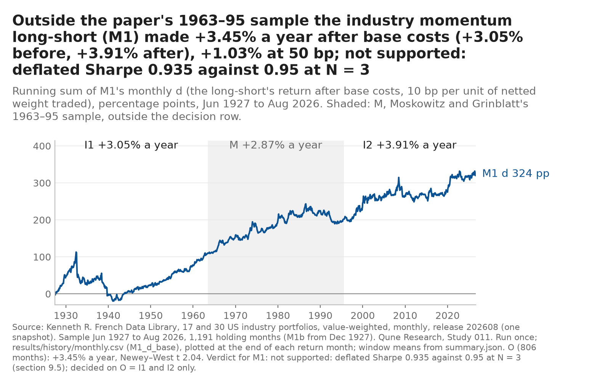
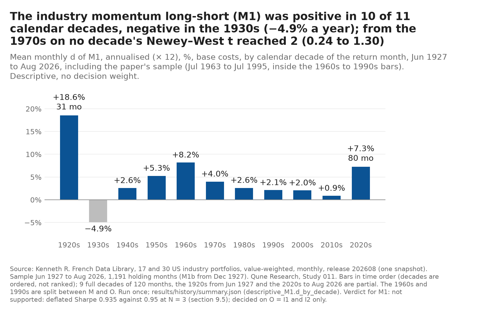
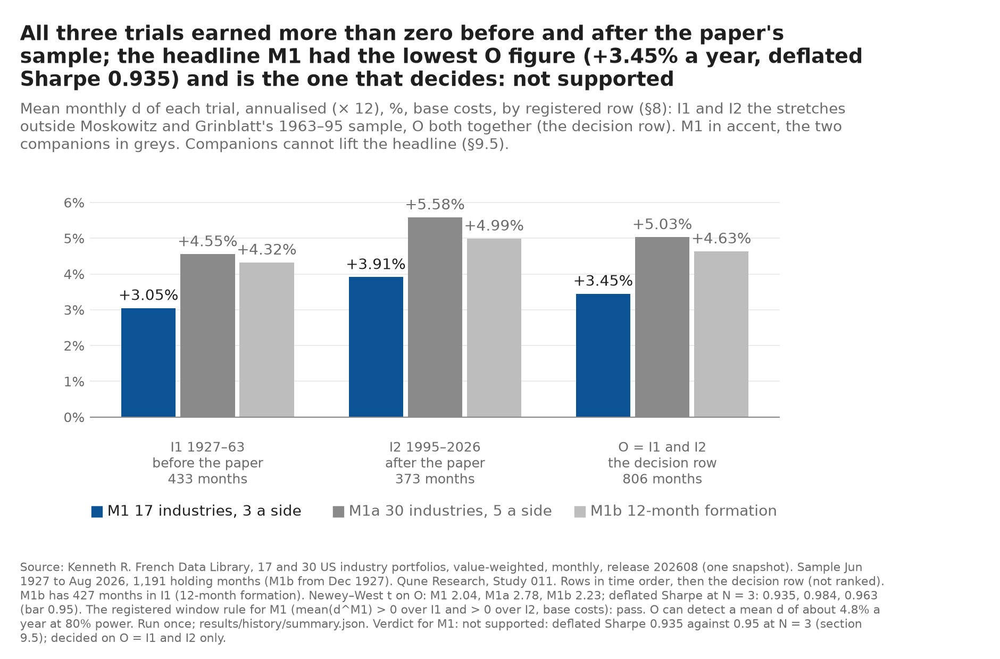

# Study 011 — Industry momentum on US industries outside Moskowitz and Grinblatt's sample (1927–1963 and 1995–2026)

**Verdict: not supported** (pre-registered row, §9.5; history run once on 2026-10-26 at 16:17:35Z). The rule is a variant of [MG99]'s on the Kenneth French Data Library's industries, not a replication. **Read the disclosure first:** before choosing this question the author knew [MG99]'s result on 1963–1995, that later work has used the library's pre-1963 industry months for related rules (known from abstracts and search summaries only), momentum's crashes in 1932 and 2009, the 1929–32 fall and that published anomalies tend to earn less after publication; the author had not seen any industry's six- or twelve-month return over 1926–1963 or 1995–2026, nor any ranking on them, and no episode was used to choose anything (§2.4 of the pre-registration). The question was chosen after ten earlier studies; only N = 3, this study's own three trials, decides the deflated Sharpe criterion.

*Dated addition, 2026-10-26, after the separate-session recomputation (must-fix M1; the paragraph above is unchanged):* the disclosure above omits one item of §2.4, given here: the later work known from search summaries **includes a ranking study on the library's 10 industries from 1926**, the closest known prior use of these months (`QUESTION.md` §3.1).

The rule ranks the library's 17 value-weighted US industries at each month end on their compounded return over the previous six months (no skipped month), buys the top three and sells the bottom three, equal weight within each leg, and holds each such cohort for six months, so six overlapping cohorts are held at once, 1/6 each (Moskowitz and Grinblatt, *Journal of Finance* 1999, [MG99], used 20 industries of their own on 1963–1995). It is a zero-investment long-short, so the decision difference d is the rule's return itself, against zero. Costs are charged on the netted change in industry weights each month: 10 bp per unit traded in the base case, 50 bp under stress; the drift within a month and the industries' own rebalancing are not charged, which flatters every figure on this page. The decision row O is the months **outside** the paper's sample: I1 (1927-06 to 1963-06, 433 months) and I2 (1995-08 to 2026-08, 373 months), 806 months together.

**What it does and does not show.** Outside the paper's window the rule earned **+3.45% a year, Newey–West t 2.04, Sharpe of d 0.237**, positive on both sides (I1 +3.05%, t 1.31; I2 +3.91%, t 1.60). That passes C1, C2 (just: the bar is t 2.0) and C4, but **fails C3: the deflated Sharpe ratio at N = 3 is 0.935 against 0.95**, so the pre-registered verdict is **not supported**. The DSR is computed with the series' own skewness and kurtosis, and d has a fat left tail (skewness −1.28, kurtosis 12.7; worst month 1932-07, −34.1%). The two fragility companions, judged on their own C1–C4, each meet them (30 industries, five a side: +5.03% a year, t 2.78, DSR 0.984; twelve-month formation: +4.63% a year, t 2.23, DSR 0.963), but a companion cannot lift the headline under the precedence of §9.5, and their rows carry the return-unit label (below). At **50 bp stress costs** the headline falls to **+1.03% a year, t 0.60**. By decade the gain is weak from the 1970s on (t between 0.24 and 1.30 in every decade from the 1970s to 2020–2026). The test can see only a large edge in return units: the minimum detectable mean at 80% power on O is **4.80% a year**, so a decayed edge of about 2% a year would not be found, and every row that is not "not supported" says "(Sharpe units; the 2%-a-year bar not met)".

Everything on this page is a backtest on the library's industry returns (release 202608), after the costs above. Nothing here is a track record, a forecast or investment advice. The question, the trials, the windows, the criteria and the order of operations were fixed in [`PREREGISTRATION.md`](PREREGISTRATION.md) before any library file was downloaded (`f534c99`); the trial log is [`trials.md`](trials.md).

What happened, in order (commit times read back from git, UTC; London is UTC on this date):

1. 15:22: question note (`7c0c156`), with power stated from month counts only ([`tools/power_industry.txt`](../../tools/power_industry.txt)); separate-session check before the commit ([QUESTION_REVIEW.md](QUESTION_REVIEW.md); 3 must-fix taken first).
2. 15:29: pre-registration and trial log, design-reviewed in a separate session before the commit ([DESIGN_REVIEW.md](DESIGN_REVIEW.md); 3 must-fix, 9 should-fix, all addressed first).
3. 15:31: data step logged before it ran (`c7753a5`), one download per file, **pass** (`d0b18cd`): both files from release 202608, 1926-07 to 2026-08, no gap, no missing-value marker; only dates and markers read.
4. 15:34–15:48: code and 21 tests on synthetic series (`fc2e1cc`, `0ab2ab2`); a separate code review passed it with fixes (must-fix: the run-once marker had been written only after the data were read; taken with a crash test, `8ccf310`) ([CODE_REVIEW.md](CODE_REVIEW.md)).
5. 16:16: `APPROVED`, the programme-wide re-count (34 registered rows in the public trial logs, 598 with the desk's private registry, no weight; a keyword search of every desk row for industry, momentum, French, sector or Fama finds nothing) and the history-run row, pushed before the run (`5c40e1b`).
6. **The history run, once** (16:17:35Z), outputs committed as written (`468c5bd`).
7. This note.

## Results: the decision row O, outside the paper's sample (base costs)

| Trial | Months | Mean d (% a year) | NW t | Sharpe of d | DSR at N = 3 | C1 | C2 | C3 | C4 | Row |
|---|---|---|---|---|---|---|---|---|---|---|
| **M1** (17 industries, 3 a side, 6-month formation) | 806 | **+3.45** | **2.04** | **0.237** | **0.935** | pass | pass | **fail** | pass | **not supported** |
| M1a (30 industries, 5 a side) | 806 | +5.03 | 2.78 | 0.329 | 0.984 | pass | pass | pass | pass | meets C1–C4 (Sharpe units; the 2%-a-year bar not met) |
| M1b (12-month formation) | 800 | +4.63 | 2.23 | 0.275 | 0.963 | pass | pass | pass | pass | meets C1–C4 (Sharpe units; the 2%-a-year bar not met) |

C1: Sharpe of d ≥ 0.10. C2: Newey–West t ≥ 2.0 (Bartlett, 6 lags, autocovariances within each stretch, §9.3). C3: deflated Sharpe ratio at N = 3 ≥ 0.95 (with the programme's variance floor, applied). C4: sign of mean d unchanged at 50 bp. **Window row (M1): pass** (I1 +3.05% a year, t 1.31; I2 +3.91% a year, t 1.60; signs tested, t reported). The verdict is fixed by M1's C3 failure; the window row and the companions do not change it.

**Deflated Sharpe at other counts (no decision weight):** M1 0.888 at N = 11 (one per study), 0.846 at 34 (the public trial logs), 0.738 at 598 (with the desk registry); M1a 0.968 / 0.951 / 0.902; M1b 0.932 / 0.902 / 0.821.

**At 50 bp stress costs:** M1 +1.03% a year (t 0.60); M1a +2.62% (t 1.44); M1b +2.94% (t 1.41). Turnover is about 6.1 units of Σ|Δw| a year for M1 and M1a and 4.3 for M1b, so the base cost is about 0.6% a year (M1b 0.4%) and the stress cost about 3.0% (M1b 2.1%).

**Sharpe of d for M1 on O:** 0.237, 95% stationary-bootstrap interval 0.006 to 0.502 (10,000 resamples, expected block 12 months, seed 20261021); 58.1% of months positive.

### Sub-windows (descriptive, no decision weight; mean d in % a year, NW t)

| Row | Months (M1) | M1 | M1a | M1b |
|---|---|---|---|---|
| I1, 1927–1963 (used by later work for related rules) | 433 | +3.05 (1.31) | +4.55 (1.87) | +4.32 (1.59), 427 months |
| I2, 1995-08 to 2026-08 (after the paper's sample; its first four years precede publication) | 373 | +3.91 (1.60) | +5.58 (2.07) | +4.99 (1.56) |
| M, 1963-07 to 1995-07 (the paper's window) | 385 | +2.87 (1.33) | +5.17 (2.51) | +4.27 (1.95) |
| Full, 1927-06 to 2026-08 (mined in part) | 1,191 | +3.26 (2.44) | +5.08 (3.64) | +4.52 (2.87), 1,185 months |

**d of M1 by decade (full history; % a year, NW t):** 1927–29 (31 months) +18.56 (3.62); 1930s −4.92 (−0.70); 1940s +2.56 (1.01); 1950s +5.26 (2.79); 1960s +8.18 (3.11); 1970s +3.99 (1.03); 1980s +2.61 (0.62); 1990s +2.11 (0.53); 2000s +2.05 (0.46); 2010s +0.87 (0.24); 2020-01 to 2026-08 (80 months) +7.27 (1.30).

**The legs of M1 on O (% a year, NW t):** winners minus the equal-weight industry mean +1.97 (2.10); losers minus that mean −2.09 (−2.22); the equal-weight mean itself +11.84. The gain comes about equally from both legs.

**The paper's comparison (descriptive only; a different industry set and classification):** M1 before costs over the paper's window M earned 0.29% a month, against [MG99]'s 0.43% a month for its six-month rule.

**Episodes listed before any result (§2.4, §9.6):** 1929-09 to 1932-12, 40 months, d summed to −5.68%; 2008-09 to 2009-12, 16 months, −26.12%. **The twelve worst months of d:** 1932-07 −34.06%, 1932-08 −27.44%, 1939-09 −21.91%, 1938-06 −19.34%, 2009-04 −15.75%, 2008-07 −15.66%, 1999-04 −14.47%, 2008-09 −12.49%, 2001-01 −11.12%, 1986-09 −10.99%, 1987-10 −10.47%, 1980-03 −10.36%.

**Eligibility and data events:** every industry had a value in every month of both files, so every ranking used the full set; no empty leg; no boundary near-tie in any held ranking month, in any trial. Each industry's share of months in the winners and losers of M1 is in `results/history/summary.json` (no industry dropped or reweighted; the library's "Other" group was a winner in 6.1% and a loser in 7.6% of ranking months, the lowest of the 17).

### Power, after the fact (§9.6)

On O, M1's d has an annualised volatility of **14.56%** and a Newey–West to iid standard-error ratio of **0.95** (below the 1.00 to 1.108 assumed in the question note). The minimum detectable mean of d is **3.38% a year at t = 2** and **4.80% a year at 80% power** (Sharpe of d 0.232 and 0.330). The question note's detectable Sharpe on O was 0.347 to 0.384, so the realised test was slightly more powerful than planned, but in return units it can see only an edge near the size the paper reported (5.2% a year, simple × 12), not one decayed to about 2% a year. M1's observed +3.45% lies between the two.

## What did not work

- **The headline rule did not clear its own bar.** t 2.04 against a bar of 2.0 and a deflated Sharpe of 0.935 against 0.95 is a near miss, and a near miss is a fail under the pre-registration. Nothing is re-weighted: the companions' stronger rows are fragility checks, not alternatives.
- **Costs decide most of it.** At 50 bp one way the headline keeps under a third of its gain (+1.03% a year, t 0.60). The costs here are a convention, not an estimate of what a fund would pay in any decade; the 1930s and pre-1962 markets were thinner and costlier than 10 bp suggests.
- **The edge is weak after 1970.** Every decade from the 1970s to the 2010s has t below 1.1; the 2020–2026 row (+7.27%, t 1.30, 80 months) is short. I2 as a whole is +3.91% a year with t 1.60, a low-power row on its own.
- **The fat left tail.** The four worst months fall in 1932 and 1938–39, and three of the twelve worst in 2008–09, the momentum crashes known before the study. The DSR's probabilistic Sharpe term uses the series' skewness (−1.28) and kurtosis (12.7), so a tail like this lowers it for the same Sharpe ratio.
- **On the paper's own window the variant earned less than the paper** (0.29% against 0.43% a month before costs), so the library's 17 industries are a weaker version of the paper's 20, not a stronger one.
- **The test cannot see a small edge.** The 80%-power detectable mean is 4.80% a year; the return-unit bar of 2% a year is not met, as the question note expected.

## Limits

- I1 is not clean: later work has used the library's pre-1963 industry months for related rules (check (a) of the question note, from abstracts and search summaries). I2's first cohorts are ranked on formation months inside the paper's window. There is no untouched window; only the forward record is out of sample in the strict sense.
- The library rebuilds its whole history with each release. Every row here uses the one snapshot of the data step (release 202608; hashes in `results/data_manifest.json`); the downloaded files are not committed, the full-precision industry series and every monthly row the run wrote are (`results/history/`).
- Before 1962 the library's universe is NYSE firms only.
- The author is an AI model whose general knowledge includes the history of these markets. The disclosure above lists what was known; it cannot prove what was not.

## Separate-session recomputation (§14 step 8)

A separate Opus session on a clean clone of `9e2bfab` rebuilt the rule from `results/history/industries_17.csv` and `industries_30.csv` alone, without the study's `src/` ([REVIEW.md](REVIEW.md), script [`review_recompute.py`](review_recompute.py)). **Confirmed with findings, no wrong number:** every monthly series of the three trials matches `monthly.csv` (largest difference 7.1e-15), all 3,585 ranking months match `cohorts.json`, and every figure on this page and in the root README's Study 011 text matches to the printed precision; the verdict stands. One must-fix (the disclosure, answered above) and seven should-fix (four on the root README, fixed there in place; three here, answered below). Not checked by the reviewer: the push before the run (no remote access) and the desk-registry part of the count (private).

*Dated additions, 2026-10-26, answering the review (the text above is unchanged):*

1. **The paper comparison** (should-fix 2): "a weaker version of the paper's 20, not a stronger one" claims more than the figures show. M1's 0.29% a month over M has a Newey–West standard error of about 0.18% a month, so the paper's 0.43% is under one standard error away. Read instead: the variant earned less than the paper on the paper's window; whether the industry set is weaker is not shown.
2. **The twelve worst months** (should-fix 3) are taken over the full history, not O. On O alone the first nine are the same; the tenth to twelfth are 2002-11 −10.14%, 2023-01 −10.03% and 2012-01 −9.60% (1986-09, 1987-10 and 1980-03 fall in M). The skewness −1.28 and kurtosis 12.7 are on O; over the full history they are −1.14 and 12.3.
3. **"Before 1962 the library's universe is NYSE firms only"** (should-fix 4) is general knowledge, not read from the library's files in this study; pre-registration §10 row 6 labels it so.
4. **Turnover** (note): the 6.1 and 4.3 units a year are over the full history; on O they are 6.06, 6.04 and 4.23. The cost figures beside them are on O.
5. **The bootstrap interval** (note) treats O as one series, so a block can span the 1963/1995 join; the two-stretch Newey–West does not (and moves t only from 2.0417 to 2.0424).
6. **Without the variance floor** (note) M1's DSR at N = 3 would be 0.945, still below 0.95: the floor does not decide the verdict. The DSR rows at N = 11, 34 and 598 use the variance across this study's three trials (floored), not across those trials.
7. **"Flatters every figure on this page"** (note) is not true of the gross paper comparison or of the equal-weight mean; it holds for every after-cost figure.
8. **Tests** (note): of the 21, five are data-step tests from `c7753a5` and one came with the review fixes in `8ccf310`; `0ab2ab2` had 20.

## Charts (§9.6, added 2026-10-26; descriptive, no decision weight; Tester chart check done: CHART_REVIEW.md, seventh section)

Drawn from the committed history files by [`charts/make_charts.py`](charts/make_charts.py) (adapted from Study 010's); every number in a title is computed by the script and listed with the input hashes in [`charts/manifest.json`](charts/manifest.json). SVG beside each PNG. A separate Tester (Opus, isolated) recomputed every number on the three charts: all correct; two must-fix and one should-fix, all in title wording (the decade title applied C2's t 2 to descriptive decade t's; the window title ranked the headline against its companions; the cumulative title led with three window figures instead of O after costs and at stress). All answered before this section was written; one fix was taken in a different form, with the reason ([CHART_REVIEW.md](../../CHART_REVIEW.md), seventh section).

## Next

1. ~~Separate-session recomputation~~ done 2026-10-26 (above).
2. ~~Charts (§14 step 9) and a Tester chart check~~: done 2026-10-26 (above).
3. Forward record code (`forward011.py`) with tests and a separate code review, before the first forward month is due (§11); shadow only, scored once after 60 holding months as a low-power check (detectable Sharpe of d about 1.27).

## References

[MG99] Moskowitz, T. J. and Grinblatt, M. (1999). Do industries explain momentum? *Journal of Finance* 54(4), 1249–1290. doi:10.1111/0022-1082.00146.
[DM16] Daniel, K. and Moskowitz, T. J. (2016). Momentum crashes. *Journal of Financial Economics* 122(2), 221–247. doi:10.1016/j.jfineco.2015.12.002.
