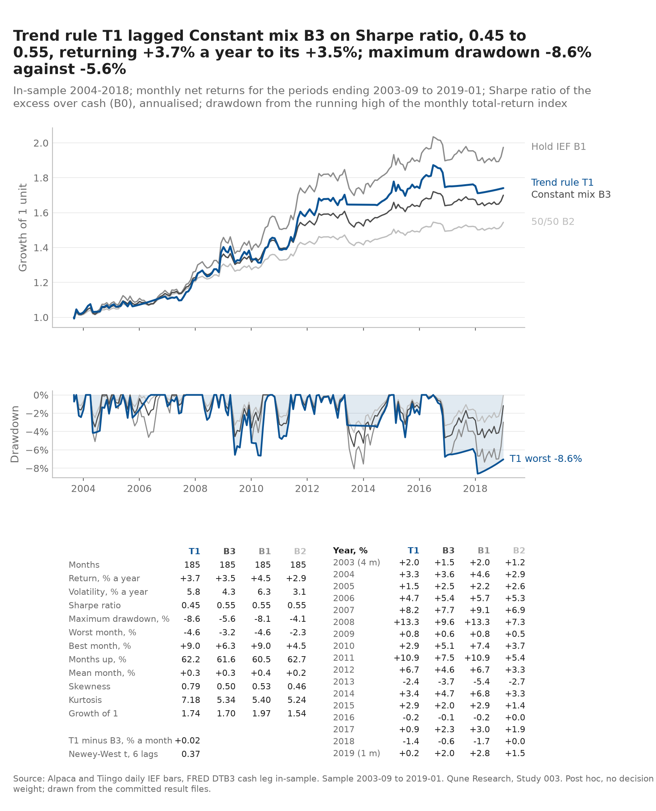
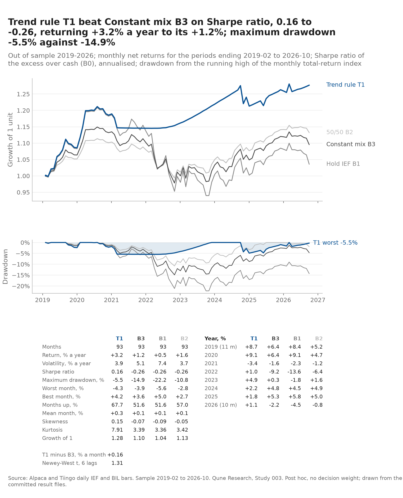
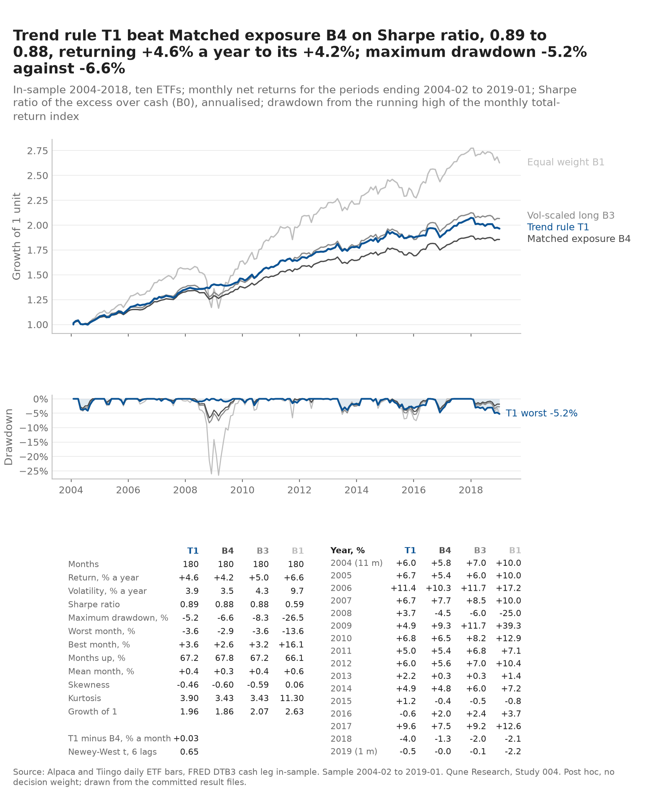
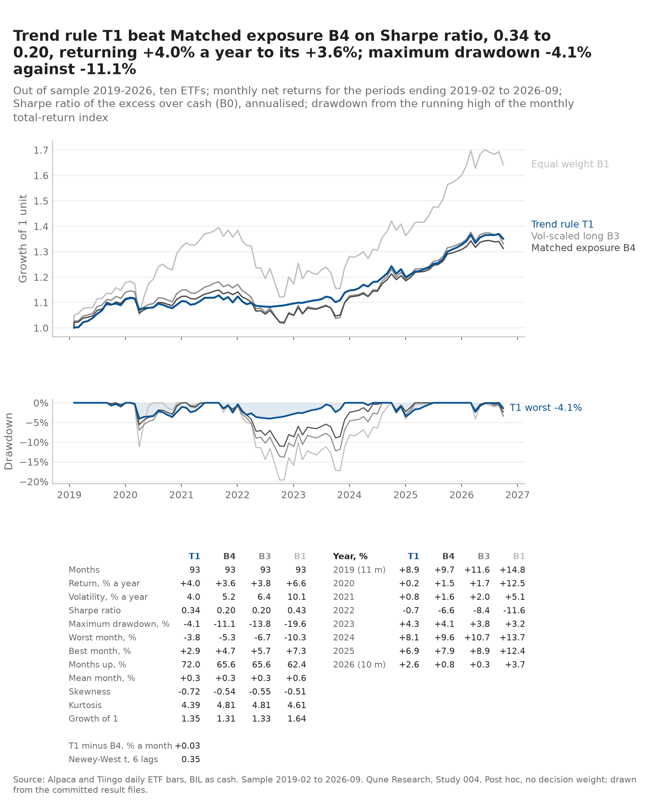
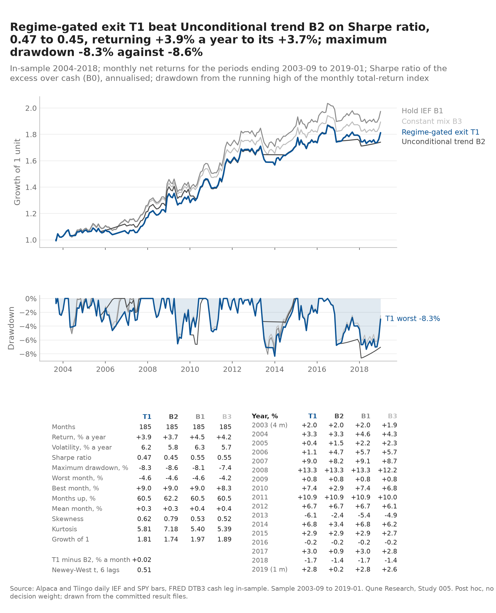
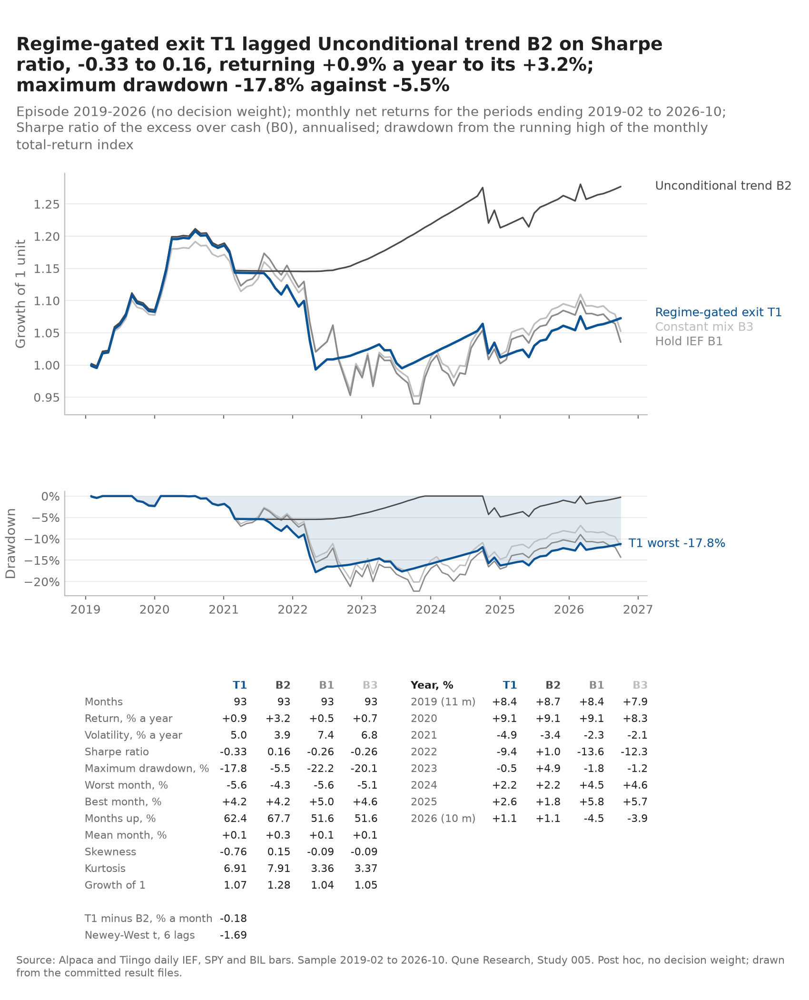

# Tear-sheets (post hoc, no decision weight)

One page per published window of Studies 003, 004 and 005, drawn by `tools/make_tearsheets.py` from the committed `results/<window>/monthly_*.csv` files with the shared library's `qune_research/report.py` (nine tests). Nothing here was re-run or fetched; no result file changed. Each study's verdict was fixed by its own pre-registered rules before this page existed, and nothing on it feeds a decision. The title of each sheet is computed from the table beneath it, never typed.

**Self-check.** For every series on every sheet the script compares its annualised return, volatility, Sharpe ratio, maximum drawdown and month count with the study's committed `metrics_*.csv` (the figures the independent reviewers recomputed) and exits non-zero on a difference above 1e-9. Last run: 2026-10-23T20:28:33Z at commit `c901364`, 120 comparisons, 0 mismatches. The SHA-256 of every input is in `manifest.json`; every number on a sheet is in its `.json` and the three CSVs beside it (metrics, calendar years, strategy-minus-benchmark differences).

Sharpe ratios are of the monthly excess over the study's cash series (B0), annualised; drawdowns are from the running high of the monthly total-return index, so they are shallower than daily figures; the Newey-West t uses six lags, as the studies do. The first benchmark listed is the one the study's pre-registration makes decisive for the strategy-minus-benchmark row (003: B3, the constant mix at T1's in-sample IEF share; 004: B4, the same book held throughout at matched exposure; 005: B2, the unconditional trend rule).

| Sheet | Window | Months | What the numbers say (computed title) |
|---|---|---|---|
| [003_insample](003_insample.png) ([svg](003_insample.svg), [json](003_insample.json)) | Study 003, In-sample 2004-2018; periods ending 2003-09 to 2019-01 | 185 | Trend rule T1 lagged Constant mix B3 on Sharpe ratio, 0.45 to 0.55, returning +3.7% a year to its +3.5%; maximum drawdown -8.6% against -5.6% |
| [003_oos](003_oos.png) ([svg](003_oos.svg), [json](003_oos.json)) | Study 003, Out of sample 2019-2026; periods ending 2019-02 to 2026-10 | 93 | Trend rule T1 beat Constant mix B3 on Sharpe ratio, 0.16 to -0.26, returning +3.2% a year to its +1.2%; maximum drawdown -5.5% against -14.9% |
| [004_insample](004_insample.png) ([svg](004_insample.svg), [json](004_insample.json)) | Study 004, In-sample 2004-2018, ten ETFs; periods ending 2004-02 to 2019-01 | 180 | Trend rule T1 beat Matched exposure B4 on Sharpe ratio, 0.89 to 0.88, returning +4.6% a year to its +4.2%; maximum drawdown -5.2% against -6.6% |
| [004_oos](004_oos.png) ([svg](004_oos.svg), [json](004_oos.json)) | Study 004, Out of sample 2019-2026, ten ETFs; periods ending 2019-02 to 2026-09 | 93 | Trend rule T1 beat Matched exposure B4 on Sharpe ratio, 0.34 to 0.20, returning +4.0% a year to its +3.6%; maximum drawdown -4.1% against -11.1% |
| [005_insample](005_insample.png) ([svg](005_insample.svg), [json](005_insample.json)) | Study 005, In-sample 2004-2018; periods ending 2003-09 to 2019-01 | 185 | Regime-gated exit T1 beat Unconditional trend B2 on Sharpe ratio, 0.47 to 0.45, returning +3.9% a year to its +3.7%; maximum drawdown -8.3% against -8.6% |
| [005_episode](005_episode.png) ([svg](005_episode.svg), [json](005_episode.json)) | Study 005, Episode 2019-2026 (no decision weight); periods ending 2019-02 to 2026-10 | 93 | Regime-gated exit T1 lagged Unconditional trend B2 on Sharpe ratio, -0.33 to 0.16, returning +0.9% a year to its +3.2%; maximum drawdown -17.8% against -5.5% |

Series labels, from each pre-registration: Study 003: T1 the 12-month trend rule on IEF with BIL as the cash leg; B3 the constant IEF-and-cash mix at T1's in-sample IEF share, frozen; B1 hold IEF; B2 50/50 IEF and cash rebalanced monthly. Study 004: T1 the ten-ETF 12-month trend rule, each position volatility-scaled; B4 the same volatility-scaled book held throughout, multiplied by T1's in-sample mean exposure; B3 the volatility-scaled book fully held; B1 equal weight. Study 005: T1 Study 003's trend exit applied only when the trailing 63-day SPY–IEF correlation is positive, else hold IEF; B2 the unconditional trend rule (Study 003's T1, same engine); B1 hold IEF; B3 the constant mix at T1's in-sample IEF share.

Regenerate from the repository root with `make tearsheets` (or `.venv/bin/python tools/make_tearsheets.py`). The PNGs come back byte-identical; the SVGs and the manifest carry the drawing date and element ids.

